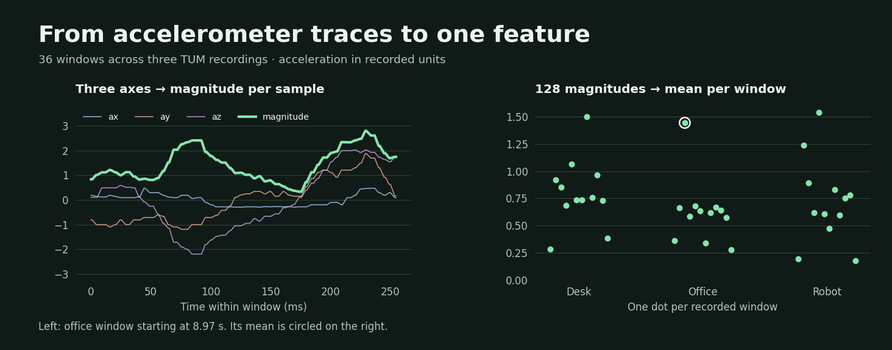
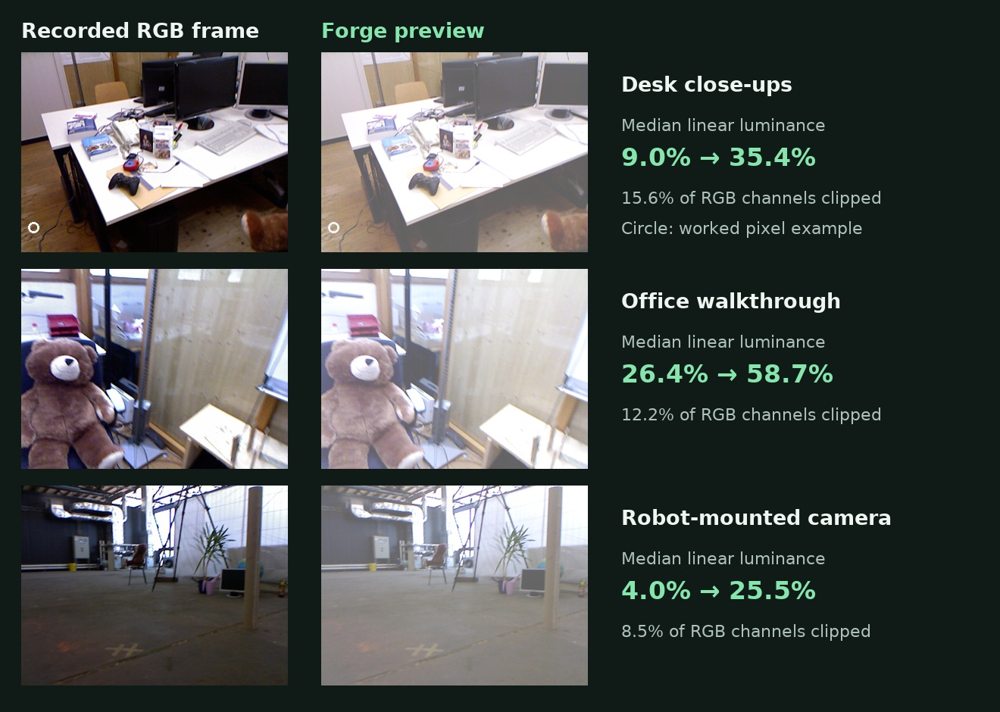
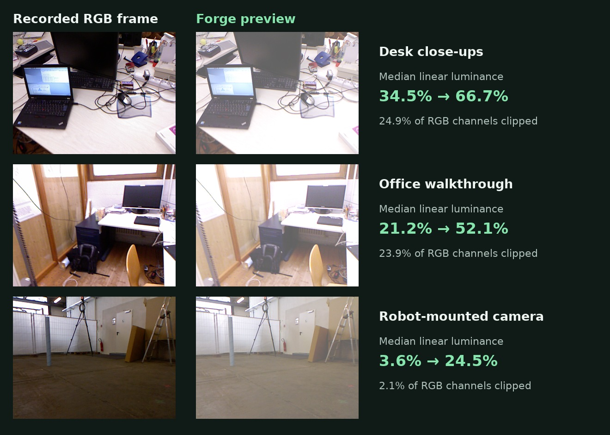
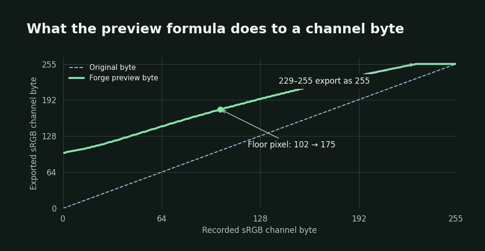
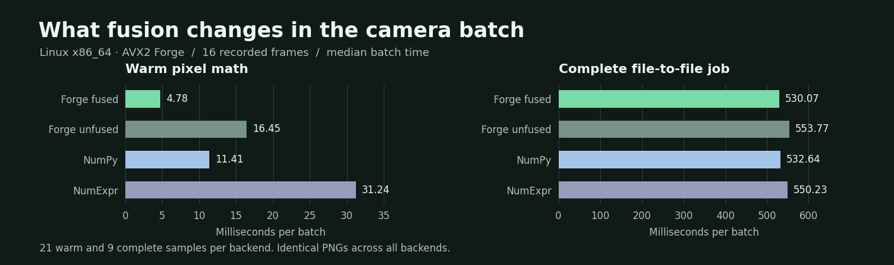
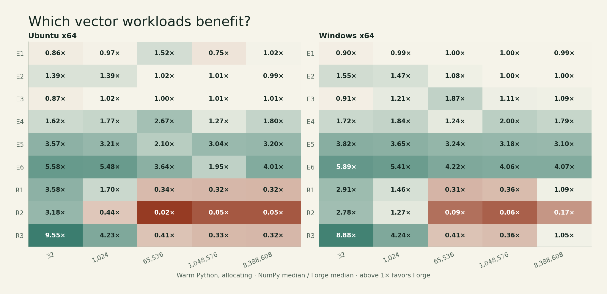
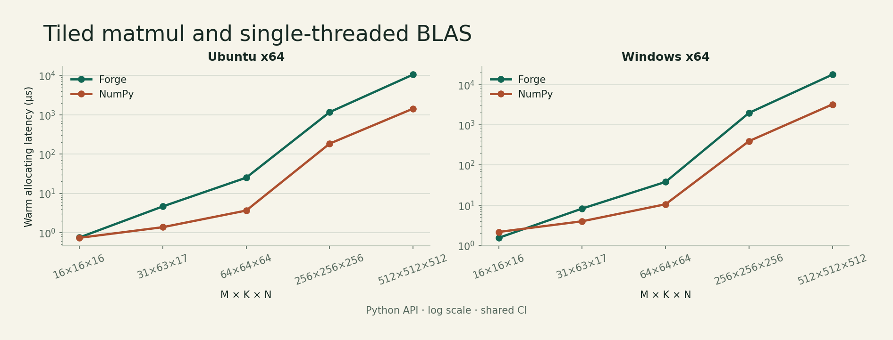

# Forge

Forge turns **Python array formulas into native CPU code**. Give it a formula and float32 NumPy arrays, and its C++20/LLVM compiler builds a callable kernel specialized to those array shapes. Its operator fusion pass combines eligible operations into one loop, so the CPU can carry intermediate values from one operation to the next before writing the result.

[Compile an expression](#compile-an-expression) · [Performance](#performance-at-a-glance) · [Motion features](#accelerometer-motion-features) · [Camera preview](#camera-preview) · [Benchmark tables](#complete-benchmark-tables) · [Compiler traces](#compiler-traces) · [Try it](#try-it)

## Compile an expression

```python
import forge
import numpy as np

x = np.array([1, 10, 25, 46], dtype=np.float32)
program = forge.compile("sqrt((x + 2) * 3)", inputs=("x",))
target = "avx2" if forge.has_avx2() else "scalar"
kernel = program.jit(x, target=target)
print(kernel(x))  # [ 3.  6.  9. 12.]
```

The expression gives the math. Forge builds a typed operation graph, schedules loops, lowers them to LLVM IR, and runs the machine code in the Python process. Here fusion turns **three array passes and two temporary arrays into one pass and zero temporary arrays**. The same compiled kernel can run on new values of the same input shape. [See the generated IR and machine code](#compiler-traces)

| Workload | Inputs and result | What Forge compiles |
| --- | --- | --- |
| [Motion features](#accelerometer-motion-features) | Three acceleration arrays → one motion feature per window | A pointwise vector magnitude followed by a mean reduction |
| [Camera preview](#camera-preview) | An array of linear-light RGB samples → an array of adjusted samples | A pointwise exposure and tone curve |
| [Dense matrix products](docs/plan/06-reductions-and-matmul.md) | Two float32 matrices → their product | Tiled rank-two matrix multiplication |

## Performance at a glance

<!-- BEGIN GENERATED HEADLINES -->

| Measured workload | Ubuntu x64 | Windows x64 |
| --- | --- | --- |
| 1,024-element add → multiply → square root, allocating Python call against NumPy | **Forge 2.88× faster** | **Forge 3.33× faster** |
| 65,536-element same chain, native AVX2 unfused → fused | **2.06×** · 29.28 → 14.25 µs | **1.91×** · 21.74 → 11.39 µs |
| 65,536-element same chain, native fused scalar → AVX2 | **4.02×** | **7.96×** |
| 512 × 512 matrix multiply, allocating Python call | **NumPy 6.56× faster** | **NumPy 4.79× faster** |

These warm medians come from shared x64 CI at 4a1620b. The native rows compare matched preallocated calls. [Source run](https://github.com/iferdous/Forge/actions/runs/45268500878)

<!-- END GENERATED HEADLINES -->


The three-op chain goes from **three loops and two temporary arrays to one loop and zero temporary arrays**. Both plans produce identical float32 output for the checked inputs. The Python timings include output allocation, and the warm comparisons exclude compilation. [Where NumPy leads](docs/results.md#crossover-and-numpy-wins)

## Accelerometer motion features

A robotics engineer can summarize each short accelerometer window to find sections of a test run worth inspecting. The example reads three recorded axes, subtracts each axis's average within the window, and passes three 128-element float32 arrays to Forge. For each timestamp, `sqrt((ax * ax + ay * ay) + az * az)` is the distance of that reading from the window's average acceleration vector. `mean(...)` turns the 128 distances into one measure of acceleration variation.



| Plan for `mean(sqrt((ax * ax + ay * ay) + az * az))` | Unfused | Fused |
| --- | ---: | ---: |
| Loops | 7 | **2** |
| Temporary arrays | 6 | **1** |

Forge combines the three squares, two adds, and square root into one loop. It materializes the magnitude array for the ordered float32 mean in the second loop. All **36 recorded windows** match an independent NumPy calculation bit for bit. [Run it and inspect the plans](docs/motion-features.md) · [Recorded inputs and license](examples/motion_features/data/README.md)

## Camera preview

The camera example uses Forge as the pixel-math backend of a batch preview tool. Pillow reads PNGs or JPEGs. Python converts their RGB channels to linear light and packs each frame into one float32 array. Forge receives that array and the formula. It returns another array for the app to encode as a review image.

The image study covers **48 real frames** from the same three TUM RGB-D recordings used for the accelerometer example. The gallery shows six pairs using **+0.35 exposure stops** and **0.015 shadow lift**. [Frame selection and license](examples/camera_preview/data/README.md)



<details>
<summary>Three more recorded frame comparisons</summary>



</details>

### How the equation changes a pixel

An RGB image stores three bytes per pixel. After decoding to linear light, the app's flat array puts red, green, and blue next to each other for every pixel. The red channel at `(column, row)` is `x[3 * (row * width + column)]`. Each array value independently goes through the same four Forge operations. The result at that index becomes the red channel of the same pixel in the preview.

```text
linear preview = sqrt((linear sample × 2^stops + lift) × (1 / (1 + lift)))
```

Exposure gain multiplies the incoming light by about **1.275×** at the default setting. Shadow lift adds **0.015** even to very dark channels. The scale keeps linear white at 1 when exposure gain is 1, and the square root lifts values between 0 and 1, with a larger relative effect on darker values. The app then clamps the result to `[0, 1]`, converts it back to sRGB, and rounds to the nearest byte.

Follow the marked floor pixel in the first pair. Its recorded RGB value was **(102, 74, 45)** and its exported value was **(175, 153, 129)**. Here is the actual red channel through the pipeline. [Measured RGB values at each step](showcase/data/camera-preview/pixel-example.json)

| Step | Red channel | What happens |
| --- | ---: | --- |
| Read the PNG | 102 | Pillow reads the original red byte. |
| Decode sRGB | 0.13287 | Convert the red byte to a linear-light sample. |
| Exposure, lift, and scale | 0.18162 | Multiply by 1.27456, add 0.015, then multiply by 0.98522. |
| Square root | 0.42617 | Apply the tone curve. |
| Clamp, encode, and round | **175** | Store a new sRGB red byte. |

<details>
<summary>See the output for all 256 possible channel values</summary>



The green line comes from running the actual kernel on each possible input byte and applying the app's sRGB export. Its flat section shows why different bright inputs can produce the same output byte.

</details>

### What changed across 48 frames


The top panel shows the **median linear luminance** of each image. Every frame brightened, and the median across the 48 frame medians rose from **18.5% to 49.4%** of reference white. The darker robot sequence went from **5.2% to 28.2%**, with a median clipping rate of **1.9%**. The brighter desk and office recordings each had a median clipping rate of about **19%**.

The bottom panel counts RGB channel values above 1 before they are clamped to display white. Bright surfaces with several channels at the ceiling can lose visible detail under this preset. Use a lower `--stops` value for frames with bright highlights. [Per-frame data](showcase/data/camera-preview/camera-study.csv) · [Calculation and reproduction](docs/camera-preview.md#reproduce-the-image-study)

### What the compiler changes

An RGB frame at 640 × 480 contains **921,600 channel values**. Unfused Forge traverses the array once for each arithmetic operation. Fused Forge loads a group of channel values, performs all four operations on that group, and writes the results. Frames with the same number of channels reuse one JIT-compiled kernel.

| What the compiler changes | Unfused | Fused |
| --- | ---: | ---: |
| Full passes for the four pixel operations | 4 | **1** |
| Intermediate arrays | 3 | **0** |
| Compiler scratch per 640 × 480 RGB frame | 10.55 MiB | **0 MiB** |

In the separate 16-frame desk benchmark, the warm AVX2 pixel kernel took **4.78 ms** on shared Ubuntu x64, compared with **16.45 ms** for unfused Forge and **11.41 ms** for preallocated NumPy. The complete batch took **530 ms** with fused Forge and **533 ms** with NumPy. Conversion and PNG export accounted for most of that time. All four backends produced byte-identical PNGs. [Raw timings](showcase/data/camera-preview/avx2.json) · [Native loop plans and machine code](docs/camera-preview.md#native-avx2-measurement)

<details>
<summary>Camera batch timing chart</summary>



</details>

<details>
<summary>Run the example on Apple Silicon or with your own frames</summary>

From the Forge checkout, use the [local LLVM build](#try-it). Choose a fresh output folder for each run.

```sh
.local/venv/bin/python -m pip install -r examples/camera_preview/requirements.txt
PYTHONPATH="$PWD/.local/build/macos-llvm/python" .local/venv/bin/python \
  -m examples.camera_preview --out .local/camera-preview/demo --explain
```

Pass a source file or folder after `examples.camera_preview` to use your own images. Read `report.json` in the output directory for the execution target, compiled loop plans, clipping counts, and per-stage timings. [Linux command and benchmark method](docs/camera-preview.md)

</details>

## Video walkthroughs

### Why fusion saves time

The problem is moving data between operations. Watch the same nine inputs go through a three-loop plan and then a fused plan. Follow the two scratch arrays as they disappear and check that the answers stay the same. The final screen shows where the difference turns into measured time and resident memory on larger inputs.

https://github.com/user-attachments/assets/3f847b68-9b62-42d8-8183-79ef54f717c9

### How the compiler handles an input that doesn't fit a vector

AVX2 can work on eight float32 values at once. Watch what happens as the input grows from 8 to 9 to 17 values. The highlighted groups match the machine code for the wide loop and the scalar cleanup path. That last path lets the same kernel handle lengths that aren't divisible by eight.

https://github.com/user-attachments/assets/7668f790-c654-4d9d-8b33-7245cde8d40a

### Where Forge wins, and why it sometimes loses

The demo starts with a sum where floating-point rounding changes the answer, then shows how Forge handles partial blocks in matrix multiplication. Watch for the crossover from an array expression Forge wins to a large matrix where NumPy’s tuned BLAS wins. The final scene shows the cache reusing machine code for the same input shape.

https://github.com/user-attachments/assets/d81e4276-488b-4272-a702-0d109e27c60c

The films use the original preview timing data and recorded native traces. [Preview evidence](https://github.com/iferdous/Forge/releases/tag/v0.1.0-preview.1)

## Memory, startup, and coverage

| Metric | Result |
| --- | --- |
| Three-op chain array traffic | 24 → 8 bytes per float32 element (**66.7% lower**, modeled) |
| Four-op chain array traffic | 32 → 8 bytes per float32 element (**75% lower**, modeled) |
| Intermediate workspace at 8,388,608 elements | **64 MiB → 0** |
| Median first-call Linux resident memory increase at the same size | **64.008 MiB → 0.004 MiB**, three fresh processes per arm |
| Native C++ coverage | **94.56% lines** (869/919), **85.09% branches** (291/342) |
| Verification | **23 tests and 61 benchmark cases per x64 runner**, plus **20 Linux sanitizer test entries** |

The byte counts model logical buffer accesses per element. The resident-memory experiment measures pages held by the whole process after compilation and after its first call.

<!-- BEGIN GENERATED STARTUP -->

| First-use timing for the 1,024-element chain | Ubuntu x64 | Windows x64 |
| --- | --- | --- |
| Cold parse and compile in an initialized process | 5.77 ms | 3.82 ms |
| First allocating call | 18.56 µs | 7.65 µs |
| Cache hit on the parsed graph, including the new handle | 8.18 µs | 6.70 µs |
| Fresh process, including interpreter launch and exit | 111.93 ms | 126.98 ms |
| Estimated warm calls to earn back compilation against NumPy | 3,106 | 1,901 |

<!-- END GENERATED STARTUP -->

The 16-entry cache specializes code by graph, shape, and target. These counts come from the same native capture used in the demos.

| Recorded request | Hits | Misses | Entries |
| --- | ---: | ---: | ---: |
| Empty cache | 0 | 0 | 0 |
| Compile for length 4 | 0 | 1 | 1 |
| Repeat length 4 | 1 | 1 | 1 |
| Compile for length 9 | 1 | 2 | 2 |

<details>
<summary>Resident memory and startup charts</summary>


</details>

## Complete benchmark tables

Expand a workload, then a call boundary. Every case shows both runners, **median and p95 in microseconds**, and **speedup as baseline time ÷ contender time**. Above 1× favors Forge, fused AVX2, or AVX2 depending on the comparison.

| Comparison | Held fixed |
| --- | --- |
| Python, allocating | Both functions allocate the output. Compilation is excluded. |
| Python, preallocated | Both functions write into provided output. Compilation is excluded. |
| Native fusion | Both plans run in AVX2 with preallocated buffers. |
| Native SIMD | The same fused plan runs scalar and AVX2 with preallocated buffers. |

<!-- BEGIN GENERATED BENCHMARK HARDWARE -->

The grid ran on Ubuntu x64 (Intel(R) Xeon(R) Platinum 8370C CPU @ 2.80GHz) and Windows x64 (AMD EPYC 9V74 80-Core Processor) with one OpenBLAS thread per runner. It covers **10 kernels and 61 size cases per runner** with **20 interleaved warm samples per configuration**. Python p95 summarizes batch means. Native p95 summarizes iteration batches. The downloadable grids include full precision and the 512 MiB streaming working set.

<!-- END GENERATED BENCHMARK HARDWARE -->

<details>
<summary>Performance by operation and matrix size</summary>





</details>

<!-- BEGIN GENERATED BENCHMARKS -->

<details>
<summary>E1 · Add two arrays</summary>

Expression `x + y`. Each time cell is median / p95 in µs.

<details>
<summary>Python call with output allocation</summary>

| Size | Ubuntu Forge | Ubuntu NumPy | Ubuntu × | Windows Forge | Windows NumPy | Windows × |
| --- | --- | --- | --- | --- | --- | --- |
| 32 | 0.7397 / 0.7650 | 0.5657 / 0.5861 | 0.76× | 0.5743 / 0.5838 | 0.4683 / 0.4718 | 0.82× |
| 1,000 | 0.8727 / 0.8951 | 0.7558 / 0.7866 | 0.87× | 0.8067 / 0.8143 | 0.7387 / 0.7423 | 0.92× |
| 1,024 | 0.8891 / 0.9537 | 0.7701 / 0.8522 | 0.87× | 0.8185 / 0.8798 | 0.7223 / 0.7412 | 0.88× |
| 65,536 | 10.27 / 10.43 | 17.73 / 17.95 | 1.73× | 8.767 / 9.684 | 8.792 / 8.955 | 1.00× |
| 1,048,576 | 756.7 / 842.8 | 651.9 / 921.2 | 0.86× | 776.2 / 787.5 | 780.3 / 803.2 | 1.01× |
| 8,388,608 | 10,824 / 11,341 | 11,520 / 13,057 | 1.06× | 6,704 / 7,696 | 6,826 / 7,492 | 1.02× |

</details>

<details>
<summary>Python call with preallocated output</summary>

| Size | Ubuntu Forge | Ubuntu NumPy | Ubuntu × | Windows Forge | Windows NumPy | Windows × |
| --- | --- | --- | --- | --- | --- | --- |
| 32 | 0.5923 / 0.6137 | 0.5515 / 0.5826 | 0.93× | 0.4128 / 0.4278 | 0.4523 / 0.4564 | 1.10× |
| 1,000 | 0.6412 / 0.6529 | 0.7007 / 0.7314 | 1.09× | 0.4679 / 0.4709 | 0.5696 / 0.5852 | 1.22× |
| 1,024 | 0.6731 / 1.184 | 0.6632 / 0.7493 | 0.99× | 0.4585 / 0.4722 | 0.5720 / 0.5829 | 1.25× |
| 65,536 | 11.30 / 11.66 | 14.36 / 14.53 | 1.27× | 7.838 / 7.981 | 8.521 / 8.865 | 1.09× |
| 1,048,576 | 552.9 / 610.7 | 554.1 / 584.8 | 1.00× | 144.4 / 154.4 | 144.3 / 150.8 | 1.00× |
| 8,388,608 | 7,455 / 7,677 | 9,639 / 10,157 | 1.29× | 2,284 / 2,473 | 2,323 / 2,669 | 1.02× |

</details>

<details>
<summary>Native AVX2, effect of fusion</summary>

| Size | Ubuntu Fused | Ubuntu Unfused | Ubuntu × | Windows Fused | Windows Unfused | Windows × |
| --- | --- | --- | --- | --- | --- | --- |
| 32 | 0.01273 / 0.01361 | 0.01261 / 0.01389 | 0.99× | 0.009839 / 0.009980 | 0.009857 / 0.01018 | 1.00× |
| 1,000 | 0.06681 / 0.08955 | 0.06893 / 0.09202 | 1.03× | 0.04636 / 0.05456 | 0.05175 / 0.06424 | 1.12× |
| 1,024 | 0.06940 / 0.09913 | 0.06891 / 0.09880 | 0.99× | 0.04708 / 0.05062 | 0.04770 / 0.04951 | 1.01× |
| 65,536 | 10.07 / 11.47 | 9.659 / 11.15 | 0.96× | 7.578 / 7.716 | 7.510 / 7.808 | 0.99× |
| 1,048,576 | 449.9 / 519.1 | 471.6 / 523.9 | 1.05× | 138.8 / 151.8 | 140.3 / 146.7 | 1.01× |
| 8,388,608 | 9,106 / 9,305 | 9,088 / 9,304 | 1.00× | 2,505 / 2,829 | 2,568 / 2,834 | 1.03× |

</details>

<details>
<summary>Native fused plan, effect of SIMD</summary>

| Size | Ubuntu AVX2 | Ubuntu Scalar | Ubuntu × | Windows AVX2 | Windows Scalar | Windows × |
| --- | --- | --- | --- | --- | --- | --- |
| 32 | 0.01273 / 0.01361 | 0.02851 / 0.02921 | 2.24× | 0.009839 / 0.009980 | 0.02470 / 0.02642 | 2.51× |
| 1,000 | 0.06681 / 0.08955 | 0.5975 / 0.6155 | 8.94× | 0.04636 / 0.05456 | 0.5708 / 0.5742 | 12.31× |
| 1,024 | 0.06940 / 0.09913 | 0.6112 / 0.6204 | 8.81× | 0.04708 / 0.05062 | 0.5827 / 0.5886 | 12.38× |
| 65,536 | 10.07 / 11.47 | 39.99 / 42.27 | 3.97× | 7.578 / 7.716 | 36.51 / 36.93 | 4.82× |
| 1,048,576 | 449.9 / 519.1 | 748.3 / 790.5 | 1.66× | 138.8 / 151.8 | 587.6 / 624.7 | 4.23× |
| 8,388,608 | 9,106 / 9,305 | 8,228 / 8,551 | 0.90× | 2,505 / 2,829 | 4,681 / 4,729 | 1.87× |

</details>

</details>

<details>
<summary>E2 · Multiply by a scalar</summary>

Expression `x * 3`. Each time cell is median / p95 in µs.

<details>
<summary>Python call with output allocation</summary>

| Size | Ubuntu Forge | Ubuntu NumPy | Ubuntu × | Windows Forge | Windows NumPy | Windows × |
| --- | --- | --- | --- | --- | --- | --- |
| 32 | 0.6886 / 0.7080 | 0.8174 / 0.8525 | 1.19× | 0.5340 / 0.5386 | 0.7406 / 0.7775 | 1.39× |
| 1,000 | 0.8965 / 0.9490 | 1.055 / 1.115 | 1.18× | 0.7207 / 0.7273 | 0.9673 / 0.9833 | 1.34× |
| 1,024 | 0.8367 / 0.8686 | 1.023 / 1.033 | 1.22× | 0.7507 / 0.7836 | 0.9781 / 1.058 | 1.30× |
| 65,536 | 7.348 / 7.495 | 7.452 / 7.503 | 1.01× | 6.244 / 6.445 | 6.465 / 6.788 | 1.04× |
| 1,048,576 | 309.9 / 332.8 | 311.9 / 338.0 | 1.01× | 743.1 / 758.2 | 755.7 / 762.8 | 1.02× |
| 8,388,608 | 9,028 / 9,510 | 9,067 / 9,517 | 1.00× | 6,122 / 6,282 | 6,134 / 6,354 | 1.00× |

</details>

<details>
<summary>Python call with preallocated output</summary>

| Size | Ubuntu Forge | Ubuntu NumPy | Ubuntu × | Windows Forge | Windows NumPy | Windows × |
| --- | --- | --- | --- | --- | --- | --- |
| 32 | 0.5257 / 0.5549 | 0.7837 / 0.7945 | 1.49× | 0.3691 / 0.3759 | 0.7534 / 0.7753 | 2.04× |
| 1,000 | 0.5966 / 0.6688 | 0.9689 / 1.067 | 1.62× | 0.4269 / 0.4290 | 0.8792 / 0.8838 | 2.06× |
| 1,024 | 0.6142 / 0.6269 | 0.9393 / 0.9542 | 1.53× | 0.4317 / 0.4689 | 0.8775 / 1.014 | 2.03× |
| 65,536 | 7.812 / 7.908 | 7.323 / 8.335 | 0.94× | 5.390 / 5.520 | 5.921 / 6.033 | 1.10× |
| 1,048,576 | 328.2 / 379.2 | 323.8 / 388.4 | 0.99× | 92.43 / 99.57 | 92.89 / 102.0 | 1.01× |
| 8,388,608 | 5,230 / 5,431 | 5,298 / 5,514 | 1.01× | 1,585 / 1,702 | 1,621 / 1,804 | 1.02× |

</details>

<details>
<summary>Native AVX2, effect of fusion</summary>

| Size | Ubuntu Fused | Ubuntu Unfused | Ubuntu × | Windows Fused | Windows Unfused | Windows × |
| --- | --- | --- | --- | --- | --- | --- |
| 32 | 0.01023 / 0.01090 | 0.01024 / 0.01094 | 1.00× | 0.008105 / 0.008201 | 0.008088 / 0.008172 | 1.00× |
| 1,000 | 0.06608 / 0.07828 | 0.05716 / 0.07189 | 0.87× | 0.04262 / 0.04767 | 0.04268 / 0.04461 | 1.00× |
| 1,024 | 0.06486 / 0.06797 | 0.06298 / 0.07110 | 0.97× | 0.04334 / 0.04427 | 0.04347 / 0.04482 | 1.00× |
| 65,536 | 6.249 / 7.358 | 6.977 / 7.445 | 1.12× | 4.679 / 4.836 | 4.728 / 4.845 | 1.01× |
| 1,048,576 | 307.1 / 331.6 | 306.7 / 327.8 | 1.00× | 91.86 / 96.49 | 91.79 / 98.30 | 1.00× |
| 8,388,608 | 6,058 / 6,248 | 6,024 / 6,209 | 0.99× | 1,755 / 1,922 | 1,763 / 1,905 | 1.00× |

</details>

<details>
<summary>Native fused plan, effect of SIMD</summary>

| Size | Ubuntu AVX2 | Ubuntu Scalar | Ubuntu × | Windows AVX2 | Windows Scalar | Windows × |
| --- | --- | --- | --- | --- | --- | --- |
| 32 | 0.01023 / 0.01090 | 0.02624 / 0.02703 | 2.57× | 0.008105 / 0.008201 | 0.01640 / 0.01660 | 2.02× |
| 1,000 | 0.06608 / 0.07828 | 0.5960 / 0.6155 | 9.02× | 0.04262 / 0.04767 | 0.2945 / 0.3020 | 6.91× |
| 1,024 | 0.06486 / 0.06797 | 0.6078 / 0.6370 | 9.37× | 0.04334 / 0.04427 | 0.2980 / 0.3003 | 6.88× |
| 65,536 | 6.249 / 7.358 | 38.17 / 40.01 | 6.11× | 4.679 / 4.836 | 18.43 / 18.57 | 3.94× |
| 1,048,576 | 307.1 / 331.6 | 631.6 / 658.0 | 2.06× | 91.86 / 96.49 | 294.2 / 301.1 | 3.20× |
| 8,388,608 | 6,058 / 6,248 | 6,772 / 6,897 | 1.12× | 1,755 / 1,922 | 2,397 / 2,470 | 1.37× |

</details>

</details>

<details>
<summary>E3 · Square root</summary>

Expression `sqrt(x)`. Each time cell is median / p95 in µs.

<details>
<summary>Python call with output allocation</summary>

| Size | Ubuntu Forge | Ubuntu NumPy | Ubuntu × | Windows Forge | Windows NumPy | Windows × |
| --- | --- | --- | --- | --- | --- | --- |
| 32 | 0.6963 / 0.7170 | 0.5354 / 0.5480 | 0.77× | 0.5279 / 0.5630 | 0.4651 / 0.4760 | 0.88× |
| 1,000 | 0.9793 / 0.9975 | 0.8606 / 0.8801 | 0.88× | 0.8378 / 0.8500 | 0.9501 / 0.9819 | 1.13× |
| 1,024 | 0.9630 / 0.9923 | 0.8500 / 0.8679 | 0.88× | 0.8465 / 0.8815 | 0.9656 / 0.9697 | 1.14× |
| 65,536 | 14.98 / 15.05 | 14.91 / 15.02 | 1.00× | 12.46 / 12.53 | 23.93 / 24.01 | 1.92× |
| 1,048,576 | 319.0 / 392.3 | 319.6 / 420.5 | 1.00× | 783.0 / 840.9 | 879.0 / 907.1 | 1.12× |
| 8,388,608 | 9,124 / 9,427 | 9,267 / 9,630 | 1.02× | 6,366 / 6,558 | 7,153 / 7,345 | 1.12× |

</details>

<details>
<summary>Python call with preallocated output</summary>

| Size | Ubuntu Forge | Ubuntu NumPy | Ubuntu × | Windows Forge | Windows NumPy | Windows × |
| --- | --- | --- | --- | --- | --- | --- |
| 32 | 0.5040 / 0.5570 | 0.4804 / 0.4864 | 0.95× | 0.3643 / 0.3709 | 0.3796 / 0.3828 | 1.04× |
| 1,000 | 0.7171 / 0.7830 | 0.7365 / 0.7477 | 1.03× | 0.5339 / 0.5510 | 0.7644 / 0.7814 | 1.43× |
| 1,024 | 0.7321 / 0.7843 | 0.7364 / 0.7642 | 1.01× | 0.5439 / 0.5615 | 0.7719 / 0.7815 | 1.42× |
| 65,536 | 16.63 / 17.04 | 14.79 / 14.97 | 0.89× | 11.80 / 11.94 | 23.30 / 23.36 | 1.97× |
| 1,048,576 | 403.7 / 439.7 | 391.1 / 429.3 | 0.97× | 185.2 / 199.3 | 368.6 / 387.9 | 1.99× |
| 8,388,608 | 5,586 / 5,680 | 5,613 / 5,838 | 1.00× | 1,645 / 1,733 | 2,960 / 2,991 | 1.80× |

</details>

<details>
<summary>Native AVX2, effect of fusion</summary>

| Size | Ubuntu Fused | Ubuntu Unfused | Ubuntu × | Windows Fused | Windows Unfused | Windows × |
| --- | --- | --- | --- | --- | --- | --- |
| 32 | 0.01019 / 0.01169 | 0.01030 / 0.01065 | 1.01× | 0.008074 / 0.01591 | 0.008066 / 0.009011 | 1.00× |
| 1,000 | 0.2181 / 0.2196 | 0.2181 / 0.2232 | 1.00× | 0.1770 / 0.1781 | 0.1772 / 0.1791 | 1.00× |
| 1,024 | 0.2238 / 0.2248 | 0.2232 / 0.2301 | 1.00× | 0.1820 / 0.1945 | 0.1810 / 0.1859 | 0.99× |
| 65,536 | 14.29 / 14.43 | 14.34 / 14.50 | 1.00× | 11.45 / 11.61 | 11.44 / 11.53 | 1.00× |
| 1,048,576 | 304.2 / 324.4 | 302.9 / 329.5 | 1.00× | 183.6 / 191.0 | 184.5 / 187.1 | 1.00× |
| 8,388,608 | 5,920 / 6,235 | 6,023 / 6,218 | 1.02× | 1,674 / 1,897 | 1,681 / 1,894 | 1.00× |

</details>

<details>
<summary>Native fused plan, effect of SIMD</summary>

| Size | Ubuntu AVX2 | Ubuntu Scalar | Ubuntu × | Windows AVX2 | Windows Scalar | Windows × |
| --- | --- | --- | --- | --- | --- | --- |
| 32 | 0.01019 / 0.01169 | 0.02785 / 0.02899 | 2.73× | 0.008074 / 0.01591 | 0.04491 / 0.04557 | 5.56× |
| 1,000 | 0.2181 / 0.2196 | 0.8713 / 0.8913 | 4.00× | 0.1770 / 0.1781 | 1.385 / 1.418 | 7.82× |
| 1,024 | 0.2238 / 0.2248 | 0.8928 / 0.9117 | 3.99× | 0.1820 / 0.1945 | 1.420 / 1.428 | 7.80× |
| 65,536 | 14.29 / 14.43 | 57.18 / 58.24 | 4.00× | 11.45 / 11.61 | 90.79 / 92.41 | 7.93× |
| 1,048,576 | 304.2 / 324.4 | 942.2 / 956.8 | 3.10× | 183.6 / 191.0 | 1,441 / 1,448 | 7.85× |
| 8,388,608 | 5,920 / 6,235 | 8,315 / 8,404 | 1.40× | 1,674 / 1,897 | 11,506 / 11,546 | 6.87× |

</details>

</details>

<details>
<summary>E4 · Multiply and add</summary>

Expression `x * y + z`. Each time cell is median / p95 in µs.

<details>
<summary>Python call with output allocation</summary>

| Size | Ubuntu Forge | Ubuntu NumPy | Ubuntu × | Windows Forge | Windows NumPy | Windows × |
| --- | --- | --- | --- | --- | --- | --- |
| 32 | 0.7679 / 0.7919 | 1.147 / 1.174 | 1.49× | 0.6039 / 0.6077 | 0.9058 / 0.9212 | 1.50× |
| 1,000 | 0.9620 / 1.023 | 1.570 / 1.611 | 1.63× | 0.9124 / 1.278 | 1.474 / 2.395 | 1.62× |
| 1,024 | 1.004 / 1.071 | 1.600 / 1.759 | 1.59× | 0.8877 / 0.8979 | 1.454 / 1.459 | 1.64× |
| 65,536 | 15.00 / 15.36 | 47.42 / 54.19 | 3.16× | 12.33 / 12.45 | 19.30 / 19.95 | 1.57× |
| 1,048,576 | 963.5 / 1,051 | 1,649 / 1,984 | 1.71× | 811.0 / 843.9 | 1,632 / 1,699 | 2.01× |
| 8,388,608 | 14,325 / 14,662 | 25,799 / 26,658 | 1.80× | 7,726 / 8,224 | 14,148 / 14,692 | 1.83× |

</details>

<details>
<summary>Python call with preallocated output</summary>

| Size | Ubuntu Forge | Ubuntu NumPy | Ubuntu × | Windows Forge | Windows NumPy | Windows × |
| --- | --- | --- | --- | --- | --- | --- |
| 32 | 0.6431 / 0.6532 | 1.074 / 1.107 | 1.67× | 0.4435 / 0.4458 | 0.8510 / 0.8671 | 1.92× |
| 1,000 | 0.7079 / 0.7420 | 1.389 / 1.448 | 1.96× | 0.5729 / 1.043 | 1.121 / 1.407 | 1.96× |
| 1,024 | 0.7428 / 0.8179 | 1.390 / 1.613 | 1.87× | 0.5450 / 0.5511 | 1.120 / 1.139 | 2.06× |
| 65,536 | 11.66 / 13.29 | 30.66 / 31.98 | 2.63× | 11.92 / 12.16 | 18.37 / 18.72 | 1.54× |
| 1,048,576 | 1,032 / 1,073 | 1,968 / 2,045 | 1.91× | 200.3 / 207.2 | 335.0 / 364.4 | 1.67× |
| 8,388,608 | 10,297 / 10,550 | 21,889 / 22,365 | 2.13× | 3,578 / 3,733 | 5,433 / 5,833 | 1.52× |

</details>

<details>
<summary>Native AVX2, effect of fusion</summary>

| Size | Ubuntu Fused | Ubuntu Unfused | Ubuntu × | Windows Fused | Windows Unfused | Windows × |
| --- | --- | --- | --- | --- | --- | --- |
| 32 | 0.01462 / 0.01578 | 0.02044 / 0.02147 | 1.40× | 0.01295 / 0.01352 | 0.01542 / 0.01592 | 1.19× |
| 1,000 | 0.1047 / 0.1490 | 0.1414 / 0.1784 | 1.35× | 0.07981 / 0.08945 | 0.08761 / 0.1020 | 1.10× |
| 1,024 | 0.09669 / 0.1236 | 0.1456 / 0.2482 | 1.51× | 0.08039 / 0.08134 | 0.09019 / 0.1033 | 1.12× |
| 65,536 | 12.94 / 18.68 | 26.06 / 29.42 | 2.01× | 10.75 / 10.95 | 16.35 / 16.96 | 1.52× |
| 1,048,576 | 672.1 / 767.8 | 1,302 / 1,459 | 1.94× | 185.1 / 200.4 | 300.2 / 346.7 | 1.62× |
| 8,388,608 | 11,625 / 12,047 | 18,052 / 18,339 | 1.55× | 3,577 / 3,759 | 5,278 / 5,566 | 1.48× |

</details>

<details>
<summary>Native fused plan, effect of SIMD</summary>

| Size | Ubuntu AVX2 | Ubuntu Scalar | Ubuntu × | Windows AVX2 | Windows Scalar | Windows × |
| --- | --- | --- | --- | --- | --- | --- |
| 32 | 0.01462 / 0.01578 | 0.02914 / 0.02968 | 1.99× | 0.01295 / 0.01352 | 0.02449 / 0.02637 | 1.89× |
| 1,000 | 0.1047 / 0.1490 | 0.5973 / 0.6070 | 5.71× | 0.07981 / 0.08945 | 0.4345 / 0.4589 | 5.44× |
| 1,024 | 0.09669 / 0.1236 | 0.6111 / 0.6418 | 6.32× | 0.08039 / 0.08134 | 0.4443 / 0.4486 | 5.53× |
| 65,536 | 12.94 / 18.68 | 51.99 / 53.14 | 4.02× | 10.75 / 10.95 | 27.88 / 28.39 | 2.59× |
| 1,048,576 | 672.1 / 767.8 | 1,082 / 1,153 | 1.61× | 185.1 / 200.4 | 449.1 / 473.0 | 2.43× |
| 8,388,608 | 11,625 / 12,047 | 9,904 / 10,210 | 0.85× | 3,577 / 3,759 | 3,990 / 4,063 | 1.12× |

</details>

</details>

<details>
<summary>E5 · Three-op chain</summary>

Expression `sqrt((x + 2) * 3)`. Each time cell is median / p95 in µs.

<details>
<summary>Python call with output allocation</summary>

| Size | Ubuntu Forge | Ubuntu NumPy | Ubuntu × | Windows Forge | Windows NumPy | Windows × |
| --- | --- | --- | --- | --- | --- | --- |
| 32 | 0.6884 / 0.7017 | 2.112 / 2.136 | 3.07× | 0.5420 / 0.5741 | 1.899 / 1.945 | 3.50× |
| 1,000 | 0.9894 / 1.043 | 2.838 / 2.925 | 2.87× | 0.8509 / 0.8660 | 2.883 / 2.908 | 3.39× |
| 1,009 | 1.006 / 1.052 | 2.879 / 2.919 | 2.86× | 0.8631 / 0.8847 | 2.923 / 2.946 | 3.39× |
| 1,024 | 0.9901 / 1.015 | 2.853 / 2.908 | 2.88× | 0.8633 / 0.8706 | 2.876 / 2.895 | 3.33× |
| 65,536 | 15.17 / 15.26 | 32.17 / 33.59 | 2.12× | 12.52 / 12.64 | 36.44 / 37.12 | 2.91× |
| 1,048,576 | 317.6 / 397.0 | 1,218 / 1,278 | 3.83× | 798.3 / 813.5 | 2,460 / 2,574 | 3.08× |
| 8,388,608 | 9,647 / 9,996 | 28,745 / 30,532 | 2.98× | 6,456 / 6,656 | 19,714 / 20,068 | 3.05× |
| 67,108,864 | 81,457 / 82,318 | 246,877 / 250,224 | 3.03× | 51,520 / 53,689 | 158,460 / 160,316 | 3.08× |

</details>

<details>
<summary>Python call with preallocated output</summary>

| Size | Ubuntu Forge | Ubuntu NumPy | Ubuntu × | Windows Forge | Windows NumPy | Windows × |
| --- | --- | --- | --- | --- | --- | --- |
| 32 | 0.5301 / 0.5473 | 1.988 / 2.015 | 3.75× | 0.3690 / 0.3750 | 1.809 / 1.851 | 4.90× |
| 1,000 | 0.7511 / 0.8374 | 2.578 / 2.604 | 3.43× | 0.5356 / 0.5538 | 2.458 / 2.536 | 4.59× |
| 1,009 | 0.7662 / 0.8347 | 2.591 / 2.639 | 3.38× | 0.5557 / 0.5652 | 2.470 / 2.486 | 4.45× |
| 1,024 | 0.7553 / 0.7859 | 2.573 / 2.629 | 3.41× | 0.5424 / 0.5646 | 2.476 / 2.495 | 4.56× |
| 65,536 | 16.44 / 16.61 | 29.39 / 29.70 | 1.79× | 12.22 / 12.30 | 33.69 / 33.90 | 2.76× |
| 1,048,576 | 433.2 / 452.6 | 1,172 / 1,345 | 2.70× | 184.8 / 187.1 | 540.1 / 572.2 | 2.92× |
| 8,388,608 | 5,145 / 6,733 | 13,501 / 14,017 | 2.62× | 1,703 / 1,806 | 5,778 / 6,098 | 3.39× |
| 67,108,864 | 49,567 / 49,877 | 124,893 / 126,566 | 2.52× | 14,701 / 15,516 | 48,903 / 50,627 | 3.33× |

</details>

<details>
<summary>Native AVX2, effect of fusion</summary>

| Size | Ubuntu Fused | Ubuntu Unfused | Ubuntu × | Windows Fused | Windows Unfused | Windows × |
| --- | --- | --- | --- | --- | --- | --- |
| 32 | 0.01038 / 0.01263 | 0.01998 / 0.02108 | 1.92× | 0.009457 / 0.009585 | 0.01744 / 0.01908 | 1.84× |
| 1,000 | 0.2179 / 0.2220 | 0.3284 / 0.3488 | 1.51× | 0.1762 / 0.1917 | 0.2830 / 0.2899 | 1.61× |
| 1,009 | 0.2225 / 0.2276 | 0.3260 / 0.3483 | 1.47× | 0.1787 / 0.1850 | 0.2853 / 0.2917 | 1.60× |
| 1,024 | 0.2231 / 0.2261 | 0.3254 / 0.3571 | 1.46× | 0.1804 / 0.1814 | 0.2898 / 0.2921 | 1.61× |
| 65,536 | 14.25 / 14.38 | 29.28 / 31.55 | 2.06× | 11.39 / 11.56 | 21.74 / 24.28 | 1.91× |
| 1,048,576 | 310.4 / 353.3 | 1,190 / 1,407 | 3.83× | 183.5 / 210.4 | 376.8 / 407.7 | 2.05× |
| 8,388,608 | 5,972 / 6,158 | 18,046 / 18,766 | 3.02× | 1,624 / 1,863 | 5,208 / 5,528 | 3.21× |
| 67,108,864 | 48,615 / 49,647 | 145,670 / 148,351 | 3.00× | 14,777 / 16,238 | 53,395 / 56,346 | 3.61× |

</details>

<details>
<summary>Native fused plan, effect of SIMD</summary>

| Size | Ubuntu AVX2 | Ubuntu Scalar | Ubuntu × | Windows AVX2 | Windows Scalar | Windows × |
| --- | --- | --- | --- | --- | --- | --- |
| 32 | 0.01038 / 0.01263 | 0.02809 / 0.02899 | 2.71× | 0.009457 / 0.009585 | 0.04518 / 0.04918 | 4.78× |
| 1,000 | 0.2179 / 0.2220 | 0.8731 / 0.8873 | 4.01× | 0.1762 / 0.1917 | 1.386 / 1.389 | 7.87× |
| 1,009 | 0.2225 / 0.2276 | 0.8798 / 0.8966 | 3.95× | 0.1787 / 0.1850 | 1.398 / 1.487 | 7.82× |
| 1,024 | 0.2231 / 0.2261 | 0.8936 / 0.9064 | 4.00× | 0.1804 / 0.1814 | 1.416 / 1.462 | 7.85× |
| 65,536 | 14.25 / 14.38 | 57.27 / 58.47 | 4.02× | 11.39 / 11.56 | 90.71 / 91.48 | 7.96× |
| 1,048,576 | 310.4 / 353.3 | 934.6 / 956.3 | 3.01× | 183.5 / 210.4 | 1,441 / 1,450 | 7.85× |
| 8,388,608 | 5,972 / 6,158 | 8,365 / 8,449 | 1.40× | 1,624 / 1,863 | 11,522 / 11,573 | 7.10× |
| 67,108,864 | 48,615 / 49,647 | 66,956 / 67,451 | 1.38× | 14,777 / 16,238 | 92,164 / 95,003 | 6.24× |

</details>

</details>

<details>
<summary>E6 · Four-op chain</summary>

Expression `((x + 1) * 2 + 3) * 4`. Each time cell is median / p95 in µs.

<details>
<summary>Python call with output allocation</summary>

| Size | Ubuntu Forge | Ubuntu NumPy | Ubuntu × | Windows Forge | Windows NumPy | Windows × |
| --- | --- | --- | --- | --- | --- | --- |
| 32 | 0.6942 / 0.7095 | 3.257 / 3.312 | 4.69× | 0.5321 / 0.5401 | 2.887 / 2.976 | 5.43× |
| 1,000 | 0.8967 / 0.9194 | 4.297 / 4.396 | 4.79× | 0.7731 / 0.7805 | 3.861 / 3.895 | 4.99× |
| 1,024 | 0.8738 / 0.8975 | 4.070 / 4.174 | 4.66× | 0.7709 / 0.7816 | 3.795 / 3.987 | 4.92× |
| 65,536 | 10.15 / 10.30 | 36.11 / 37.21 | 3.56× | 5.612 / 5.693 | 26.69 / 27.48 | 4.76× |
| 1,048,576 | 885.0 / 978.1 | 1,791 / 2,377 | 2.02× | 815.9 / 828.2 | 3,221 / 3,281 | 3.95× |
| 8,388,608 | 10,306 / 11,291 | 43,513 / 44,961 | 4.22× | 6,489 / 6,812 | 25,316 / 26,356 | 3.90× |

</details>

<details>
<summary>Python call with preallocated output</summary>

| Size | Ubuntu Forge | Ubuntu NumPy | Ubuntu × | Windows Forge | Windows NumPy | Windows × |
| --- | --- | --- | --- | --- | --- | --- |
| 32 | 0.5495 / 0.5609 | 3.012 / 3.068 | 5.48× | 0.3759 / 0.3791 | 2.882 / 2.928 | 7.67× |
| 1,000 | 0.6333 / 0.6540 | 3.633 / 3.659 | 5.74× | 0.4635 / 0.4722 | 3.316 / 3.375 | 7.15× |
| 1,024 | 0.6123 / 0.6534 | 3.613 / 3.641 | 5.90× | 0.4721 / 0.4845 | 3.304 / 3.372 | 7.00× |
| 65,536 | 7.764 / 7.889 | 23.18 / 23.92 | 2.99× | 5.872 / 5.900 | 20.74 / 21.08 | 3.53× |
| 1,048,576 | 395.6 / 495.0 | 1,546 / 1,944 | 3.91× | 104.1 / 109.1 | 334.7 / 353.4 | 3.22× |
| 8,388,608 | 6,329 / 6,422 | 18,558 / 19,148 | 2.93× | 1,845 / 1,915 | 5,775 / 6,068 | 3.13× |

</details>

<details>
<summary>Native AVX2, effect of fusion</summary>

| Size | Ubuntu Fused | Ubuntu Unfused | Ubuntu × | Windows Fused | Windows Unfused | Windows × |
| --- | --- | --- | --- | --- | --- | --- |
| 32 | 0.01112 / 0.01178 | 0.02595 / 0.02768 | 2.33× | 0.01031 / 0.01054 | 0.02180 / 0.02369 | 2.11× |
| 1,000 | 0.08790 / 0.08916 | 0.2429 / 0.2682 | 2.76× | 0.07869 / 0.07995 | 0.1903 / 0.2038 | 2.42× |
| 1,024 | 0.08883 / 0.09987 | 0.2496 / 0.2725 | 2.81× | 0.08004 / 0.08074 | 0.1926 / 0.1962 | 2.41× |
| 65,536 | 6.851 / 7.339 | 38.98 / 42.61 | 5.69× | 4.638 / 5.147 | 21.57 / 23.87 | 4.65× |
| 1,048,576 | 303.7 / 333.6 | 1,769 / 2,075 | 5.83× | 100.5 / 107.3 | 395.7 / 448.3 | 3.94× |
| 8,388,608 | 5,894 / 6,031 | 24,321 / 24,718 | 4.13× | 1,591 / 1,850 | 7,412 / 7,985 | 4.66× |

</details>

<details>
<summary>Native fused plan, effect of SIMD</summary>

| Size | Ubuntu AVX2 | Ubuntu Scalar | Ubuntu × | Windows AVX2 | Windows Scalar | Windows × |
| --- | --- | --- | --- | --- | --- | --- |
| 32 | 0.01112 / 0.01178 | 0.02480 / 0.02593 | 2.23× | 0.01031 / 0.01054 | 0.02591 / 0.02649 | 2.51× |
| 1,000 | 0.08790 / 0.08916 | 0.5937 / 0.6113 | 6.75× | 0.07869 / 0.07995 | 0.5688 / 0.5839 | 7.23× |
| 1,024 | 0.08883 / 0.09987 | 0.6063 / 0.6138 | 6.83× | 0.08004 / 0.08074 | 0.5813 / 0.5878 | 7.26× |
| 65,536 | 6.851 / 7.339 | 38.18 / 44.57 | 5.57× | 4.638 / 5.147 | 36.58 / 37.48 | 7.89× |
| 1,048,576 | 303.7 / 333.6 | 645.7 / 671.4 | 2.13× | 100.5 / 107.3 | 577.7 / 596.6 | 5.75× |
| 8,388,608 | 5,894 / 6,031 | 6,980 / 7,286 | 1.18× | 1,591 / 1,850 | 4,648 / 4,687 | 2.92× |

</details>

</details>

<details>
<summary>R1 · Ordered sum</summary>

Expression `sum(x)`. Each time cell is median / p95 in µs. This standalone kernel has a single loop plan.

<details>
<summary>Python call with output allocation</summary>

| Size | Ubuntu Forge | Ubuntu NumPy | Ubuntu × | Windows Forge | Windows NumPy | Windows × |
| --- | --- | --- | --- | --- | --- | --- |
| 32 | 0.6290 / 0.6609 | 1.932 / 1.970 | 3.07× | 0.5362 / 0.5477 | 1.612 / 1.632 | 3.01× |
| 1,000 | 1.757 / 1.777 | 2.258 / 2.309 | 1.29× | 1.332 / 1.342 | 1.877 / 1.923 | 1.41× |
| 1,024 | 1.783 / 1.805 | 2.288 / 2.331 | 1.28× | 1.350 / 1.362 | 1.861 / 1.879 | 1.38× |
| 65,536 | 76.15 / 76.59 | 15.21 / 15.25 | 0.20× | 54.45 / 54.70 | 13.81 / 13.95 | 0.25× |
| 1,048,576 | 1,216 / 1,244 | 221.0 / 226.2 | 0.18× | 863.5 / 866.9 | 322.2 / 331.6 | 0.37× |
| 8,388,608 | 9,912 / 9,945 | 3,029 / 3,315 | 0.31× | 6,915 / 6,941 | 7,703 / 8,855 | 1.11× |

</details>

<details>
<summary>Python call with preallocated output</summary>

| Size | Ubuntu Forge | Ubuntu NumPy | Ubuntu × | Windows Forge | Windows NumPy | Windows × |
| --- | --- | --- | --- | --- | --- | --- |
| 32 | 0.5253 / 0.5570 | 2.183 / 2.209 | 4.16× | 0.3823 / 0.3850 | 1.917 / 1.940 | 5.02× |
| 1,000 | 1.661 / 1.675 | 2.528 / 2.553 | 1.52× | 1.174 / 1.194 | 2.224 / 2.239 | 1.89× |
| 1,024 | 1.687 / 1.709 | 2.531 / 2.551 | 1.50× | 1.194 / 1.210 | 2.179 / 2.229 | 1.83× |
| 65,536 | 76.05 / 76.55 | 15.51 / 15.56 | 0.20× | 54.31 / 55.01 | 14.17 / 14.38 | 0.26× |
| 1,048,576 | 1,217 / 1,228 | 225.0 / 226.8 | 0.18× | 862.8 / 869.5 | 321.9 / 328.6 | 0.37× |
| 8,388,608 | 9,901 / 9,949 | 3,021 / 3,454 | 0.31× | 6,913 / 6,966 | 7,377 / 7,911 | 1.07× |

</details>

<details>
<summary>Native fused plan, effect of SIMD</summary>

| Size | Ubuntu AVX2 | Ubuntu Scalar | Ubuntu × | Windows AVX2 | Windows Scalar | Windows × |
| --- | --- | --- | --- | --- | --- | --- |
| 32 | 0.02380 / 0.02486 | 0.02675 / 0.02745 | 1.12× | 0.01725 / 0.01738 | 0.01730 / 0.02632 | 1.00× |
| 1,000 | 1.114 / 1.118 | 1.099 / 1.126 | 0.99× | 0.7997 / 0.8225 | 0.8002 / 0.8057 | 1.00× |
| 1,024 | 1.141 / 1.154 | 1.131 / 1.140 | 0.99× | 0.8200 / 0.8506 | 0.8075 / 0.8311 | 0.98× |
| 65,536 | 76.10 / 76.80 | 76.07 / 77.50 | 1.00× | 54.36 / 55.24 | 54.24 / 54.79 | 1.00× |
| 1,048,576 | 1,216 / 1,234 | 1,218 / 1,231 | 1.00× | 861.5 / 871.6 | 862.3 / 872.4 | 1.00× |
| 8,388,608 | 10,046 / 10,080 | 10,031 / 10,067 | 1.00× | 6,895 / 6,922 | 6,905 / 6,955 | 1.00× |

</details>

</details>

<details>
<summary>R2 · NaN-aware max</summary>

Expression `max(x)`. Each time cell is median / p95 in µs. This standalone kernel has a single loop plan.

<details>
<summary>Python call with output allocation</summary>

| Size | Ubuntu Forge | Ubuntu NumPy | Ubuntu × | Windows Forge | Windows NumPy | Windows × |
| --- | --- | --- | --- | --- | --- | --- |
| 32 | 0.6916 / 0.7431 | 1.949 / 2.038 | 2.82× | 0.5405 / 0.5476 | 1.552 / 1.570 | 2.87× |
| 1,000 | 3.110 / 3.143 | 2.112 / 2.149 | 0.68× | 1.614 / 1.622 | 1.677 / 1.697 | 1.04× |
| 1,024 | 3.168 / 3.217 | 2.134 / 2.401 | 0.67× | 1.643 / 1.652 | 1.686 / 1.714 | 1.03× |
| 65,536 | 164.3 / 165.9 | 6.276 / 6.346 | 0.04× | 72.72 / 72.98 | 4.208 / 4.239 | 0.06× |
| 1,048,576 | 2,594 / 2,607 | 156.6 / 157.9 | 0.06× | 1,158 / 1,171 | 46.99 / 48.44 | 0.04× |
| 8,388,608 | 20,921 / 20,965 | 3,180 / 3,377 | 0.15× | 9,228 / 9,276 | 718.9 / 824.5 | 0.08× |

</details>

<details>
<summary>Python call with preallocated output</summary>

| Size | Ubuntu Forge | Ubuntu NumPy | Ubuntu × | Windows Forge | Windows NumPy | Windows × |
| --- | --- | --- | --- | --- | --- | --- |
| 32 | 0.6165 / 0.6650 | 2.324 / 2.361 | 3.77× | 0.3883 / 0.3957 | 1.968 / 2.093 | 5.07× |
| 1,000 | 3.023 / 3.045 | 2.478 / 2.501 | 0.82× | 1.459 / 1.473 | 2.118 / 2.132 | 1.45× |
| 1,024 | 3.074 / 3.118 | 2.503 / 2.526 | 0.81× | 1.486 / 1.499 | 2.111 / 2.164 | 1.42× |
| 65,536 | 164.3 / 166.2 | 6.642 / 6.739 | 0.04× | 72.21 / 74.42 | 4.634 / 4.877 | 0.06× |
| 1,048,576 | 2,598 / 2,647 | 157.8 / 159.7 | 0.06× | 1,153 / 1,162 | 47.58 / 48.29 | 0.04× |
| 8,388,608 | 20,937 / 20,966 | 3,112 / 3,447 | 0.15× | 9,222 / 9,325 | 731.2 / 809.5 | 0.08× |

</details>

<details>
<summary>Native fused plan, effect of SIMD</summary>

| Size | Ubuntu AVX2 | Ubuntu Scalar | Ubuntu × | Windows AVX2 | Windows Scalar | Windows × |
| --- | --- | --- | --- | --- | --- | --- |
| 32 | 0.06640 / 0.06733 | 0.08635 / 0.08742 | 1.30× | 0.02747 / 0.02777 | 0.04217 / 0.04289 | 1.53× |
| 1,000 | 2.448 / 2.482 | 3.084 / 3.109 | 1.26× | 1.101 / 1.106 | 1.646 / 1.692 | 1.49× |
| 1,024 | 2.514 / 2.520 | 3.156 / 3.192 | 1.26× | 1.126 / 1.145 | 1.690 / 1.704 | 1.50× |
| 65,536 | 161.5 / 163.5 | 202.5 / 204.5 | 1.25× | 72.42 / 72.65 | 108.1 / 116.3 | 1.49× |
| 1,048,576 | 2,571 / 2,624 | 3,229 / 3,258 | 1.26× | 1,153 / 1,171 | 1,723 / 1,740 | 1.49× |
| 8,388,608 | 20,860 / 20,957 | 26,073 / 26,129 | 1.25× | 9,199 / 9,297 | 13,771 / 13,864 | 1.50× |

</details>

</details>

<details>
<summary>R3 · Ordered mean</summary>

Expression `mean(x)`. Each time cell is median / p95 in µs. This standalone kernel has a single loop plan.

<details>
<summary>Python call with output allocation</summary>

| Size | Ubuntu Forge | Ubuntu NumPy | Ubuntu × | Windows Forge | Windows NumPy | Windows × |
| --- | --- | --- | --- | --- | --- | --- |
| 32 | 0.6166 / 0.6625 | 5.529 / 5.579 | 8.97× | 0.5371 / 0.5458 | 4.610 / 4.645 | 8.58× |
| 1,000 | 1.750 / 1.769 | 5.925 / 6.088 | 3.39× | 1.327 / 1.367 | 4.918 / 5.014 | 3.71× |
| 1,024 | 1.770 / 1.802 | 5.978 / 6.101 | 3.38× | 1.354 / 1.707 | 5.010 / 8.325 | 3.70× |
| 65,536 | 76.24 / 76.74 | 18.96 / 19.54 | 0.25× | 54.38 / 54.74 | 16.91 / 17.27 | 0.31× |
| 1,048,576 | 1,223 / 1,229 | 228.8 / 235.1 | 0.19× | 864.8 / 868.6 | 326.8 / 336.6 | 0.38× |
| 8,388,608 | 9,905 / 9,981 | 3,077 / 3,306 | 0.31× | 6,926 / 6,989 | 10,153 / 10,807 | 1.47× |

</details>

<details>
<summary>Python call with preallocated output</summary>

| Size | Ubuntu Forge | Ubuntu NumPy | Ubuntu × | Windows Forge | Windows NumPy | Windows × |
| --- | --- | --- | --- | --- | --- | --- |
| 32 | 0.5420 / 0.5602 | 5.450 / 5.498 | 10.05× | 0.3796 / 0.3848 | 4.738 / 4.768 | 12.48× |
| 1,000 | 1.674 / 1.701 | 5.867 / 5.954 | 3.50× | 1.179 / 1.191 | 5.146 / 5.256 | 4.36× |
| 1,024 | 1.674 / 1.696 | 5.945 / 6.285 | 3.55× | 1.198 / 1.551 | 5.169 / 7.798 | 4.32× |
| 65,536 | 76.14 / 77.02 | 19.01 / 19.21 | 0.25× | 54.26 / 54.83 | 17.37 / 17.73 | 0.32× |
| 1,048,576 | 1,218 / 1,230 | 230.1 / 241.5 | 0.19× | 865.1 / 874.8 | 330.0 / 335.4 | 0.38× |
| 8,388,608 | 9,911 / 9,946 | 3,046 / 3,299 | 0.31× | 6,928 / 7,001 | 10,263 / 11,073 | 1.48× |

</details>

<details>
<summary>Native fused plan, effect of SIMD</summary>

| Size | Ubuntu AVX2 | Ubuntu Scalar | Ubuntu × | Windows AVX2 | Windows Scalar | Windows × |
| --- | --- | --- | --- | --- | --- | --- |
| 32 | 0.02571 / 0.02673 | 0.02727 / 0.02750 | 1.06× | 0.01723 / 0.01737 | 0.01725 / 0.01750 | 1.00× |
| 1,000 | 1.113 / 1.127 | 1.102 / 1.119 | 0.99× | 0.8016 / 0.8083 | 0.8059 / 0.8353 | 1.01× |
| 1,024 | 1.140 / 1.150 | 1.131 / 1.140 | 0.99× | 0.8211 / 0.8362 | 0.8205 / 0.8262 | 1.00× |
| 65,536 | 76.11 / 76.84 | 76.21 / 77.39 | 1.00× | 54.37 / 55.25 | 54.38 / 54.56 | 1.00× |
| 1,048,576 | 1,216 / 1,230 | 1,215 / 1,234 | 1.00× | 861.8 / 865.5 | 862.4 / 865.1 | 1.00× |
| 8,388,608 | 10,029 / 10,086 | 10,053 / 10,109 | 1.00× | 6,903 / 6,938 | 6,907 / 6,962 | 1.00× |

</details>

</details>

<details>
<summary>M1 · Tiled matrix multiplication</summary>

Expression `A @ B`. Each time cell is median / p95 in µs. This standalone kernel has a single loop plan.

<details>
<summary>Python call with output allocation</summary>

| Size | Ubuntu Forge | Ubuntu NumPy | Ubuntu × | Windows Forge | Windows NumPy | Windows × |
| --- | --- | --- | --- | --- | --- | --- |
| 16 × 16 × 16 | 1.528 / 1.666 | 1.563 / 1.601 | 1.02× | 1.372 / 1.391 | 1.416 / 1.428 | 1.03× |
| 31 × 63 × 17 | 6.761 / 7.847 | 2.747 / 2.778 | 0.41× | 7.106 / 7.989 | 2.308 / 3.434 | 0.32× |
| 64 × 64 × 64 | 30.08 / 33.62 | 6.123 / 7.417 | 0.20× | 25.92 / 26.02 | 6.062 / 6.129 | 0.23× |
| 256 × 256 × 256 | 1,937 / 2,127 | 308.3 / 332.2 | 0.16× | 1,502 / 1,560 | 340.0 / 348.9 | 0.23× |
| 512 × 512 × 512 | 15,198 / 15,285 | 2,318 / 2,435 | 0.15× | 13,556 / 13,839 | 2,830 / 3,011 | 0.21× |

</details>

<details>
<summary>Python call with preallocated output</summary>

| Size | Ubuntu Forge | Ubuntu NumPy | Ubuntu × | Windows Forge | Windows NumPy | Windows × |
| --- | --- | --- | --- | --- | --- | --- |
| 16 × 16 × 16 | 1.250 / 1.507 | 1.513 / 1.586 | 1.21× | 0.9852 / 1.020 | 1.241 / 1.258 | 1.26× |
| 31 × 63 × 17 | 6.704 / 7.366 | 2.649 / 2.683 | 0.40× | 6.697 / 7.566 | 2.164 / 3.281 | 0.32× |
| 64 × 64 × 64 | 34.58 / 39.50 | 6.049 / 6.252 | 0.17× | 33.05 / 33.26 | 5.894 / 5.945 | 0.18× |
| 256 × 256 × 256 | 2,385 / 2,695 | 309.6 / 334.8 | 0.13× | 1,973 / 1,986 | 340.3 / 344.4 | 0.17× |
| 512 × 512 × 512 | 15,884 / 16,006 | 2,241 / 2,381 | 0.14× | 13,124 / 13,236 | 2,582 / 2,636 | 0.20× |

</details>

<details>
<summary>Native fused plan, effect of SIMD</summary>

| Size | Ubuntu AVX2 | Ubuntu Scalar | Ubuntu × | Windows AVX2 | Windows Scalar | Windows × |
| --- | --- | --- | --- | --- | --- | --- |
| 16 × 16 × 16 | 0.5181 / 0.5431 | 1.782 / 1.972 | 3.44× | 0.4631 / 0.4777 | 2.310 / 2.348 | 4.99× |
| 31 × 63 × 17 | 5.245 / 5.964 | 13.56 / 14.42 | 2.59× | 7.071 / 7.478 | 18.86 / 19.91 | 2.67× |
| 64 × 64 × 64 | 25.55 / 30.00 | 159.2 / 161.1 | 6.23× | 24.02 / 24.65 | 83.85 / 88.09 | 3.49× |
| 256 × 256 × 256 | 1,881 / 2,143 | 10,109 / 10,183 | 5.37× | 1,567 / 1,960 | 5,287 / 5,447 | 3.37× |
| 512 × 512 × 512 | 20,971 / 21,363 | 81,437 / 82,506 | 3.88× | 13,401 / 13,778 | 42,561 / 43,016 | 3.18× |

</details>

</details>

<!-- END GENERATED BENCHMARKS -->

[Ubuntu CSV](showcase/data/linux-x64.csv) · [Windows CSV](showcase/data/windows-x64.csv) · [Raw benchmark samples and SHA-256 manifest](showcase/data/benchmark-evidence.zip) · [Measurement protocol](docs/results.md)

## Compiler traces

Follow actual Linux x64 captures through input binding, a typed graph, loop planning, optimized LLVM IR, native disassembly, and the checked output. The 8-, 9-, and 17-element cases exercise the vector-body and scalar-tail paths. The shared producer stays materialized because the multiply reads it twice. The matrix examples cover both a full small result and a shape that crosses all three tile boundaries.

<!-- BEGIN GENERATED TRACES -->

<details>
<summary>Pointwise chain · 8 elements</summary>

| Plan | Loops | Temporary arrays |
| --- | --- | --- |
| unfused | 3 | 2 |
| fused | 1 | 0 |

<details>
<summary>Input and rerun command</summary>

~~~sh
python -m forge 'sqrt((x + 2) * 3)' --array 'x=[1.0,10.0,25.0,46.0,1.0,10.0,25.0,46.0]'
~~~

~~~text
x (8) = [1.0, 10.0, 25.0, 46.0, 1.0, 10.0, 25.0, 46.0]
~~~

</details>

<details>
<summary>Typed graph</summary>

~~~text
%0 = input(0) : f32[8] @1:7 uses=1
%1 = literal(0x40000000) : f32 @1:11 uses=1
%2 = splat(%1) : f32[8] @1:11 uses=1
%3 = add(%0, %2) : f32[8] @1:7 uses=1
%4 = literal(0x40400000) : f32 @1:16 uses=1
%5 = splat(%4) : f32[8] @1:16 uses=1
%6 = multiply(%3, %5) : f32[8] @1:6 uses=1
%7 = sqrt(%6) : f32[8] @1:1 uses=0
return %7
~~~

</details>

<details>
<summary>Loop plan</summary>

**Unfused**

~~~text
loops=3 temporary_arrays=2
loop %3 -> scratch[1]
  %3 = add(%0, %2)
loop %6 -> scratch[2]
  %6 = multiply(%3, %5)
loop %7 -> output
  %7 = sqrt(%6)
~~~

**Fused**

~~~text
loops=1 temporary_arrays=0
loop %7 -> output
  %3 = add(%0, %2)
  %6 = multiply(%3, %5)
  %7 = sqrt(%6)
~~~

</details>

<details>
<summary>Optimized LLVM IR</summary>

**Unfused**

~~~text
; ModuleID = 'forge'
source_filename = "forge"
target datalayout = "e-m:e-p270:32:32-p271:32:32-p272:64:64-i64:64-i128:128-f80:128-n8:16:32:64-S128"
target triple = "x86_64-unknown-linux-gnu"

define void @forge_kernel(i64 %count, ptr nofree readonly captures(none) %inputs, ptr nofree readonly captures(none) %buffers) local_unnamed_addr {
entry:
  %0 = load ptr, ptr %inputs, align 8
  %1 = getelementptr inbounds nuw i8, ptr %buffers, i64 8
  %2 = load ptr, ptr %1, align 8
  tail call void @forge_add_3(ptr %2, i64 %count, ptr %0, float 2.000000e+00)
  %3 = getelementptr inbounds nuw i8, ptr %buffers, i64 16
  %4 = load ptr, ptr %3, align 8
  tail call void @forge_multiply_6(ptr %4, i64 %count, ptr %2, float 3.000000e+00)
  %5 = load ptr, ptr %buffers, align 8
  tail call void @forge_sqrt_7(ptr %5, i64 %count, ptr %4)
  ret void
}

; Function Attrs: nobuiltin noinline
define internal void @forge_add_3(ptr noalias %output, i64 %count, ptr readonly %operand0, float nofpclass(nan inf zero sub nnorm) %operand1) unnamed_addr #0 {
entry:
  %0 = icmp eq i64 %count, 0
  br i1 %0, label %exit, label %loop.preheader

loop.preheader:                                   ; preds = %entry
  %min.iters.check = icmp ult i64 %count, 8
  br i1 %min.iters.check, label %loop.preheader2, label %vector.ph

vector.ph:                                        ; preds = %loop.preheader
  %n.vec = and i64 %count, -8
  %broadcast.splatinsert = insertelement <8 x float> poison, float %operand1, i64 0
  %broadcast.splat = shufflevector <8 x float> %broadcast.splatinsert, <8 x float> poison, <8 x i32> zeroinitializer
  br label %vector.body

vector.body:                                      ; preds = %vector.body, %vector.ph
  %index1 = phi i64 [ 0, %vector.ph ], [ %index.next, %vector.body ]
  %1 = getelementptr inbounds [4 x i8], ptr %operand0, i64 %index1
  %wide.load = load <8 x float>, ptr %1, align 1
  %2 = fadd <8 x float> %broadcast.splat, %wide.load
  %3 = getelementptr inbounds [4 x i8], ptr %output, i64 %index1
  store <8 x float> %2, ptr %3, align 1
  %index.next = add nuw i64 %index1, 8
  %4 = icmp eq i64 %index.next, %n.vec
  br i1 %4, label %middle.block, label %vector.body, !llvm.loop !0

middle.block:                                     ; preds = %vector.body
  %cmp.n = icmp eq i64 %count, %n.vec
  br i1 %cmp.n, label %exit, label %loop.preheader2

loop.preheader2:                                  ; preds = %loop.preheader, %middle.block
  %index.ph = phi i64 [ 0, %loop.preheader ], [ %n.vec, %middle.block ]
  br label %loop

loop:                                             ; preds = %loop.preheader2, %loop
  %index = phi i64 [ %next, %loop ], [ %index.ph, %loop.preheader2 ]
  %5 = getelementptr inbounds [4 x i8], ptr %operand0, i64 %index
  %6 = load float, ptr %5, align 1
  %sum = fadd float %operand1, %6
  %7 = getelementptr inbounds [4 x i8], ptr %output, i64 %index
  store float %sum, ptr %7, align 1
  %next = add nuw i64 %index, 1
  %8 = icmp eq i64 %next, %count
  br i1 %8, label %exit, label %loop, !llvm.loop !4

exit:                                             ; preds = %loop, %middle.block, %entry
  ret void
}

; Function Attrs: nobuiltin noinline
define internal void @forge_multiply_6(ptr noalias %output, i64 %count, ptr readonly %operand0, float nofpclass(nan inf zero sub nnorm) %operand1) unnamed_addr #0 {
entry:
  %0 = icmp eq i64 %count, 0
  br i1 %0, label %exit, label %loop.preheader

loop.preheader:                                   ; preds = %entry
  %min.iters.check = icmp ult i64 %count, 8
  br i1 %min.iters.check, label %loop.preheader2, label %vector.ph

vector.ph:                                        ; preds = %loop.preheader
  %n.vec = and i64 %count, -8
  %broadcast.splatinsert = insertelement <8 x float> poison, float %operand1, i64 0
  %broadcast.splat = shufflevector <8 x float> %broadcast.splatinsert, <8 x float> poison, <8 x i32> zeroinitializer
  br label %vector.body

vector.body:                                      ; preds = %vector.body, %vector.ph
  %index1 = phi i64 [ 0, %vector.ph ], [ %index.next, %vector.body ]
  %1 = getelementptr inbounds [4 x i8], ptr %operand0, i64 %index1
  %wide.load = load <8 x float>, ptr %1, align 1
  %2 = fmul <8 x float> %broadcast.splat, %wide.load
  %3 = getelementptr inbounds [4 x i8], ptr %output, i64 %index1
  store <8 x float> %2, ptr %3, align 1
  %index.next = add nuw i64 %index1, 8
  %4 = icmp eq i64 %index.next, %n.vec
  br i1 %4, label %middle.block, label %vector.body, !llvm.loop !6

middle.block:                                     ; preds = %vector.body
  %cmp.n = icmp eq i64 %count, %n.vec
  br i1 %cmp.n, label %exit, label %loop.preheader2

loop.preheader2:                                  ; preds = %loop.preheader, %middle.block
  %index.ph = phi i64 [ 0, %loop.preheader ], [ %n.vec, %middle.block ]
  br label %loop

loop:                                             ; preds = %loop.preheader2, %loop
  %index = phi i64 [ %next, %loop ], [ %index.ph, %loop.preheader2 ]
  %5 = getelementptr inbounds [4 x i8], ptr %operand0, i64 %index
  %6 = load float, ptr %5, align 1
  %product = fmul float %operand1, %6
  %7 = getelementptr inbounds [4 x i8], ptr %output, i64 %index
  store float %product, ptr %7, align 1
  %next = add nuw i64 %index, 1
  %8 = icmp eq i64 %next, %count
  br i1 %8, label %exit, label %loop, !llvm.loop !7

exit:                                             ; preds = %loop, %middle.block, %entry
  ret void
}

; Function Attrs: nobuiltin noinline
define internal void @forge_sqrt_7(ptr noalias %output, i64 %count, ptr readonly %operand0) unnamed_addr #0 {
entry:
  %0 = icmp eq i64 %count, 0
  br i1 %0, label %exit, label %loop.preheader

loop.preheader:                                   ; preds = %entry
  %min.iters.check = icmp ult i64 %count, 8
  br i1 %min.iters.check, label %loop.preheader2, label %vector.ph

vector.ph:                                        ; preds = %loop.preheader
  %n.vec = and i64 %count, -8
  br label %vector.body

vector.body:                                      ; preds = %vector.body, %vector.ph
  %index1 = phi i64 [ 0, %vector.ph ], [ %index.next, %vector.body ]
  %1 = getelementptr inbounds [4 x i8], ptr %operand0, i64 %index1
  %wide.load = load <8 x float>, ptr %1, align 1
  %2 = tail call <8 x float> @llvm.sqrt.v8f32(<8 x float> %wide.load)
  %3 = getelementptr inbounds [4 x i8], ptr %output, i64 %index1
  store <8 x float> %2, ptr %3, align 1
  %index.next = add nuw i64 %index1, 8
  %4 = icmp eq i64 %index.next, %n.vec
  br i1 %4, label %middle.block, label %vector.body, !llvm.loop !8

middle.block:                                     ; preds = %vector.body
  %cmp.n = icmp eq i64 %count, %n.vec
  br i1 %cmp.n, label %exit, label %loop.preheader2

loop.preheader2:                                  ; preds = %loop.preheader, %middle.block
  %index.ph = phi i64 [ 0, %loop.preheader ], [ %n.vec, %middle.block ]
  br label %loop

loop:                                             ; preds = %loop.preheader2, %loop
  %index = phi i64 [ %next, %loop ], [ %index.ph, %loop.preheader2 ]
  %5 = getelementptr inbounds [4 x i8], ptr %operand0, i64 %index
  %6 = load float, ptr %5, align 1
  %7 = tail call float @llvm.sqrt.f32(float %6)
  %8 = getelementptr inbounds [4 x i8], ptr %output, i64 %index
  store float %7, ptr %8, align 1
  %next = add nuw i64 %index, 1
  %9 = icmp eq i64 %next, %count
  br i1 %9, label %exit, label %loop, !llvm.loop !9

exit:                                             ; preds = %loop, %middle.block, %entry
  ret void
}

; Function Attrs: mustprogress nocallback nocreateundeforpoison nofree nosync nounwind speculatable willreturn memory(none)
declare float @llvm.sqrt.f32(float) #1

; Function Attrs: nocallback nocreateundeforpoison nofree nosync nounwind speculatable willreturn memory(none)
declare <8 x float> @llvm.sqrt.v8f32(<8 x float>) #2

attributes #0 = { nobuiltin noinline }
attributes #1 = { mustprogress nocallback nocreateundeforpoison nofree nosync nounwind speculatable willreturn memory(none) }
attributes #2 = { nocallback nocreateundeforpoison nofree nosync nounwind speculatable willreturn memory(none) }

!0 = distinct !{!0, !1, !2, !3}
!1 = !{!"llvm.loop.isvectorized", i32 1}
!2 = !{!"llvm.loop.vectorize.body", i32 1}
!3 = !{!"llvm.loop.unroll.runtime.disable"}
!4 = distinct !{!4, !3, !1, !5}
!5 = !{!"llvm.loop.vectorize.epilogue", i32 1}
!6 = distinct !{!6, !1, !2, !3}
!7 = distinct !{!7, !3, !1, !5}
!8 = distinct !{!8, !1, !2, !3}
!9 = distinct !{!9, !3, !1, !5}
~~~

**Fused**

~~~text
; ModuleID = 'forge'
source_filename = "forge"
target datalayout = "e-m:e-p270:32:32-p271:32:32-p272:64:64-i64:64-i128:128-f80:128-n8:16:32:64-S128"
target triple = "x86_64-unknown-linux-gnu"

define void @forge_kernel(i64 %count, ptr nofree readonly captures(none) %inputs, ptr nofree readonly captures(none) %buffers) local_unnamed_addr {
entry:
  %0 = load ptr, ptr %inputs, align 8
  %1 = load ptr, ptr %buffers, align 8
  tail call void @forge_fused_7(ptr %1, i64 %count, ptr %0, float 2.000000e+00, float 3.000000e+00)
  ret void
}

; Function Attrs: nobuiltin noinline
define internal void @forge_fused_7(ptr noalias %output, i64 %count, ptr readonly %operand0, float nofpclass(nan inf zero sub nnorm) %operand1, float nofpclass(nan inf zero sub nnorm) %operand2) unnamed_addr #0 {
entry:
  %0 = icmp eq i64 %count, 0
  br i1 %0, label %exit, label %loop.preheader

loop.preheader:                                   ; preds = %entry
  %min.iters.check = icmp ult i64 %count, 8
  br i1 %min.iters.check, label %loop.preheader4, label %vector.ph

vector.ph:                                        ; preds = %loop.preheader
  %n.vec = and i64 %count, -8
  %broadcast.splatinsert = insertelement <8 x float> poison, float %operand1, i64 0
  %broadcast.splat = shufflevector <8 x float> %broadcast.splatinsert, <8 x float> poison, <8 x i32> zeroinitializer
  %broadcast.splatinsert1 = insertelement <8 x float> poison, float %operand2, i64 0
  %broadcast.splat2 = shufflevector <8 x float> %broadcast.splatinsert1, <8 x float> poison, <8 x i32> zeroinitializer
  br label %vector.body

vector.body:                                      ; preds = %vector.body, %vector.ph
  %index3 = phi i64 [ 0, %vector.ph ], [ %index.next, %vector.body ]
  %1 = getelementptr inbounds [4 x i8], ptr %operand0, i64 %index3
  %wide.load = load <8 x float>, ptr %1, align 1
  %2 = fadd <8 x float> %broadcast.splat, %wide.load
  %3 = fmul <8 x float> %broadcast.splat2, %2
  %4 = tail call <8 x float> @llvm.sqrt.v8f32(<8 x float> %3)
  %5 = getelementptr inbounds [4 x i8], ptr %output, i64 %index3
  store <8 x float> %4, ptr %5, align 1
  %index.next = add nuw i64 %index3, 8
  %6 = icmp eq i64 %index.next, %n.vec
  br i1 %6, label %middle.block, label %vector.body, !llvm.loop !0

middle.block:                                     ; preds = %vector.body
  %cmp.n = icmp eq i64 %count, %n.vec
  br i1 %cmp.n, label %exit, label %loop.preheader4

loop.preheader4:                                  ; preds = %loop.preheader, %middle.block
  %index.ph = phi i64 [ 0, %loop.preheader ], [ %n.vec, %middle.block ]
  br label %loop

loop:                                             ; preds = %loop.preheader4, %loop
  %index = phi i64 [ %next, %loop ], [ %index.ph, %loop.preheader4 ]
  %7 = getelementptr inbounds [4 x i8], ptr %operand0, i64 %index
  %8 = load float, ptr %7, align 1
  %sum = fadd float %operand1, %8
  %product = fmul float %operand2, %sum
  %9 = tail call float @llvm.sqrt.f32(float %product)
  %10 = getelementptr inbounds [4 x i8], ptr %output, i64 %index
  store float %9, ptr %10, align 1
  %next = add nuw i64 %index, 1
  %11 = icmp eq i64 %next, %count
  br i1 %11, label %exit, label %loop, !llvm.loop !4

exit:                                             ; preds = %loop, %middle.block, %entry
  ret void
}

; Function Attrs: mustprogress nocallback nocreateundeforpoison nofree nosync nounwind speculatable willreturn memory(none)
declare float @llvm.sqrt.f32(float) #1

; Function Attrs: nocallback nocreateundeforpoison nofree nosync nounwind speculatable willreturn memory(none)
declare <8 x float> @llvm.sqrt.v8f32(<8 x float>) #2

attributes #0 = { nobuiltin noinline }
attributes #1 = { mustprogress nocallback nocreateundeforpoison nofree nosync nounwind speculatable willreturn memory(none) }
attributes #2 = { nocallback nocreateundeforpoison nofree nosync nounwind speculatable willreturn memory(none) }

!0 = distinct !{!0, !1, !2, !3}
!1 = !{!"llvm.loop.isvectorized", i32 1}
!2 = !{!"llvm.loop.vectorize.body", i32 1}
!3 = !{!"llvm.loop.unroll.runtime.disable"}
!4 = distinct !{!4, !3, !1, !5}
!5 = !{!"llvm.loop.vectorize.epilogue", i32 1}
~~~

</details>

<details>
<summary>LLJIT disassembly</summary>

**Unfused**

~~~text
kernel.o:	file format elf64-x86-64

Disassembly of section .text:

0000000000000000 <forge_kernel>:
       0:      	pushq	%r15
       2:      	pushq	%r14
       4:      	pushq	%r12
       6:      	pushq	%rbx
       7:      	pushq	%rax
       8:      	movq	%rdx, %rbx
       b:      	movq	%rdi, %r14
       e:      	movq	(%rsi), %rdx
      11:      	movq	0x8(%rbx), %r15
      15:      	vmovss	(%rip), %xmm0           # 0x1d <forge_kernel+0x1d>
      1d:      	movq	%r15, %rdi
      20:      	movq	%r14, %rsi
      23:      	callq	0x60 <forge_add_3>
      28:      	movq	0x10(%rbx), %r12
      2c:      	vmovss	(%rip), %xmm0           # 0x34 <forge_kernel+0x34>
      34:      	movq	%r12, %rdi
      37:      	movq	%r14, %rsi
      3a:      	movq	%r15, %rdx
      3d:      	callq	0xb0 <forge_multiply_6>
      42:      	movq	(%rbx), %rdi
      45:      	movq	%r14, %rsi
      48:      	movq	%r12, %rdx
      4b:      	addq	$0x8, %rsp
      4f:      	popq	%rbx
      50:      	popq	%r12
      52:      	popq	%r14
      54:      	popq	%r15
      56:      	jmp	0x100 <forge_sqrt_7>
      5b:      	nopl	(%rax,%rax)

0000000000000060 <forge_add_3>:
      60:      	testq	%rsi, %rsi
      63:      	je	0xa7 <forge_add_3+0x47>
      65:      	cmpq	$0x8, %rsi
      69:      	jae	0x6f <forge_add_3+0xf>
      6b:      	xorl	%eax, %eax
      6d:      	jmp	0x95 <forge_add_3+0x35>
      6f:      	movq	%rsi, %rax
      72:      	andq	$-0x8, %rax
      76:      	vbroadcastss	%xmm0, %ymm1
      7b:      	xorl	%ecx, %ecx
      7d:      	nopl	(%rax)
      80:      	vaddps	(%rdx,%rcx,4), %ymm1, %ymm2
      85:      	vmovups	%ymm2, (%rdi,%rcx,4)
      8a:      	addq	$0x8, %rcx
      8e:      	cmpq	%rcx, %rax
      91:      	jne	0x80 <forge_add_3+0x20>
      93:      	jmp	0xa2 <forge_add_3+0x42>
      95:      	vaddss	(%rdx,%rax,4), %xmm0, %xmm1
      9a:      	vmovss	%xmm1, (%rdi,%rax,4)
      9f:      	incq	%rax
      a2:      	cmpq	%rax, %rsi
      a5:      	jne	0x95 <forge_add_3+0x35>
      a7:      	vzeroupper
      aa:      	retq
      ab:      	nopl	(%rax,%rax)

00000000000000b0 <forge_multiply_6>:
      b0:      	testq	%rsi, %rsi
      b3:      	je	0xf7 <forge_multiply_6+0x47>
      b5:      	cmpq	$0x8, %rsi
      b9:      	jae	0xbf <forge_multiply_6+0xf>
      bb:      	xorl	%eax, %eax
      bd:      	jmp	0xe5 <forge_multiply_6+0x35>
      bf:      	movq	%rsi, %rax
      c2:      	andq	$-0x8, %rax
      c6:      	vbroadcastss	%xmm0, %ymm1
      cb:      	xorl	%ecx, %ecx
      cd:      	nopl	(%rax)
      d0:      	vmulps	(%rdx,%rcx,4), %ymm1, %ymm2
      d5:      	vmovups	%ymm2, (%rdi,%rcx,4)
      da:      	addq	$0x8, %rcx
      de:      	cmpq	%rcx, %rax
      e1:      	jne	0xd0 <forge_multiply_6+0x20>
      e3:      	jmp	0xf2 <forge_multiply_6+0x42>
      e5:      	vmulss	(%rdx,%rax,4), %xmm0, %xmm1
      ea:      	vmovss	%xmm1, (%rdi,%rax,4)
      ef:      	incq	%rax
      f2:      	cmpq	%rax, %rsi
      f5:      	jne	0xe5 <forge_multiply_6+0x35>
      f7:      	vzeroupper
      fa:      	retq
      fb:      	nopl	(%rax,%rax)

0000000000000100 <forge_sqrt_7>:
     100:      	testq	%rsi, %rsi
     103:      	je	0x14b <forge_sqrt_7+0x4b>
     105:      	cmpq	$0x8, %rsi
     109:      	jae	0x10f <forge_sqrt_7+0xf>
     10b:      	xorl	%eax, %eax
     10d:      	jmp	0x135 <forge_sqrt_7+0x35>
     10f:      	movq	%rsi, %rax
     112:      	andq	$-0x8, %rax
     116:      	xorl	%ecx, %ecx
     118:      	nopl	(%rax,%rax)
     120:      	vsqrtps	(%rdx,%rcx,4), %ymm0
     125:      	vmovups	%ymm0, (%rdi,%rcx,4)
     12a:      	addq	$0x8, %rcx
     12e:      	cmpq	%rcx, %rax
     131:      	jne	0x120 <forge_sqrt_7+0x20>
     133:      	jmp	0x146 <forge_sqrt_7+0x46>
     135:      	vmovss	(%rdx,%rax,4), %xmm0
     13a:      	vsqrtss	%xmm0, %xmm0, %xmm0
     13e:      	vmovss	%xmm0, (%rdi,%rax,4)
     143:      	incq	%rax
     146:      	cmpq	%rax, %rsi
     149:      	jne	0x135 <forge_sqrt_7+0x35>
     14b:      	vzeroupper
     14e:      	retq
~~~

**Fused**

~~~text
kernel.o:	file format elf64-x86-64

Disassembly of section .text:

0000000000000000 <forge_kernel>:
       0:      	movq	%rdi, %rax
       3:      	movq	(%rsi), %rcx
       6:      	movq	(%rdx), %rdi
       9:      	vmovss	(%rip), %xmm0           # 0x11 <forge_kernel+0x11>
      11:      	vmovss	(%rip), %xmm1           # 0x19 <forge_kernel+0x19>
      19:      	movq	%rax, %rsi
      1c:      	movq	%rcx, %rdx
      1f:      	jmp	0x30 <forge_fused_7>
      21:      	nopw	%cs:(%rax,%rax)

0000000000000030 <forge_fused_7>:
      30:      	testq	%rsi, %rsi
      33:      	je	0x97 <forge_fused_7+0x67>
      35:      	cmpq	$0x8, %rsi
      39:      	jae	0x3f <forge_fused_7+0xf>
      3b:      	xorl	%eax, %eax
      3d:      	jmp	0x7d <forge_fused_7+0x4d>
      3f:      	movq	%rsi, %rax
      42:      	andq	$-0x8, %rax
      46:      	vbroadcastss	%xmm0, %ymm2
      4b:      	vbroadcastss	%xmm1, %ymm3
      50:      	xorl	%ecx, %ecx
      52:      	nopw	%cs:(%rax,%rax)
      60:      	vaddps	(%rdx,%rcx,4), %ymm2, %ymm4
      65:      	vmulps	%ymm4, %ymm3, %ymm4
      69:      	vsqrtps	%ymm4, %ymm4
      6d:      	vmovups	%ymm4, (%rdi,%rcx,4)
      72:      	addq	$0x8, %rcx
      76:      	cmpq	%rcx, %rax
      79:      	jne	0x60 <forge_fused_7+0x30>
      7b:      	jmp	0x92 <forge_fused_7+0x62>
      7d:      	vaddss	(%rdx,%rax,4), %xmm0, %xmm2
      82:      	vmulss	%xmm2, %xmm1, %xmm2
      86:      	vsqrtss	%xmm2, %xmm2, %xmm2
      8a:      	vmovss	%xmm2, (%rdi,%rax,4)
      8f:      	incq	%rax
      92:      	cmpq	%rax, %rsi
      95:      	jne	0x7d <forge_fused_7+0x4d>
      97:      	vzeroupper
      9a:      	retq
~~~

</details>

<details>
<summary>Result</summary>

Verified 8 output

~~~json
[3.0, 6.0, 9.0, 12.0, 3.0, 6.0, 9.0, 12.0]
~~~

</details>

</details>

<details>
<summary>Pointwise chain · 9 elements</summary>

| Plan | Loops | Temporary arrays |
| --- | --- | --- |
| unfused | 3 | 2 |
| fused | 1 | 0 |

<details>
<summary>Input and rerun command</summary>

~~~sh
python -m forge 'sqrt((x + 2) * 3)' --array 'x=[1.0,10.0,25.0,46.0,1.0,10.0,25.0,46.0,1.0]'
~~~

~~~text
x (9) = [1.0, 10.0, 25.0, 46.0, 1.0, 10.0, 25.0, 46.0, 1.0]
~~~

</details>

<details>
<summary>Typed graph</summary>

~~~text
%0 = input(0) : f32[9] @1:7 uses=1
%1 = literal(0x40000000) : f32 @1:11 uses=1
%2 = splat(%1) : f32[9] @1:11 uses=1
%3 = add(%0, %2) : f32[9] @1:7 uses=1
%4 = literal(0x40400000) : f32 @1:16 uses=1
%5 = splat(%4) : f32[9] @1:16 uses=1
%6 = multiply(%3, %5) : f32[9] @1:6 uses=1
%7 = sqrt(%6) : f32[9] @1:1 uses=0
return %7
~~~

</details>

<details>
<summary>Loop plan</summary>

**Unfused**

~~~text
loops=3 temporary_arrays=2
loop %3 -> scratch[1]
  %3 = add(%0, %2)
loop %6 -> scratch[2]
  %6 = multiply(%3, %5)
loop %7 -> output
  %7 = sqrt(%6)
~~~

**Fused**

~~~text
loops=1 temporary_arrays=0
loop %7 -> output
  %3 = add(%0, %2)
  %6 = multiply(%3, %5)
  %7 = sqrt(%6)
~~~

</details>

<details>
<summary>Optimized LLVM IR</summary>

**Unfused**

~~~text
; ModuleID = 'forge'
source_filename = "forge"
target datalayout = "e-m:e-p270:32:32-p271:32:32-p272:64:64-i64:64-i128:128-f80:128-n8:16:32:64-S128"
target triple = "x86_64-unknown-linux-gnu"

define void @forge_kernel(i64 %count, ptr nofree readonly captures(none) %inputs, ptr nofree readonly captures(none) %buffers) local_unnamed_addr {
entry:
  %0 = load ptr, ptr %inputs, align 8
  %1 = getelementptr inbounds nuw i8, ptr %buffers, i64 8
  %2 = load ptr, ptr %1, align 8
  tail call void @forge_add_3(ptr %2, i64 %count, ptr %0, float 2.000000e+00)
  %3 = getelementptr inbounds nuw i8, ptr %buffers, i64 16
  %4 = load ptr, ptr %3, align 8
  tail call void @forge_multiply_6(ptr %4, i64 %count, ptr %2, float 3.000000e+00)
  %5 = load ptr, ptr %buffers, align 8
  tail call void @forge_sqrt_7(ptr %5, i64 %count, ptr %4)
  ret void
}

; Function Attrs: nobuiltin noinline
define internal void @forge_add_3(ptr noalias %output, i64 %count, ptr readonly %operand0, float nofpclass(nan inf zero sub nnorm) %operand1) unnamed_addr #0 {
entry:
  %0 = icmp eq i64 %count, 0
  br i1 %0, label %exit, label %loop.preheader

loop.preheader:                                   ; preds = %entry
  %min.iters.check = icmp ult i64 %count, 8
  br i1 %min.iters.check, label %loop.preheader2, label %vector.ph

vector.ph:                                        ; preds = %loop.preheader
  %n.vec = and i64 %count, -8
  %broadcast.splatinsert = insertelement <8 x float> poison, float %operand1, i64 0
  %broadcast.splat = shufflevector <8 x float> %broadcast.splatinsert, <8 x float> poison, <8 x i32> zeroinitializer
  br label %vector.body

vector.body:                                      ; preds = %vector.body, %vector.ph
  %index1 = phi i64 [ 0, %vector.ph ], [ %index.next, %vector.body ]
  %1 = getelementptr inbounds [4 x i8], ptr %operand0, i64 %index1
  %wide.load = load <8 x float>, ptr %1, align 1
  %2 = fadd <8 x float> %broadcast.splat, %wide.load
  %3 = getelementptr inbounds [4 x i8], ptr %output, i64 %index1
  store <8 x float> %2, ptr %3, align 1
  %index.next = add nuw i64 %index1, 8
  %4 = icmp eq i64 %index.next, %n.vec
  br i1 %4, label %middle.block, label %vector.body, !llvm.loop !0

middle.block:                                     ; preds = %vector.body
  %cmp.n = icmp eq i64 %count, %n.vec
  br i1 %cmp.n, label %exit, label %loop.preheader2

loop.preheader2:                                  ; preds = %loop.preheader, %middle.block
  %index.ph = phi i64 [ 0, %loop.preheader ], [ %n.vec, %middle.block ]
  br label %loop

loop:                                             ; preds = %loop.preheader2, %loop
  %index = phi i64 [ %next, %loop ], [ %index.ph, %loop.preheader2 ]
  %5 = getelementptr inbounds [4 x i8], ptr %operand0, i64 %index
  %6 = load float, ptr %5, align 1
  %sum = fadd float %operand1, %6
  %7 = getelementptr inbounds [4 x i8], ptr %output, i64 %index
  store float %sum, ptr %7, align 1
  %next = add nuw i64 %index, 1
  %8 = icmp eq i64 %next, %count
  br i1 %8, label %exit, label %loop, !llvm.loop !4

exit:                                             ; preds = %loop, %middle.block, %entry
  ret void
}

; Function Attrs: nobuiltin noinline
define internal void @forge_multiply_6(ptr noalias %output, i64 %count, ptr readonly %operand0, float nofpclass(nan inf zero sub nnorm) %operand1) unnamed_addr #0 {
entry:
  %0 = icmp eq i64 %count, 0
  br i1 %0, label %exit, label %loop.preheader

loop.preheader:                                   ; preds = %entry
  %min.iters.check = icmp ult i64 %count, 8
  br i1 %min.iters.check, label %loop.preheader2, label %vector.ph

vector.ph:                                        ; preds = %loop.preheader
  %n.vec = and i64 %count, -8
  %broadcast.splatinsert = insertelement <8 x float> poison, float %operand1, i64 0
  %broadcast.splat = shufflevector <8 x float> %broadcast.splatinsert, <8 x float> poison, <8 x i32> zeroinitializer
  br label %vector.body

vector.body:                                      ; preds = %vector.body, %vector.ph
  %index1 = phi i64 [ 0, %vector.ph ], [ %index.next, %vector.body ]
  %1 = getelementptr inbounds [4 x i8], ptr %operand0, i64 %index1
  %wide.load = load <8 x float>, ptr %1, align 1
  %2 = fmul <8 x float> %broadcast.splat, %wide.load
  %3 = getelementptr inbounds [4 x i8], ptr %output, i64 %index1
  store <8 x float> %2, ptr %3, align 1
  %index.next = add nuw i64 %index1, 8
  %4 = icmp eq i64 %index.next, %n.vec
  br i1 %4, label %middle.block, label %vector.body, !llvm.loop !6

middle.block:                                     ; preds = %vector.body
  %cmp.n = icmp eq i64 %count, %n.vec
  br i1 %cmp.n, label %exit, label %loop.preheader2

loop.preheader2:                                  ; preds = %loop.preheader, %middle.block
  %index.ph = phi i64 [ 0, %loop.preheader ], [ %n.vec, %middle.block ]
  br label %loop

loop:                                             ; preds = %loop.preheader2, %loop
  %index = phi i64 [ %next, %loop ], [ %index.ph, %loop.preheader2 ]
  %5 = getelementptr inbounds [4 x i8], ptr %operand0, i64 %index
  %6 = load float, ptr %5, align 1
  %product = fmul float %operand1, %6
  %7 = getelementptr inbounds [4 x i8], ptr %output, i64 %index
  store float %product, ptr %7, align 1
  %next = add nuw i64 %index, 1
  %8 = icmp eq i64 %next, %count
  br i1 %8, label %exit, label %loop, !llvm.loop !7

exit:                                             ; preds = %loop, %middle.block, %entry
  ret void
}

; Function Attrs: nobuiltin noinline
define internal void @forge_sqrt_7(ptr noalias %output, i64 %count, ptr readonly %operand0) unnamed_addr #0 {
entry:
  %0 = icmp eq i64 %count, 0
  br i1 %0, label %exit, label %loop.preheader

loop.preheader:                                   ; preds = %entry
  %min.iters.check = icmp ult i64 %count, 8
  br i1 %min.iters.check, label %loop.preheader2, label %vector.ph

vector.ph:                                        ; preds = %loop.preheader
  %n.vec = and i64 %count, -8
  br label %vector.body

vector.body:                                      ; preds = %vector.body, %vector.ph
  %index1 = phi i64 [ 0, %vector.ph ], [ %index.next, %vector.body ]
  %1 = getelementptr inbounds [4 x i8], ptr %operand0, i64 %index1
  %wide.load = load <8 x float>, ptr %1, align 1
  %2 = tail call <8 x float> @llvm.sqrt.v8f32(<8 x float> %wide.load)
  %3 = getelementptr inbounds [4 x i8], ptr %output, i64 %index1
  store <8 x float> %2, ptr %3, align 1
  %index.next = add nuw i64 %index1, 8
  %4 = icmp eq i64 %index.next, %n.vec
  br i1 %4, label %middle.block, label %vector.body, !llvm.loop !8

middle.block:                                     ; preds = %vector.body
  %cmp.n = icmp eq i64 %count, %n.vec
  br i1 %cmp.n, label %exit, label %loop.preheader2

loop.preheader2:                                  ; preds = %loop.preheader, %middle.block
  %index.ph = phi i64 [ 0, %loop.preheader ], [ %n.vec, %middle.block ]
  br label %loop

loop:                                             ; preds = %loop.preheader2, %loop
  %index = phi i64 [ %next, %loop ], [ %index.ph, %loop.preheader2 ]
  %5 = getelementptr inbounds [4 x i8], ptr %operand0, i64 %index
  %6 = load float, ptr %5, align 1
  %7 = tail call float @llvm.sqrt.f32(float %6)
  %8 = getelementptr inbounds [4 x i8], ptr %output, i64 %index
  store float %7, ptr %8, align 1
  %next = add nuw i64 %index, 1
  %9 = icmp eq i64 %next, %count
  br i1 %9, label %exit, label %loop, !llvm.loop !9

exit:                                             ; preds = %loop, %middle.block, %entry
  ret void
}

; Function Attrs: mustprogress nocallback nocreateundeforpoison nofree nosync nounwind speculatable willreturn memory(none)
declare float @llvm.sqrt.f32(float) #1

; Function Attrs: nocallback nocreateundeforpoison nofree nosync nounwind speculatable willreturn memory(none)
declare <8 x float> @llvm.sqrt.v8f32(<8 x float>) #2

attributes #0 = { nobuiltin noinline }
attributes #1 = { mustprogress nocallback nocreateundeforpoison nofree nosync nounwind speculatable willreturn memory(none) }
attributes #2 = { nocallback nocreateundeforpoison nofree nosync nounwind speculatable willreturn memory(none) }

!0 = distinct !{!0, !1, !2, !3}
!1 = !{!"llvm.loop.isvectorized", i32 1}
!2 = !{!"llvm.loop.vectorize.body", i32 1}
!3 = !{!"llvm.loop.unroll.runtime.disable"}
!4 = distinct !{!4, !3, !1, !5}
!5 = !{!"llvm.loop.vectorize.epilogue", i32 1}
!6 = distinct !{!6, !1, !2, !3}
!7 = distinct !{!7, !3, !1, !5}
!8 = distinct !{!8, !1, !2, !3}
!9 = distinct !{!9, !3, !1, !5}
~~~

**Fused**

~~~text
; ModuleID = 'forge'
source_filename = "forge"
target datalayout = "e-m:e-p270:32:32-p271:32:32-p272:64:64-i64:64-i128:128-f80:128-n8:16:32:64-S128"
target triple = "x86_64-unknown-linux-gnu"

define void @forge_kernel(i64 %count, ptr nofree readonly captures(none) %inputs, ptr nofree readonly captures(none) %buffers) local_unnamed_addr {
entry:
  %0 = load ptr, ptr %inputs, align 8
  %1 = load ptr, ptr %buffers, align 8
  tail call void @forge_fused_7(ptr %1, i64 %count, ptr %0, float 2.000000e+00, float 3.000000e+00)
  ret void
}

; Function Attrs: nobuiltin noinline
define internal void @forge_fused_7(ptr noalias %output, i64 %count, ptr readonly %operand0, float nofpclass(nan inf zero sub nnorm) %operand1, float nofpclass(nan inf zero sub nnorm) %operand2) unnamed_addr #0 {
entry:
  %0 = icmp eq i64 %count, 0
  br i1 %0, label %exit, label %loop.preheader

loop.preheader:                                   ; preds = %entry
  %min.iters.check = icmp ult i64 %count, 8
  br i1 %min.iters.check, label %loop.preheader4, label %vector.ph

vector.ph:                                        ; preds = %loop.preheader
  %n.vec = and i64 %count, -8
  %broadcast.splatinsert = insertelement <8 x float> poison, float %operand1, i64 0
  %broadcast.splat = shufflevector <8 x float> %broadcast.splatinsert, <8 x float> poison, <8 x i32> zeroinitializer
  %broadcast.splatinsert1 = insertelement <8 x float> poison, float %operand2, i64 0
  %broadcast.splat2 = shufflevector <8 x float> %broadcast.splatinsert1, <8 x float> poison, <8 x i32> zeroinitializer
  br label %vector.body

vector.body:                                      ; preds = %vector.body, %vector.ph
  %index3 = phi i64 [ 0, %vector.ph ], [ %index.next, %vector.body ]
  %1 = getelementptr inbounds [4 x i8], ptr %operand0, i64 %index3
  %wide.load = load <8 x float>, ptr %1, align 1
  %2 = fadd <8 x float> %broadcast.splat, %wide.load
  %3 = fmul <8 x float> %broadcast.splat2, %2
  %4 = tail call <8 x float> @llvm.sqrt.v8f32(<8 x float> %3)
  %5 = getelementptr inbounds [4 x i8], ptr %output, i64 %index3
  store <8 x float> %4, ptr %5, align 1
  %index.next = add nuw i64 %index3, 8
  %6 = icmp eq i64 %index.next, %n.vec
  br i1 %6, label %middle.block, label %vector.body, !llvm.loop !0

middle.block:                                     ; preds = %vector.body
  %cmp.n = icmp eq i64 %count, %n.vec
  br i1 %cmp.n, label %exit, label %loop.preheader4

loop.preheader4:                                  ; preds = %loop.preheader, %middle.block
  %index.ph = phi i64 [ 0, %loop.preheader ], [ %n.vec, %middle.block ]
  br label %loop

loop:                                             ; preds = %loop.preheader4, %loop
  %index = phi i64 [ %next, %loop ], [ %index.ph, %loop.preheader4 ]
  %7 = getelementptr inbounds [4 x i8], ptr %operand0, i64 %index
  %8 = load float, ptr %7, align 1
  %sum = fadd float %operand1, %8
  %product = fmul float %operand2, %sum
  %9 = tail call float @llvm.sqrt.f32(float %product)
  %10 = getelementptr inbounds [4 x i8], ptr %output, i64 %index
  store float %9, ptr %10, align 1
  %next = add nuw i64 %index, 1
  %11 = icmp eq i64 %next, %count
  br i1 %11, label %exit, label %loop, !llvm.loop !4

exit:                                             ; preds = %loop, %middle.block, %entry
  ret void
}

; Function Attrs: mustprogress nocallback nocreateundeforpoison nofree nosync nounwind speculatable willreturn memory(none)
declare float @llvm.sqrt.f32(float) #1

; Function Attrs: nocallback nocreateundeforpoison nofree nosync nounwind speculatable willreturn memory(none)
declare <8 x float> @llvm.sqrt.v8f32(<8 x float>) #2

attributes #0 = { nobuiltin noinline }
attributes #1 = { mustprogress nocallback nocreateundeforpoison nofree nosync nounwind speculatable willreturn memory(none) }
attributes #2 = { nocallback nocreateundeforpoison nofree nosync nounwind speculatable willreturn memory(none) }

!0 = distinct !{!0, !1, !2, !3}
!1 = !{!"llvm.loop.isvectorized", i32 1}
!2 = !{!"llvm.loop.vectorize.body", i32 1}
!3 = !{!"llvm.loop.unroll.runtime.disable"}
!4 = distinct !{!4, !3, !1, !5}
!5 = !{!"llvm.loop.vectorize.epilogue", i32 1}
~~~

</details>

<details>
<summary>LLJIT disassembly</summary>

**Unfused**

~~~text
kernel.o:	file format elf64-x86-64

Disassembly of section .text:

0000000000000000 <forge_kernel>:
       0:      	pushq	%r15
       2:      	pushq	%r14
       4:      	pushq	%r12
       6:      	pushq	%rbx
       7:      	pushq	%rax
       8:      	movq	%rdx, %rbx
       b:      	movq	%rdi, %r14
       e:      	movq	(%rsi), %rdx
      11:      	movq	0x8(%rbx), %r15
      15:      	vmovss	(%rip), %xmm0           # 0x1d <forge_kernel+0x1d>
      1d:      	movq	%r15, %rdi
      20:      	movq	%r14, %rsi
      23:      	callq	0x60 <forge_add_3>
      28:      	movq	0x10(%rbx), %r12
      2c:      	vmovss	(%rip), %xmm0           # 0x34 <forge_kernel+0x34>
      34:      	movq	%r12, %rdi
      37:      	movq	%r14, %rsi
      3a:      	movq	%r15, %rdx
      3d:      	callq	0xb0 <forge_multiply_6>
      42:      	movq	(%rbx), %rdi
      45:      	movq	%r14, %rsi
      48:      	movq	%r12, %rdx
      4b:      	addq	$0x8, %rsp
      4f:      	popq	%rbx
      50:      	popq	%r12
      52:      	popq	%r14
      54:      	popq	%r15
      56:      	jmp	0x100 <forge_sqrt_7>
      5b:      	nopl	(%rax,%rax)

0000000000000060 <forge_add_3>:
      60:      	testq	%rsi, %rsi
      63:      	je	0xa7 <forge_add_3+0x47>
      65:      	cmpq	$0x8, %rsi
      69:      	jae	0x6f <forge_add_3+0xf>
      6b:      	xorl	%eax, %eax
      6d:      	jmp	0x95 <forge_add_3+0x35>
      6f:      	movq	%rsi, %rax
      72:      	andq	$-0x8, %rax
      76:      	vbroadcastss	%xmm0, %ymm1
      7b:      	xorl	%ecx, %ecx
      7d:      	nopl	(%rax)
      80:      	vaddps	(%rdx,%rcx,4), %ymm1, %ymm2
      85:      	vmovups	%ymm2, (%rdi,%rcx,4)
      8a:      	addq	$0x8, %rcx
      8e:      	cmpq	%rcx, %rax
      91:      	jne	0x80 <forge_add_3+0x20>
      93:      	jmp	0xa2 <forge_add_3+0x42>
      95:      	vaddss	(%rdx,%rax,4), %xmm0, %xmm1
      9a:      	vmovss	%xmm1, (%rdi,%rax,4)
      9f:      	incq	%rax
      a2:      	cmpq	%rax, %rsi
      a5:      	jne	0x95 <forge_add_3+0x35>
      a7:      	vzeroupper
      aa:      	retq
      ab:      	nopl	(%rax,%rax)

00000000000000b0 <forge_multiply_6>:
      b0:      	testq	%rsi, %rsi
      b3:      	je	0xf7 <forge_multiply_6+0x47>
      b5:      	cmpq	$0x8, %rsi
      b9:      	jae	0xbf <forge_multiply_6+0xf>
      bb:      	xorl	%eax, %eax
      bd:      	jmp	0xe5 <forge_multiply_6+0x35>
      bf:      	movq	%rsi, %rax
      c2:      	andq	$-0x8, %rax
      c6:      	vbroadcastss	%xmm0, %ymm1
      cb:      	xorl	%ecx, %ecx
      cd:      	nopl	(%rax)
      d0:      	vmulps	(%rdx,%rcx,4), %ymm1, %ymm2
      d5:      	vmovups	%ymm2, (%rdi,%rcx,4)
      da:      	addq	$0x8, %rcx
      de:      	cmpq	%rcx, %rax
      e1:      	jne	0xd0 <forge_multiply_6+0x20>
      e3:      	jmp	0xf2 <forge_multiply_6+0x42>
      e5:      	vmulss	(%rdx,%rax,4), %xmm0, %xmm1
      ea:      	vmovss	%xmm1, (%rdi,%rax,4)
      ef:      	incq	%rax
      f2:      	cmpq	%rax, %rsi
      f5:      	jne	0xe5 <forge_multiply_6+0x35>
      f7:      	vzeroupper
      fa:      	retq
      fb:      	nopl	(%rax,%rax)

0000000000000100 <forge_sqrt_7>:
     100:      	testq	%rsi, %rsi
     103:      	je	0x14b <forge_sqrt_7+0x4b>
     105:      	cmpq	$0x8, %rsi
     109:      	jae	0x10f <forge_sqrt_7+0xf>
     10b:      	xorl	%eax, %eax
     10d:      	jmp	0x135 <forge_sqrt_7+0x35>
     10f:      	movq	%rsi, %rax
     112:      	andq	$-0x8, %rax
     116:      	xorl	%ecx, %ecx
     118:      	nopl	(%rax,%rax)
     120:      	vsqrtps	(%rdx,%rcx,4), %ymm0
     125:      	vmovups	%ymm0, (%rdi,%rcx,4)
     12a:      	addq	$0x8, %rcx
     12e:      	cmpq	%rcx, %rax
     131:      	jne	0x120 <forge_sqrt_7+0x20>
     133:      	jmp	0x146 <forge_sqrt_7+0x46>
     135:      	vmovss	(%rdx,%rax,4), %xmm0
     13a:      	vsqrtss	%xmm0, %xmm0, %xmm0
     13e:      	vmovss	%xmm0, (%rdi,%rax,4)
     143:      	incq	%rax
     146:      	cmpq	%rax, %rsi
     149:      	jne	0x135 <forge_sqrt_7+0x35>
     14b:      	vzeroupper
     14e:      	retq
~~~

**Fused**

~~~text
kernel.o:	file format elf64-x86-64

Disassembly of section .text:

0000000000000000 <forge_kernel>:
       0:      	movq	%rdi, %rax
       3:      	movq	(%rsi), %rcx
       6:      	movq	(%rdx), %rdi
       9:      	vmovss	(%rip), %xmm0           # 0x11 <forge_kernel+0x11>
      11:      	vmovss	(%rip), %xmm1           # 0x19 <forge_kernel+0x19>
      19:      	movq	%rax, %rsi
      1c:      	movq	%rcx, %rdx
      1f:      	jmp	0x30 <forge_fused_7>
      21:      	nopw	%cs:(%rax,%rax)

0000000000000030 <forge_fused_7>:
      30:      	testq	%rsi, %rsi
      33:      	je	0x97 <forge_fused_7+0x67>
      35:      	cmpq	$0x8, %rsi
      39:      	jae	0x3f <forge_fused_7+0xf>
      3b:      	xorl	%eax, %eax
      3d:      	jmp	0x7d <forge_fused_7+0x4d>
      3f:      	movq	%rsi, %rax
      42:      	andq	$-0x8, %rax
      46:      	vbroadcastss	%xmm0, %ymm2
      4b:      	vbroadcastss	%xmm1, %ymm3
      50:      	xorl	%ecx, %ecx
      52:      	nopw	%cs:(%rax,%rax)
      60:      	vaddps	(%rdx,%rcx,4), %ymm2, %ymm4
      65:      	vmulps	%ymm4, %ymm3, %ymm4
      69:      	vsqrtps	%ymm4, %ymm4
      6d:      	vmovups	%ymm4, (%rdi,%rcx,4)
      72:      	addq	$0x8, %rcx
      76:      	cmpq	%rcx, %rax
      79:      	jne	0x60 <forge_fused_7+0x30>
      7b:      	jmp	0x92 <forge_fused_7+0x62>
      7d:      	vaddss	(%rdx,%rax,4), %xmm0, %xmm2
      82:      	vmulss	%xmm2, %xmm1, %xmm2
      86:      	vsqrtss	%xmm2, %xmm2, %xmm2
      8a:      	vmovss	%xmm2, (%rdi,%rax,4)
      8f:      	incq	%rax
      92:      	cmpq	%rax, %rsi
      95:      	jne	0x7d <forge_fused_7+0x4d>
      97:      	vzeroupper
      9a:      	retq
~~~

</details>

<details>
<summary>Result</summary>

Verified 9 output

~~~json
[3.0, 6.0, 9.0, 12.0, 3.0, 6.0, 9.0, 12.0, 3.0]
~~~

</details>

</details>

<details>
<summary>Pointwise chain · 17 elements</summary>

| Plan | Loops | Temporary arrays |
| --- | --- | --- |
| unfused | 3 | 2 |
| fused | 1 | 0 |

<details>
<summary>Input and rerun command</summary>

~~~sh
python -m forge 'sqrt((x + 2) * 3)' --array 'x=[1.0,10.0,25.0,46.0,1.0,10.0,25.0,46.0,1.0,10.0,25.0,46.0,1.0,10.0,25.0,46.0,1.0]'
~~~

~~~text
x (17) = [1.0, 10.0, 25.0, 46.0, 1.0, 10.0, 25.0, 46.0, 1.0, 10.0, 25.0, 46.0, 1.0, 10.0, 25.0, 46.0, 1.0]
~~~

</details>

<details>
<summary>Typed graph</summary>

~~~text
%0 = input(0) : f32[17] @1:7 uses=1
%1 = literal(0x40000000) : f32 @1:11 uses=1
%2 = splat(%1) : f32[17] @1:11 uses=1
%3 = add(%0, %2) : f32[17] @1:7 uses=1
%4 = literal(0x40400000) : f32 @1:16 uses=1
%5 = splat(%4) : f32[17] @1:16 uses=1
%6 = multiply(%3, %5) : f32[17] @1:6 uses=1
%7 = sqrt(%6) : f32[17] @1:1 uses=0
return %7
~~~

</details>

<details>
<summary>Loop plan</summary>

**Unfused**

~~~text
loops=3 temporary_arrays=2
loop %3 -> scratch[1]
  %3 = add(%0, %2)
loop %6 -> scratch[2]
  %6 = multiply(%3, %5)
loop %7 -> output
  %7 = sqrt(%6)
~~~

**Fused**

~~~text
loops=1 temporary_arrays=0
loop %7 -> output
  %3 = add(%0, %2)
  %6 = multiply(%3, %5)
  %7 = sqrt(%6)
~~~

</details>

<details>
<summary>Optimized LLVM IR</summary>

**Unfused**

~~~text
; ModuleID = 'forge'
source_filename = "forge"
target datalayout = "e-m:e-p270:32:32-p271:32:32-p272:64:64-i64:64-i128:128-f80:128-n8:16:32:64-S128"
target triple = "x86_64-unknown-linux-gnu"

define void @forge_kernel(i64 %count, ptr nofree readonly captures(none) %inputs, ptr nofree readonly captures(none) %buffers) local_unnamed_addr {
entry:
  %0 = load ptr, ptr %inputs, align 8
  %1 = getelementptr inbounds nuw i8, ptr %buffers, i64 8
  %2 = load ptr, ptr %1, align 8
  tail call void @forge_add_3(ptr %2, i64 %count, ptr %0, float 2.000000e+00)
  %3 = getelementptr inbounds nuw i8, ptr %buffers, i64 16
  %4 = load ptr, ptr %3, align 8
  tail call void @forge_multiply_6(ptr %4, i64 %count, ptr %2, float 3.000000e+00)
  %5 = load ptr, ptr %buffers, align 8
  tail call void @forge_sqrt_7(ptr %5, i64 %count, ptr %4)
  ret void
}

; Function Attrs: nobuiltin noinline
define internal void @forge_add_3(ptr noalias %output, i64 %count, ptr readonly %operand0, float nofpclass(nan inf zero sub nnorm) %operand1) unnamed_addr #0 {
entry:
  %0 = icmp eq i64 %count, 0
  br i1 %0, label %exit, label %loop.preheader

loop.preheader:                                   ; preds = %entry
  %min.iters.check = icmp ult i64 %count, 8
  br i1 %min.iters.check, label %loop.preheader2, label %vector.ph

vector.ph:                                        ; preds = %loop.preheader
  %n.vec = and i64 %count, -8
  %broadcast.splatinsert = insertelement <8 x float> poison, float %operand1, i64 0
  %broadcast.splat = shufflevector <8 x float> %broadcast.splatinsert, <8 x float> poison, <8 x i32> zeroinitializer
  br label %vector.body

vector.body:                                      ; preds = %vector.body, %vector.ph
  %index1 = phi i64 [ 0, %vector.ph ], [ %index.next, %vector.body ]
  %1 = getelementptr inbounds [4 x i8], ptr %operand0, i64 %index1
  %wide.load = load <8 x float>, ptr %1, align 1
  %2 = fadd <8 x float> %broadcast.splat, %wide.load
  %3 = getelementptr inbounds [4 x i8], ptr %output, i64 %index1
  store <8 x float> %2, ptr %3, align 1
  %index.next = add nuw i64 %index1, 8
  %4 = icmp eq i64 %index.next, %n.vec
  br i1 %4, label %middle.block, label %vector.body, !llvm.loop !0

middle.block:                                     ; preds = %vector.body
  %cmp.n = icmp eq i64 %count, %n.vec
  br i1 %cmp.n, label %exit, label %loop.preheader2

loop.preheader2:                                  ; preds = %loop.preheader, %middle.block
  %index.ph = phi i64 [ 0, %loop.preheader ], [ %n.vec, %middle.block ]
  br label %loop

loop:                                             ; preds = %loop.preheader2, %loop
  %index = phi i64 [ %next, %loop ], [ %index.ph, %loop.preheader2 ]
  %5 = getelementptr inbounds [4 x i8], ptr %operand0, i64 %index
  %6 = load float, ptr %5, align 1
  %sum = fadd float %operand1, %6
  %7 = getelementptr inbounds [4 x i8], ptr %output, i64 %index
  store float %sum, ptr %7, align 1
  %next = add nuw i64 %index, 1
  %8 = icmp eq i64 %next, %count
  br i1 %8, label %exit, label %loop, !llvm.loop !4

exit:                                             ; preds = %loop, %middle.block, %entry
  ret void
}

; Function Attrs: nobuiltin noinline
define internal void @forge_multiply_6(ptr noalias %output, i64 %count, ptr readonly %operand0, float nofpclass(nan inf zero sub nnorm) %operand1) unnamed_addr #0 {
entry:
  %0 = icmp eq i64 %count, 0
  br i1 %0, label %exit, label %loop.preheader

loop.preheader:                                   ; preds = %entry
  %min.iters.check = icmp ult i64 %count, 8
  br i1 %min.iters.check, label %loop.preheader2, label %vector.ph

vector.ph:                                        ; preds = %loop.preheader
  %n.vec = and i64 %count, -8
  %broadcast.splatinsert = insertelement <8 x float> poison, float %operand1, i64 0
  %broadcast.splat = shufflevector <8 x float> %broadcast.splatinsert, <8 x float> poison, <8 x i32> zeroinitializer
  br label %vector.body

vector.body:                                      ; preds = %vector.body, %vector.ph
  %index1 = phi i64 [ 0, %vector.ph ], [ %index.next, %vector.body ]
  %1 = getelementptr inbounds [4 x i8], ptr %operand0, i64 %index1
  %wide.load = load <8 x float>, ptr %1, align 1
  %2 = fmul <8 x float> %broadcast.splat, %wide.load
  %3 = getelementptr inbounds [4 x i8], ptr %output, i64 %index1
  store <8 x float> %2, ptr %3, align 1
  %index.next = add nuw i64 %index1, 8
  %4 = icmp eq i64 %index.next, %n.vec
  br i1 %4, label %middle.block, label %vector.body, !llvm.loop !6

middle.block:                                     ; preds = %vector.body
  %cmp.n = icmp eq i64 %count, %n.vec
  br i1 %cmp.n, label %exit, label %loop.preheader2

loop.preheader2:                                  ; preds = %loop.preheader, %middle.block
  %index.ph = phi i64 [ 0, %loop.preheader ], [ %n.vec, %middle.block ]
  br label %loop

loop:                                             ; preds = %loop.preheader2, %loop
  %index = phi i64 [ %next, %loop ], [ %index.ph, %loop.preheader2 ]
  %5 = getelementptr inbounds [4 x i8], ptr %operand0, i64 %index
  %6 = load float, ptr %5, align 1
  %product = fmul float %operand1, %6
  %7 = getelementptr inbounds [4 x i8], ptr %output, i64 %index
  store float %product, ptr %7, align 1
  %next = add nuw i64 %index, 1
  %8 = icmp eq i64 %next, %count
  br i1 %8, label %exit, label %loop, !llvm.loop !7

exit:                                             ; preds = %loop, %middle.block, %entry
  ret void
}

; Function Attrs: nobuiltin noinline
define internal void @forge_sqrt_7(ptr noalias %output, i64 %count, ptr readonly %operand0) unnamed_addr #0 {
entry:
  %0 = icmp eq i64 %count, 0
  br i1 %0, label %exit, label %loop.preheader

loop.preheader:                                   ; preds = %entry
  %min.iters.check = icmp ult i64 %count, 8
  br i1 %min.iters.check, label %loop.preheader2, label %vector.ph

vector.ph:                                        ; preds = %loop.preheader
  %n.vec = and i64 %count, -8
  br label %vector.body

vector.body:                                      ; preds = %vector.body, %vector.ph
  %index1 = phi i64 [ 0, %vector.ph ], [ %index.next, %vector.body ]
  %1 = getelementptr inbounds [4 x i8], ptr %operand0, i64 %index1
  %wide.load = load <8 x float>, ptr %1, align 1
  %2 = tail call <8 x float> @llvm.sqrt.v8f32(<8 x float> %wide.load)
  %3 = getelementptr inbounds [4 x i8], ptr %output, i64 %index1
  store <8 x float> %2, ptr %3, align 1
  %index.next = add nuw i64 %index1, 8
  %4 = icmp eq i64 %index.next, %n.vec
  br i1 %4, label %middle.block, label %vector.body, !llvm.loop !8

middle.block:                                     ; preds = %vector.body
  %cmp.n = icmp eq i64 %count, %n.vec
  br i1 %cmp.n, label %exit, label %loop.preheader2

loop.preheader2:                                  ; preds = %loop.preheader, %middle.block
  %index.ph = phi i64 [ 0, %loop.preheader ], [ %n.vec, %middle.block ]
  br label %loop

loop:                                             ; preds = %loop.preheader2, %loop
  %index = phi i64 [ %next, %loop ], [ %index.ph, %loop.preheader2 ]
  %5 = getelementptr inbounds [4 x i8], ptr %operand0, i64 %index
  %6 = load float, ptr %5, align 1
  %7 = tail call float @llvm.sqrt.f32(float %6)
  %8 = getelementptr inbounds [4 x i8], ptr %output, i64 %index
  store float %7, ptr %8, align 1
  %next = add nuw i64 %index, 1
  %9 = icmp eq i64 %next, %count
  br i1 %9, label %exit, label %loop, !llvm.loop !9

exit:                                             ; preds = %loop, %middle.block, %entry
  ret void
}

; Function Attrs: mustprogress nocallback nocreateundeforpoison nofree nosync nounwind speculatable willreturn memory(none)
declare float @llvm.sqrt.f32(float) #1

; Function Attrs: nocallback nocreateundeforpoison nofree nosync nounwind speculatable willreturn memory(none)
declare <8 x float> @llvm.sqrt.v8f32(<8 x float>) #2

attributes #0 = { nobuiltin noinline }
attributes #1 = { mustprogress nocallback nocreateundeforpoison nofree nosync nounwind speculatable willreturn memory(none) }
attributes #2 = { nocallback nocreateundeforpoison nofree nosync nounwind speculatable willreturn memory(none) }

!0 = distinct !{!0, !1, !2, !3}
!1 = !{!"llvm.loop.isvectorized", i32 1}
!2 = !{!"llvm.loop.vectorize.body", i32 1}
!3 = !{!"llvm.loop.unroll.runtime.disable"}
!4 = distinct !{!4, !3, !1, !5}
!5 = !{!"llvm.loop.vectorize.epilogue", i32 1}
!6 = distinct !{!6, !1, !2, !3}
!7 = distinct !{!7, !3, !1, !5}
!8 = distinct !{!8, !1, !2, !3}
!9 = distinct !{!9, !3, !1, !5}
~~~

**Fused**

~~~text
; ModuleID = 'forge'
source_filename = "forge"
target datalayout = "e-m:e-p270:32:32-p271:32:32-p272:64:64-i64:64-i128:128-f80:128-n8:16:32:64-S128"
target triple = "x86_64-unknown-linux-gnu"

define void @forge_kernel(i64 %count, ptr nofree readonly captures(none) %inputs, ptr nofree readonly captures(none) %buffers) local_unnamed_addr {
entry:
  %0 = load ptr, ptr %inputs, align 8
  %1 = load ptr, ptr %buffers, align 8
  tail call void @forge_fused_7(ptr %1, i64 %count, ptr %0, float 2.000000e+00, float 3.000000e+00)
  ret void
}

; Function Attrs: nobuiltin noinline
define internal void @forge_fused_7(ptr noalias %output, i64 %count, ptr readonly %operand0, float nofpclass(nan inf zero sub nnorm) %operand1, float nofpclass(nan inf zero sub nnorm) %operand2) unnamed_addr #0 {
entry:
  %0 = icmp eq i64 %count, 0
  br i1 %0, label %exit, label %loop.preheader

loop.preheader:                                   ; preds = %entry
  %min.iters.check = icmp ult i64 %count, 8
  br i1 %min.iters.check, label %loop.preheader4, label %vector.ph

vector.ph:                                        ; preds = %loop.preheader
  %n.vec = and i64 %count, -8
  %broadcast.splatinsert = insertelement <8 x float> poison, float %operand1, i64 0
  %broadcast.splat = shufflevector <8 x float> %broadcast.splatinsert, <8 x float> poison, <8 x i32> zeroinitializer
  %broadcast.splatinsert1 = insertelement <8 x float> poison, float %operand2, i64 0
  %broadcast.splat2 = shufflevector <8 x float> %broadcast.splatinsert1, <8 x float> poison, <8 x i32> zeroinitializer
  br label %vector.body

vector.body:                                      ; preds = %vector.body, %vector.ph
  %index3 = phi i64 [ 0, %vector.ph ], [ %index.next, %vector.body ]
  %1 = getelementptr inbounds [4 x i8], ptr %operand0, i64 %index3
  %wide.load = load <8 x float>, ptr %1, align 1
  %2 = fadd <8 x float> %broadcast.splat, %wide.load
  %3 = fmul <8 x float> %broadcast.splat2, %2
  %4 = tail call <8 x float> @llvm.sqrt.v8f32(<8 x float> %3)
  %5 = getelementptr inbounds [4 x i8], ptr %output, i64 %index3
  store <8 x float> %4, ptr %5, align 1
  %index.next = add nuw i64 %index3, 8
  %6 = icmp eq i64 %index.next, %n.vec
  br i1 %6, label %middle.block, label %vector.body, !llvm.loop !0

middle.block:                                     ; preds = %vector.body
  %cmp.n = icmp eq i64 %count, %n.vec
  br i1 %cmp.n, label %exit, label %loop.preheader4

loop.preheader4:                                  ; preds = %loop.preheader, %middle.block
  %index.ph = phi i64 [ 0, %loop.preheader ], [ %n.vec, %middle.block ]
  br label %loop

loop:                                             ; preds = %loop.preheader4, %loop
  %index = phi i64 [ %next, %loop ], [ %index.ph, %loop.preheader4 ]
  %7 = getelementptr inbounds [4 x i8], ptr %operand0, i64 %index
  %8 = load float, ptr %7, align 1
  %sum = fadd float %operand1, %8
  %product = fmul float %operand2, %sum
  %9 = tail call float @llvm.sqrt.f32(float %product)
  %10 = getelementptr inbounds [4 x i8], ptr %output, i64 %index
  store float %9, ptr %10, align 1
  %next = add nuw i64 %index, 1
  %11 = icmp eq i64 %next, %count
  br i1 %11, label %exit, label %loop, !llvm.loop !4

exit:                                             ; preds = %loop, %middle.block, %entry
  ret void
}

; Function Attrs: mustprogress nocallback nocreateundeforpoison nofree nosync nounwind speculatable willreturn memory(none)
declare float @llvm.sqrt.f32(float) #1

; Function Attrs: nocallback nocreateundeforpoison nofree nosync nounwind speculatable willreturn memory(none)
declare <8 x float> @llvm.sqrt.v8f32(<8 x float>) #2

attributes #0 = { nobuiltin noinline }
attributes #1 = { mustprogress nocallback nocreateundeforpoison nofree nosync nounwind speculatable willreturn memory(none) }
attributes #2 = { nocallback nocreateundeforpoison nofree nosync nounwind speculatable willreturn memory(none) }

!0 = distinct !{!0, !1, !2, !3}
!1 = !{!"llvm.loop.isvectorized", i32 1}
!2 = !{!"llvm.loop.vectorize.body", i32 1}
!3 = !{!"llvm.loop.unroll.runtime.disable"}
!4 = distinct !{!4, !3, !1, !5}
!5 = !{!"llvm.loop.vectorize.epilogue", i32 1}
~~~

</details>

<details>
<summary>LLJIT disassembly</summary>

**Unfused**

~~~text
kernel.o:	file format elf64-x86-64

Disassembly of section .text:

0000000000000000 <forge_kernel>:
       0:      	pushq	%r15
       2:      	pushq	%r14
       4:      	pushq	%r12
       6:      	pushq	%rbx
       7:      	pushq	%rax
       8:      	movq	%rdx, %rbx
       b:      	movq	%rdi, %r14
       e:      	movq	(%rsi), %rdx
      11:      	movq	0x8(%rbx), %r15
      15:      	vmovss	(%rip), %xmm0           # 0x1d <forge_kernel+0x1d>
      1d:      	movq	%r15, %rdi
      20:      	movq	%r14, %rsi
      23:      	callq	0x60 <forge_add_3>
      28:      	movq	0x10(%rbx), %r12
      2c:      	vmovss	(%rip), %xmm0           # 0x34 <forge_kernel+0x34>
      34:      	movq	%r12, %rdi
      37:      	movq	%r14, %rsi
      3a:      	movq	%r15, %rdx
      3d:      	callq	0xb0 <forge_multiply_6>
      42:      	movq	(%rbx), %rdi
      45:      	movq	%r14, %rsi
      48:      	movq	%r12, %rdx
      4b:      	addq	$0x8, %rsp
      4f:      	popq	%rbx
      50:      	popq	%r12
      52:      	popq	%r14
      54:      	popq	%r15
      56:      	jmp	0x100 <forge_sqrt_7>
      5b:      	nopl	(%rax,%rax)

0000000000000060 <forge_add_3>:
      60:      	testq	%rsi, %rsi
      63:      	je	0xa7 <forge_add_3+0x47>
      65:      	cmpq	$0x8, %rsi
      69:      	jae	0x6f <forge_add_3+0xf>
      6b:      	xorl	%eax, %eax
      6d:      	jmp	0x95 <forge_add_3+0x35>
      6f:      	movq	%rsi, %rax
      72:      	andq	$-0x8, %rax
      76:      	vbroadcastss	%xmm0, %ymm1
      7b:      	xorl	%ecx, %ecx
      7d:      	nopl	(%rax)
      80:      	vaddps	(%rdx,%rcx,4), %ymm1, %ymm2
      85:      	vmovups	%ymm2, (%rdi,%rcx,4)
      8a:      	addq	$0x8, %rcx
      8e:      	cmpq	%rcx, %rax
      91:      	jne	0x80 <forge_add_3+0x20>
      93:      	jmp	0xa2 <forge_add_3+0x42>
      95:      	vaddss	(%rdx,%rax,4), %xmm0, %xmm1
      9a:      	vmovss	%xmm1, (%rdi,%rax,4)
      9f:      	incq	%rax
      a2:      	cmpq	%rax, %rsi
      a5:      	jne	0x95 <forge_add_3+0x35>
      a7:      	vzeroupper
      aa:      	retq
      ab:      	nopl	(%rax,%rax)

00000000000000b0 <forge_multiply_6>:
      b0:      	testq	%rsi, %rsi
      b3:      	je	0xf7 <forge_multiply_6+0x47>
      b5:      	cmpq	$0x8, %rsi
      b9:      	jae	0xbf <forge_multiply_6+0xf>
      bb:      	xorl	%eax, %eax
      bd:      	jmp	0xe5 <forge_multiply_6+0x35>
      bf:      	movq	%rsi, %rax
      c2:      	andq	$-0x8, %rax
      c6:      	vbroadcastss	%xmm0, %ymm1
      cb:      	xorl	%ecx, %ecx
      cd:      	nopl	(%rax)
      d0:      	vmulps	(%rdx,%rcx,4), %ymm1, %ymm2
      d5:      	vmovups	%ymm2, (%rdi,%rcx,4)
      da:      	addq	$0x8, %rcx
      de:      	cmpq	%rcx, %rax
      e1:      	jne	0xd0 <forge_multiply_6+0x20>
      e3:      	jmp	0xf2 <forge_multiply_6+0x42>
      e5:      	vmulss	(%rdx,%rax,4), %xmm0, %xmm1
      ea:      	vmovss	%xmm1, (%rdi,%rax,4)
      ef:      	incq	%rax
      f2:      	cmpq	%rax, %rsi
      f5:      	jne	0xe5 <forge_multiply_6+0x35>
      f7:      	vzeroupper
      fa:      	retq
      fb:      	nopl	(%rax,%rax)

0000000000000100 <forge_sqrt_7>:
     100:      	testq	%rsi, %rsi
     103:      	je	0x14b <forge_sqrt_7+0x4b>
     105:      	cmpq	$0x8, %rsi
     109:      	jae	0x10f <forge_sqrt_7+0xf>
     10b:      	xorl	%eax, %eax
     10d:      	jmp	0x135 <forge_sqrt_7+0x35>
     10f:      	movq	%rsi, %rax
     112:      	andq	$-0x8, %rax
     116:      	xorl	%ecx, %ecx
     118:      	nopl	(%rax,%rax)
     120:      	vsqrtps	(%rdx,%rcx,4), %ymm0
     125:      	vmovups	%ymm0, (%rdi,%rcx,4)
     12a:      	addq	$0x8, %rcx
     12e:      	cmpq	%rcx, %rax
     131:      	jne	0x120 <forge_sqrt_7+0x20>
     133:      	jmp	0x146 <forge_sqrt_7+0x46>
     135:      	vmovss	(%rdx,%rax,4), %xmm0
     13a:      	vsqrtss	%xmm0, %xmm0, %xmm0
     13e:      	vmovss	%xmm0, (%rdi,%rax,4)
     143:      	incq	%rax
     146:      	cmpq	%rax, %rsi
     149:      	jne	0x135 <forge_sqrt_7+0x35>
     14b:      	vzeroupper
     14e:      	retq
~~~

**Fused**

~~~text
kernel.o:	file format elf64-x86-64

Disassembly of section .text:

0000000000000000 <forge_kernel>:
       0:      	movq	%rdi, %rax
       3:      	movq	(%rsi), %rcx
       6:      	movq	(%rdx), %rdi
       9:      	vmovss	(%rip), %xmm0           # 0x11 <forge_kernel+0x11>
      11:      	vmovss	(%rip), %xmm1           # 0x19 <forge_kernel+0x19>
      19:      	movq	%rax, %rsi
      1c:      	movq	%rcx, %rdx
      1f:      	jmp	0x30 <forge_fused_7>
      21:      	nopw	%cs:(%rax,%rax)

0000000000000030 <forge_fused_7>:
      30:      	testq	%rsi, %rsi
      33:      	je	0x97 <forge_fused_7+0x67>
      35:      	cmpq	$0x8, %rsi
      39:      	jae	0x3f <forge_fused_7+0xf>
      3b:      	xorl	%eax, %eax
      3d:      	jmp	0x7d <forge_fused_7+0x4d>
      3f:      	movq	%rsi, %rax
      42:      	andq	$-0x8, %rax
      46:      	vbroadcastss	%xmm0, %ymm2
      4b:      	vbroadcastss	%xmm1, %ymm3
      50:      	xorl	%ecx, %ecx
      52:      	nopw	%cs:(%rax,%rax)
      60:      	vaddps	(%rdx,%rcx,4), %ymm2, %ymm4
      65:      	vmulps	%ymm4, %ymm3, %ymm4
      69:      	vsqrtps	%ymm4, %ymm4
      6d:      	vmovups	%ymm4, (%rdi,%rcx,4)
      72:      	addq	$0x8, %rcx
      76:      	cmpq	%rcx, %rax
      79:      	jne	0x60 <forge_fused_7+0x30>
      7b:      	jmp	0x92 <forge_fused_7+0x62>
      7d:      	vaddss	(%rdx,%rax,4), %xmm0, %xmm2
      82:      	vmulss	%xmm2, %xmm1, %xmm2
      86:      	vsqrtss	%xmm2, %xmm2, %xmm2
      8a:      	vmovss	%xmm2, (%rdi,%rax,4)
      8f:      	incq	%rax
      92:      	cmpq	%rax, %rsi
      95:      	jne	0x7d <forge_fused_7+0x4d>
      97:      	vzeroupper
      9a:      	retq
~~~

</details>

<details>
<summary>Result</summary>

Verified 17 output

~~~json
[3.0, 6.0, 9.0, 12.0, 3.0, 6.0, 9.0, 12.0, 3.0, 6.0, 9.0, 12.0, 3.0, 6.0, 9.0, 12.0, 3.0]
~~~

</details>

</details>

<details>
<summary>Shared producer</summary>

| Plan | Loops | Temporary arrays |
| --- | --- | --- |
| unfused | 3 | 2 |
| fused | 2 | 1 |

<details>
<summary>Input and rerun command</summary>

~~~sh
python -m forge 'sqrt((x + 2) * (x + 2))' --array 'x=[1.0,10.0,25.0,46.0,1.0,10.0,25.0,46.0,1.0]'
~~~

~~~text
x (9) = [1.0, 10.0, 25.0, 46.0, 1.0, 10.0, 25.0, 46.0, 1.0]
~~~

</details>

<details>
<summary>Typed graph</summary>

~~~text
%0 = input(0) : f32[9] @1:7 uses=1
%1 = literal(0x40000000) : f32 @1:11 uses=1
%2 = splat(%1) : f32[9] @1:11 uses=1
%3 = add(%0, %2) : f32[9] @1:7 uses=2
%4 = multiply(%3, %3) : f32[9] @1:6 uses=1
%5 = sqrt(%4) : f32[9] @1:1 uses=0
return %5
~~~

</details>

<details>
<summary>Loop plan</summary>

**Unfused**

~~~text
loops=3 temporary_arrays=2
loop %3 -> scratch[1]
  %3 = add(%0, %2)
loop %4 -> scratch[2]
  %4 = multiply(%3, %3)
loop %5 -> output
  %5 = sqrt(%4)
~~~

**Fused**

~~~text
loops=2 temporary_arrays=1
loop %3 -> scratch[1]
  %3 = add(%0, %2)
loop %5 -> output
  %4 = multiply(%3, %3)
  %5 = sqrt(%4)
~~~

</details>

<details>
<summary>Optimized LLVM IR</summary>

**Unfused**

~~~text
; ModuleID = 'forge'
source_filename = "forge"
target datalayout = "e-m:e-p270:32:32-p271:32:32-p272:64:64-i64:64-i128:128-f80:128-n8:16:32:64-S128"
target triple = "x86_64-unknown-linux-gnu"

define void @forge_kernel(i64 %count, ptr nofree readonly captures(none) %inputs, ptr nofree readonly captures(none) %buffers) local_unnamed_addr {
entry:
  %0 = load ptr, ptr %inputs, align 8
  %1 = getelementptr inbounds nuw i8, ptr %buffers, i64 8
  %2 = load ptr, ptr %1, align 8
  tail call void @forge_add_3(ptr %2, i64 %count, ptr %0, float 2.000000e+00)
  %3 = getelementptr inbounds nuw i8, ptr %buffers, i64 16
  %4 = load ptr, ptr %3, align 8
  tail call void @forge_multiply_4(ptr %4, i64 %count, ptr %2)
  %5 = load ptr, ptr %buffers, align 8
  tail call void @forge_sqrt_5(ptr %5, i64 %count, ptr %4)
  ret void
}

; Function Attrs: nobuiltin noinline
define internal void @forge_add_3(ptr noalias %output, i64 %count, ptr readonly %operand0, float nofpclass(nan inf zero sub nnorm) %operand1) unnamed_addr #0 {
entry:
  %0 = icmp eq i64 %count, 0
  br i1 %0, label %exit, label %loop.preheader

loop.preheader:                                   ; preds = %entry
  %min.iters.check = icmp ult i64 %count, 8
  br i1 %min.iters.check, label %loop.preheader2, label %vector.ph

vector.ph:                                        ; preds = %loop.preheader
  %n.vec = and i64 %count, -8
  %broadcast.splatinsert = insertelement <8 x float> poison, float %operand1, i64 0
  %broadcast.splat = shufflevector <8 x float> %broadcast.splatinsert, <8 x float> poison, <8 x i32> zeroinitializer
  br label %vector.body

vector.body:                                      ; preds = %vector.body, %vector.ph
  %index1 = phi i64 [ 0, %vector.ph ], [ %index.next, %vector.body ]
  %1 = getelementptr inbounds [4 x i8], ptr %operand0, i64 %index1
  %wide.load = load <8 x float>, ptr %1, align 1
  %2 = fadd <8 x float> %broadcast.splat, %wide.load
  %3 = getelementptr inbounds [4 x i8], ptr %output, i64 %index1
  store <8 x float> %2, ptr %3, align 1
  %index.next = add nuw i64 %index1, 8
  %4 = icmp eq i64 %index.next, %n.vec
  br i1 %4, label %middle.block, label %vector.body, !llvm.loop !0

middle.block:                                     ; preds = %vector.body
  %cmp.n = icmp eq i64 %count, %n.vec
  br i1 %cmp.n, label %exit, label %loop.preheader2

loop.preheader2:                                  ; preds = %loop.preheader, %middle.block
  %index.ph = phi i64 [ 0, %loop.preheader ], [ %n.vec, %middle.block ]
  br label %loop

loop:                                             ; preds = %loop.preheader2, %loop
  %index = phi i64 [ %next, %loop ], [ %index.ph, %loop.preheader2 ]
  %5 = getelementptr inbounds [4 x i8], ptr %operand0, i64 %index
  %6 = load float, ptr %5, align 1
  %sum = fadd float %operand1, %6
  %7 = getelementptr inbounds [4 x i8], ptr %output, i64 %index
  store float %sum, ptr %7, align 1
  %next = add nuw i64 %index, 1
  %8 = icmp eq i64 %next, %count
  br i1 %8, label %exit, label %loop, !llvm.loop !4

exit:                                             ; preds = %loop, %middle.block, %entry
  ret void
}

; Function Attrs: nobuiltin noinline
define internal void @forge_multiply_4(ptr noalias %output, i64 %count, ptr readonly %operand0) unnamed_addr #0 {
entry:
  %0 = icmp eq i64 %count, 0
  br i1 %0, label %exit, label %loop.preheader

loop.preheader:                                   ; preds = %entry
  %min.iters.check = icmp ult i64 %count, 8
  br i1 %min.iters.check, label %loop.preheader2, label %vector.ph

vector.ph:                                        ; preds = %loop.preheader
  %n.vec = and i64 %count, -8
  br label %vector.body

vector.body:                                      ; preds = %vector.body, %vector.ph
  %index1 = phi i64 [ 0, %vector.ph ], [ %index.next, %vector.body ]
  %1 = getelementptr inbounds [4 x i8], ptr %operand0, i64 %index1
  %wide.load = load <8 x float>, ptr %1, align 1
  %2 = fmul <8 x float> %wide.load, %wide.load
  %3 = getelementptr inbounds [4 x i8], ptr %output, i64 %index1
  store <8 x float> %2, ptr %3, align 1
  %index.next = add nuw i64 %index1, 8
  %4 = icmp eq i64 %index.next, %n.vec
  br i1 %4, label %middle.block, label %vector.body, !llvm.loop !6

middle.block:                                     ; preds = %vector.body
  %cmp.n = icmp eq i64 %count, %n.vec
  br i1 %cmp.n, label %exit, label %loop.preheader2

loop.preheader2:                                  ; preds = %loop.preheader, %middle.block
  %index.ph = phi i64 [ 0, %loop.preheader ], [ %n.vec, %middle.block ]
  br label %loop

loop:                                             ; preds = %loop.preheader2, %loop
  %index = phi i64 [ %next, %loop ], [ %index.ph, %loop.preheader2 ]
  %5 = getelementptr inbounds [4 x i8], ptr %operand0, i64 %index
  %6 = load float, ptr %5, align 1
  %product = fmul float %6, %6
  %7 = getelementptr inbounds [4 x i8], ptr %output, i64 %index
  store float %product, ptr %7, align 1
  %next = add nuw i64 %index, 1
  %8 = icmp eq i64 %next, %count
  br i1 %8, label %exit, label %loop, !llvm.loop !7

exit:                                             ; preds = %loop, %middle.block, %entry
  ret void
}

; Function Attrs: nobuiltin noinline
define internal void @forge_sqrt_5(ptr noalias %output, i64 %count, ptr readonly %operand0) unnamed_addr #0 {
entry:
  %0 = icmp eq i64 %count, 0
  br i1 %0, label %exit, label %loop.preheader

loop.preheader:                                   ; preds = %entry
  %min.iters.check = icmp ult i64 %count, 8
  br i1 %min.iters.check, label %loop.preheader2, label %vector.ph

vector.ph:                                        ; preds = %loop.preheader
  %n.vec = and i64 %count, -8
  br label %vector.body

vector.body:                                      ; preds = %vector.body, %vector.ph
  %index1 = phi i64 [ 0, %vector.ph ], [ %index.next, %vector.body ]
  %1 = getelementptr inbounds [4 x i8], ptr %operand0, i64 %index1
  %wide.load = load <8 x float>, ptr %1, align 1
  %2 = tail call <8 x float> @llvm.sqrt.v8f32(<8 x float> %wide.load)
  %3 = getelementptr inbounds [4 x i8], ptr %output, i64 %index1
  store <8 x float> %2, ptr %3, align 1
  %index.next = add nuw i64 %index1, 8
  %4 = icmp eq i64 %index.next, %n.vec
  br i1 %4, label %middle.block, label %vector.body, !llvm.loop !8

middle.block:                                     ; preds = %vector.body
  %cmp.n = icmp eq i64 %count, %n.vec
  br i1 %cmp.n, label %exit, label %loop.preheader2

loop.preheader2:                                  ; preds = %loop.preheader, %middle.block
  %index.ph = phi i64 [ 0, %loop.preheader ], [ %n.vec, %middle.block ]
  br label %loop

loop:                                             ; preds = %loop.preheader2, %loop
  %index = phi i64 [ %next, %loop ], [ %index.ph, %loop.preheader2 ]
  %5 = getelementptr inbounds [4 x i8], ptr %operand0, i64 %index
  %6 = load float, ptr %5, align 1
  %7 = tail call float @llvm.sqrt.f32(float %6)
  %8 = getelementptr inbounds [4 x i8], ptr %output, i64 %index
  store float %7, ptr %8, align 1
  %next = add nuw i64 %index, 1
  %9 = icmp eq i64 %next, %count
  br i1 %9, label %exit, label %loop, !llvm.loop !9

exit:                                             ; preds = %loop, %middle.block, %entry
  ret void
}

; Function Attrs: mustprogress nocallback nocreateundeforpoison nofree nosync nounwind speculatable willreturn memory(none)
declare float @llvm.sqrt.f32(float) #1

; Function Attrs: nocallback nocreateundeforpoison nofree nosync nounwind speculatable willreturn memory(none)
declare <8 x float> @llvm.sqrt.v8f32(<8 x float>) #2

attributes #0 = { nobuiltin noinline }
attributes #1 = { mustprogress nocallback nocreateundeforpoison nofree nosync nounwind speculatable willreturn memory(none) }
attributes #2 = { nocallback nocreateundeforpoison nofree nosync nounwind speculatable willreturn memory(none) }

!0 = distinct !{!0, !1, !2, !3}
!1 = !{!"llvm.loop.isvectorized", i32 1}
!2 = !{!"llvm.loop.vectorize.body", i32 1}
!3 = !{!"llvm.loop.unroll.runtime.disable"}
!4 = distinct !{!4, !3, !1, !5}
!5 = !{!"llvm.loop.vectorize.epilogue", i32 1}
!6 = distinct !{!6, !1, !2, !3}
!7 = distinct !{!7, !3, !1, !5}
!8 = distinct !{!8, !1, !2, !3}
!9 = distinct !{!9, !3, !1, !5}
~~~

**Fused**

~~~text
; ModuleID = 'forge'
source_filename = "forge"
target datalayout = "e-m:e-p270:32:32-p271:32:32-p272:64:64-i64:64-i128:128-f80:128-n8:16:32:64-S128"
target triple = "x86_64-unknown-linux-gnu"

define void @forge_kernel(i64 %count, ptr nofree readonly captures(none) %inputs, ptr nofree readonly captures(none) %buffers) local_unnamed_addr {
entry:
  %0 = load ptr, ptr %inputs, align 8
  %1 = getelementptr inbounds nuw i8, ptr %buffers, i64 8
  %2 = load ptr, ptr %1, align 8
  tail call void @forge_add_3(ptr %2, i64 %count, ptr %0, float 2.000000e+00)
  %3 = load ptr, ptr %buffers, align 8
  tail call void @forge_fused_5(ptr %3, i64 %count, ptr %2)
  ret void
}

; Function Attrs: nobuiltin noinline
define internal void @forge_add_3(ptr noalias %output, i64 %count, ptr readonly %operand0, float nofpclass(nan inf zero sub nnorm) %operand1) unnamed_addr #0 {
entry:
  %0 = icmp eq i64 %count, 0
  br i1 %0, label %exit, label %loop.preheader

loop.preheader:                                   ; preds = %entry
  %min.iters.check = icmp ult i64 %count, 8
  br i1 %min.iters.check, label %loop.preheader2, label %vector.ph

vector.ph:                                        ; preds = %loop.preheader
  %n.vec = and i64 %count, -8
  %broadcast.splatinsert = insertelement <8 x float> poison, float %operand1, i64 0
  %broadcast.splat = shufflevector <8 x float> %broadcast.splatinsert, <8 x float> poison, <8 x i32> zeroinitializer
  br label %vector.body

vector.body:                                      ; preds = %vector.body, %vector.ph
  %index1 = phi i64 [ 0, %vector.ph ], [ %index.next, %vector.body ]
  %1 = getelementptr inbounds [4 x i8], ptr %operand0, i64 %index1
  %wide.load = load <8 x float>, ptr %1, align 1
  %2 = fadd <8 x float> %broadcast.splat, %wide.load
  %3 = getelementptr inbounds [4 x i8], ptr %output, i64 %index1
  store <8 x float> %2, ptr %3, align 1
  %index.next = add nuw i64 %index1, 8
  %4 = icmp eq i64 %index.next, %n.vec
  br i1 %4, label %middle.block, label %vector.body, !llvm.loop !0

middle.block:                                     ; preds = %vector.body
  %cmp.n = icmp eq i64 %count, %n.vec
  br i1 %cmp.n, label %exit, label %loop.preheader2

loop.preheader2:                                  ; preds = %loop.preheader, %middle.block
  %index.ph = phi i64 [ 0, %loop.preheader ], [ %n.vec, %middle.block ]
  br label %loop

loop:                                             ; preds = %loop.preheader2, %loop
  %index = phi i64 [ %next, %loop ], [ %index.ph, %loop.preheader2 ]
  %5 = getelementptr inbounds [4 x i8], ptr %operand0, i64 %index
  %6 = load float, ptr %5, align 1
  %sum = fadd float %operand1, %6
  %7 = getelementptr inbounds [4 x i8], ptr %output, i64 %index
  store float %sum, ptr %7, align 1
  %next = add nuw i64 %index, 1
  %8 = icmp eq i64 %next, %count
  br i1 %8, label %exit, label %loop, !llvm.loop !4

exit:                                             ; preds = %loop, %middle.block, %entry
  ret void
}

; Function Attrs: nobuiltin noinline
define internal void @forge_fused_5(ptr noalias %output, i64 %count, ptr readonly %operand0) unnamed_addr #0 {
entry:
  %0 = icmp eq i64 %count, 0
  br i1 %0, label %exit, label %loop.preheader

loop.preheader:                                   ; preds = %entry
  %min.iters.check = icmp ult i64 %count, 8
  br i1 %min.iters.check, label %loop.preheader2, label %vector.ph

vector.ph:                                        ; preds = %loop.preheader
  %n.vec = and i64 %count, -8
  br label %vector.body

vector.body:                                      ; preds = %vector.body, %vector.ph
  %index1 = phi i64 [ 0, %vector.ph ], [ %index.next, %vector.body ]
  %1 = getelementptr inbounds [4 x i8], ptr %operand0, i64 %index1
  %wide.load = load <8 x float>, ptr %1, align 1
  %2 = fmul <8 x float> %wide.load, %wide.load
  %3 = tail call <8 x float> @llvm.sqrt.v8f32(<8 x float> %2)
  %4 = getelementptr inbounds [4 x i8], ptr %output, i64 %index1
  store <8 x float> %3, ptr %4, align 1
  %index.next = add nuw i64 %index1, 8
  %5 = icmp eq i64 %index.next, %n.vec
  br i1 %5, label %middle.block, label %vector.body, !llvm.loop !6

middle.block:                                     ; preds = %vector.body
  %cmp.n = icmp eq i64 %count, %n.vec
  br i1 %cmp.n, label %exit, label %loop.preheader2

loop.preheader2:                                  ; preds = %loop.preheader, %middle.block
  %index.ph = phi i64 [ 0, %loop.preheader ], [ %n.vec, %middle.block ]
  br label %loop

loop:                                             ; preds = %loop.preheader2, %loop
  %index = phi i64 [ %next, %loop ], [ %index.ph, %loop.preheader2 ]
  %6 = getelementptr inbounds [4 x i8], ptr %operand0, i64 %index
  %7 = load float, ptr %6, align 1
  %product = fmul float %7, %7
  %8 = tail call float @llvm.sqrt.f32(float %product)
  %9 = getelementptr inbounds [4 x i8], ptr %output, i64 %index
  store float %8, ptr %9, align 1
  %next = add nuw i64 %index, 1
  %10 = icmp eq i64 %next, %count
  br i1 %10, label %exit, label %loop, !llvm.loop !7

exit:                                             ; preds = %loop, %middle.block, %entry
  ret void
}

; Function Attrs: mustprogress nocallback nocreateundeforpoison nofree nosync nounwind speculatable willreturn memory(none)
declare float @llvm.sqrt.f32(float) #1

; Function Attrs: nocallback nocreateundeforpoison nofree nosync nounwind speculatable willreturn memory(none)
declare <8 x float> @llvm.sqrt.v8f32(<8 x float>) #2

attributes #0 = { nobuiltin noinline }
attributes #1 = { mustprogress nocallback nocreateundeforpoison nofree nosync nounwind speculatable willreturn memory(none) }
attributes #2 = { nocallback nocreateundeforpoison nofree nosync nounwind speculatable willreturn memory(none) }

!0 = distinct !{!0, !1, !2, !3}
!1 = !{!"llvm.loop.isvectorized", i32 1}
!2 = !{!"llvm.loop.vectorize.body", i32 1}
!3 = !{!"llvm.loop.unroll.runtime.disable"}
!4 = distinct !{!4, !3, !1, !5}
!5 = !{!"llvm.loop.vectorize.epilogue", i32 1}
!6 = distinct !{!6, !1, !2, !3}
!7 = distinct !{!7, !3, !1, !5}
~~~

</details>

<details>
<summary>LLJIT disassembly</summary>

**Unfused**

~~~text
kernel.o:	file format elf64-x86-64

Disassembly of section .text:

0000000000000000 <forge_kernel>:
       0:      	pushq	%r15
       2:      	pushq	%r14
       4:      	pushq	%r12
       6:      	pushq	%rbx
       7:      	pushq	%rax
       8:      	movq	%rdx, %rbx
       b:      	movq	%rdi, %r14
       e:      	movq	(%rsi), %rdx
      11:      	movq	0x8(%rbx), %r15
      15:      	vmovss	(%rip), %xmm0           # 0x1d <forge_kernel+0x1d>
      1d:      	movq	%r15, %rdi
      20:      	movq	%r14, %rsi
      23:      	callq	0x60 <forge_add_3>
      28:      	movq	0x10(%rbx), %r12
      2c:      	movq	%r12, %rdi
      2f:      	movq	%r14, %rsi
      32:      	movq	%r15, %rdx
      35:      	callq	0xb0 <forge_multiply_4>
      3a:      	movq	(%rbx), %rdi
      3d:      	movq	%r14, %rsi
      40:      	movq	%r12, %rdx
      43:      	addq	$0x8, %rsp
      47:      	popq	%rbx
      48:      	popq	%r12
      4a:      	popq	%r14
      4c:      	popq	%r15
      4e:      	jmp	0x110 <forge_sqrt_5>
      53:      	nopw	%cs:(%rax,%rax)

0000000000000060 <forge_add_3>:
      60:      	testq	%rsi, %rsi
      63:      	je	0xa7 <forge_add_3+0x47>
      65:      	cmpq	$0x8, %rsi
      69:      	jae	0x6f <forge_add_3+0xf>
      6b:      	xorl	%eax, %eax
      6d:      	jmp	0x95 <forge_add_3+0x35>
      6f:      	movq	%rsi, %rax
      72:      	andq	$-0x8, %rax
      76:      	vbroadcastss	%xmm0, %ymm1
      7b:      	xorl	%ecx, %ecx
      7d:      	nopl	(%rax)
      80:      	vaddps	(%rdx,%rcx,4), %ymm1, %ymm2
      85:      	vmovups	%ymm2, (%rdi,%rcx,4)
      8a:      	addq	$0x8, %rcx
      8e:      	cmpq	%rcx, %rax
      91:      	jne	0x80 <forge_add_3+0x20>
      93:      	jmp	0xa2 <forge_add_3+0x42>
      95:      	vaddss	(%rdx,%rax,4), %xmm0, %xmm1
      9a:      	vmovss	%xmm1, (%rdi,%rax,4)
      9f:      	incq	%rax
      a2:      	cmpq	%rax, %rsi
      a5:      	jne	0x95 <forge_add_3+0x35>
      a7:      	vzeroupper
      aa:      	retq
      ab:      	nopl	(%rax,%rax)

00000000000000b0 <forge_multiply_4>:
      b0:      	testq	%rsi, %rsi
      b3:      	je	0xff <forge_multiply_4+0x4f>
      b5:      	cmpq	$0x8, %rsi
      b9:      	jae	0xbf <forge_multiply_4+0xf>
      bb:      	xorl	%eax, %eax
      bd:      	jmp	0xe9 <forge_multiply_4+0x39>
      bf:      	movq	%rsi, %rax
      c2:      	andq	$-0x8, %rax
      c6:      	xorl	%ecx, %ecx
      c8:      	nopl	(%rax,%rax)
      d0:      	vmovups	(%rdx,%rcx,4), %ymm0
      d5:      	vmulps	%ymm0, %ymm0, %ymm0
      d9:      	vmovups	%ymm0, (%rdi,%rcx,4)
      de:      	addq	$0x8, %rcx
      e2:      	cmpq	%rcx, %rax
      e5:      	jne	0xd0 <forge_multiply_4+0x20>
      e7:      	jmp	0xfa <forge_multiply_4+0x4a>
      e9:      	vmovss	(%rdx,%rax,4), %xmm0
      ee:      	vmulss	%xmm0, %xmm0, %xmm0
      f2:      	vmovss	%xmm0, (%rdi,%rax,4)
      f7:      	incq	%rax
      fa:      	cmpq	%rax, %rsi
      fd:      	jne	0xe9 <forge_multiply_4+0x39>
      ff:      	vzeroupper
     102:      	retq
     103:      	nopw	%cs:(%rax,%rax)

0000000000000110 <forge_sqrt_5>:
     110:      	testq	%rsi, %rsi
     113:      	je	0x15b <forge_sqrt_5+0x4b>
     115:      	cmpq	$0x8, %rsi
     119:      	jae	0x11f <forge_sqrt_5+0xf>
     11b:      	xorl	%eax, %eax
     11d:      	jmp	0x145 <forge_sqrt_5+0x35>
     11f:      	movq	%rsi, %rax
     122:      	andq	$-0x8, %rax
     126:      	xorl	%ecx, %ecx
     128:      	nopl	(%rax,%rax)
     130:      	vsqrtps	(%rdx,%rcx,4), %ymm0
     135:      	vmovups	%ymm0, (%rdi,%rcx,4)
     13a:      	addq	$0x8, %rcx
     13e:      	cmpq	%rcx, %rax
     141:      	jne	0x130 <forge_sqrt_5+0x20>
     143:      	jmp	0x156 <forge_sqrt_5+0x46>
     145:      	vmovss	(%rdx,%rax,4), %xmm0
     14a:      	vsqrtss	%xmm0, %xmm0, %xmm0
     14e:      	vmovss	%xmm0, (%rdi,%rax,4)
     153:      	incq	%rax
     156:      	cmpq	%rax, %rsi
     159:      	jne	0x145 <forge_sqrt_5+0x35>
     15b:      	vzeroupper
     15e:      	retq
~~~

**Fused**

~~~text
kernel.o:	file format elf64-x86-64

Disassembly of section .text:

0000000000000000 <forge_kernel>:
       0:      	pushq	%r15
       2:      	pushq	%r14
       4:      	pushq	%rbx
       5:      	movq	%rdx, %rbx
       8:      	movq	%rdi, %r14
       b:      	movq	(%rsi), %rdx
       e:      	movq	0x8(%rbx), %r15
      12:      	vmovss	(%rip), %xmm0           # 0x1a <forge_kernel+0x1a>
      1a:      	movq	%r15, %rdi
      1d:      	movq	%r14, %rsi
      20:      	callq	0x40 <forge_add_3>
      25:      	movq	(%rbx), %rdi
      28:      	movq	%r14, %rsi
      2b:      	movq	%r15, %rdx
      2e:      	popq	%rbx
      2f:      	popq	%r14
      31:      	popq	%r15
      33:      	jmp	0x90 <forge_fused_5>
      35:      	nopw	%cs:(%rax,%rax)

0000000000000040 <forge_add_3>:
      40:      	testq	%rsi, %rsi
      43:      	je	0x87 <forge_add_3+0x47>
      45:      	cmpq	$0x8, %rsi
      49:      	jae	0x4f <forge_add_3+0xf>
      4b:      	xorl	%eax, %eax
      4d:      	jmp	0x75 <forge_add_3+0x35>
      4f:      	movq	%rsi, %rax
      52:      	andq	$-0x8, %rax
      56:      	vbroadcastss	%xmm0, %ymm1
      5b:      	xorl	%ecx, %ecx
      5d:      	nopl	(%rax)
      60:      	vaddps	(%rdx,%rcx,4), %ymm1, %ymm2
      65:      	vmovups	%ymm2, (%rdi,%rcx,4)
      6a:      	addq	$0x8, %rcx
      6e:      	cmpq	%rcx, %rax
      71:      	jne	0x60 <forge_add_3+0x20>
      73:      	jmp	0x82 <forge_add_3+0x42>
      75:      	vaddss	(%rdx,%rax,4), %xmm0, %xmm1
      7a:      	vmovss	%xmm1, (%rdi,%rax,4)
      7f:      	incq	%rax
      82:      	cmpq	%rax, %rsi
      85:      	jne	0x75 <forge_add_3+0x35>
      87:      	vzeroupper
      8a:      	retq
      8b:      	nopl	(%rax,%rax)

0000000000000090 <forge_fused_5>:
      90:      	testq	%rsi, %rsi
      93:      	je	0xe7 <forge_fused_5+0x57>
      95:      	cmpq	$0x8, %rsi
      99:      	jae	0x9f <forge_fused_5+0xf>
      9b:      	xorl	%eax, %eax
      9d:      	jmp	0xcd <forge_fused_5+0x3d>
      9f:      	movq	%rsi, %rax
      a2:      	andq	$-0x8, %rax
      a6:      	xorl	%ecx, %ecx
      a8:      	nopl	(%rax,%rax)
      b0:      	vmovups	(%rdx,%rcx,4), %ymm0
      b5:      	vmulps	%ymm0, %ymm0, %ymm0
      b9:      	vsqrtps	%ymm0, %ymm0
      bd:      	vmovups	%ymm0, (%rdi,%rcx,4)
      c2:      	addq	$0x8, %rcx
      c6:      	cmpq	%rcx, %rax
      c9:      	jne	0xb0 <forge_fused_5+0x20>
      cb:      	jmp	0xe2 <forge_fused_5+0x52>
      cd:      	vmovss	(%rdx,%rax,4), %xmm0
      d2:      	vmulss	%xmm0, %xmm0, %xmm0
      d6:      	vsqrtss	%xmm0, %xmm0, %xmm0
      da:      	vmovss	%xmm0, (%rdi,%rax,4)
      df:      	incq	%rax
      e2:      	cmpq	%rax, %rsi
      e5:      	jne	0xcd <forge_fused_5+0x3d>
      e7:      	vzeroupper
      ea:      	retq
~~~

</details>

<details>
<summary>Result</summary>

Verified 9 output

~~~json
[3.0, 12.0, 27.0, 48.0, 3.0, 12.0, 27.0, 48.0, 3.0]
~~~

</details>

</details>

<details>
<summary>Ordered sum</summary>

| Plan | Loops | Temporary arrays |
| --- | --- | --- |
| unfused | 1 | 0 |
| fused | 1 | 0 |

<details>
<summary>Input and rerun command</summary>

~~~sh
python -m forge 'sum(x)' --array 'x=[16777216.0,1.0,-16777216.0,4.0]'
~~~

~~~text
x (4) = [16777216.0, 1.0, -16777216.0, 4.0]
~~~

</details>

<details>
<summary>Typed graph</summary>

~~~text
%0 = input(0) : f32[4] @1:5 uses=1
%1 = sum(%0) : f32 @1:1 uses=0
return %1
~~~

</details>

<details>
<summary>Loop plan</summary>

**Unfused**

~~~text
loops=1 temporary_arrays=0
loop %1 -> output
  %1 = sum(%0)
~~~

**Fused**

~~~text
loops=1 temporary_arrays=0
loop %1 -> output
  %1 = sum(%0)
~~~

</details>

<details>
<summary>Optimized LLVM IR</summary>

**Unfused**

~~~text
; ModuleID = 'forge'
source_filename = "forge"
target datalayout = "e-m:e-p270:32:32-p271:32:32-p272:64:64-i64:64-i128:128-f80:128-n8:16:32:64-S128"
target triple = "x86_64-unknown-linux-gnu"

; Function Attrs: nofree norecurse nosync nounwind memory(readwrite, inaccessiblemem: none, target_mem: none)
define void @forge_kernel(i64 %count, ptr nofree readonly captures(none) %inputs, ptr nofree readonly captures(none) %buffers) local_unnamed_addr #0 {
entry:
  %0 = load ptr, ptr %inputs, align 8
  %1 = tail call fastcc float @forge_reduce_sum_1(ptr %0)
  %2 = load ptr, ptr %buffers, align 8
  store float %1, ptr %2, align 1
  ret void
}

; Function Attrs: nofree noinline norecurse nosync nounwind memory(argmem: read)
define internal fastcc float @forge_reduce_sum_1(ptr readonly captures(none) %0) unnamed_addr #1 {
entry:
  br label %ordered

ordered:                                          ; preds = %ordered, %entry
  %index = phi i64 [ 0, %entry ], [ %next, %ordered ]
  %accumulator = phi float [ 0.000000e+00, %entry ], [ %total, %ordered ]
  %1 = getelementptr inbounds nuw [4 x i8], ptr %0, i64 %index
  %2 = load float, ptr %1, align 1
  %total = fadd float %accumulator, %2
  %next = add nuw nsw i64 %index, 1
  %3 = icmp eq i64 %next, 4
  br i1 %3, label %exit, label %ordered, !llvm.loop !0

exit:                                             ; preds = %ordered
  ret float %total
}

attributes #0 = { nofree norecurse nosync nounwind memory(readwrite, inaccessiblemem: none, target_mem: none) }
attributes #1 = { nofree noinline norecurse nosync nounwind memory(argmem: read) }

!0 = distinct !{!0, !1}
!1 = !{!"llvm.loop.vectorize.enable", i1 false}
~~~

**Fused**

~~~text
; ModuleID = 'forge'
source_filename = "forge"
target datalayout = "e-m:e-p270:32:32-p271:32:32-p272:64:64-i64:64-i128:128-f80:128-n8:16:32:64-S128"
target triple = "x86_64-unknown-linux-gnu"

; Function Attrs: nofree norecurse nosync nounwind memory(readwrite, inaccessiblemem: none, target_mem: none)
define void @forge_kernel(i64 %count, ptr nofree readonly captures(none) %inputs, ptr nofree readonly captures(none) %buffers) local_unnamed_addr #0 {
entry:
  %0 = load ptr, ptr %inputs, align 8
  %1 = tail call fastcc float @forge_reduce_sum_1(ptr %0)
  %2 = load ptr, ptr %buffers, align 8
  store float %1, ptr %2, align 1
  ret void
}

; Function Attrs: nofree noinline norecurse nosync nounwind memory(argmem: read)
define internal fastcc float @forge_reduce_sum_1(ptr readonly captures(none) %0) unnamed_addr #1 {
entry:
  br label %ordered

ordered:                                          ; preds = %ordered, %entry
  %index = phi i64 [ 0, %entry ], [ %next, %ordered ]
  %accumulator = phi float [ 0.000000e+00, %entry ], [ %total, %ordered ]
  %1 = getelementptr inbounds nuw [4 x i8], ptr %0, i64 %index
  %2 = load float, ptr %1, align 1
  %total = fadd float %accumulator, %2
  %next = add nuw nsw i64 %index, 1
  %3 = icmp eq i64 %next, 4
  br i1 %3, label %exit, label %ordered, !llvm.loop !0

exit:                                             ; preds = %ordered
  ret float %total
}

attributes #0 = { nofree norecurse nosync nounwind memory(readwrite, inaccessiblemem: none, target_mem: none) }
attributes #1 = { nofree noinline norecurse nosync nounwind memory(argmem: read) }

!0 = distinct !{!0, !1}
!1 = !{!"llvm.loop.vectorize.enable", i1 false}
~~~

</details>

<details>
<summary>LLJIT disassembly</summary>

**Unfused**

~~~text
kernel.o:	file format elf64-x86-64

Disassembly of section .text:

0000000000000000 <forge_kernel>:
       0:      	pushq	%rbx
       1:      	movq	%rdx, %rbx
       4:      	movq	(%rsi), %rdi
       7:      	callq	0x20 <forge_reduce_sum_1>
       c:      	movq	(%rbx), %rax
       f:      	vmovss	%xmm0, (%rax)
      13:      	popq	%rbx
      14:      	retq
      15:      	nopw	%cs:(%rax,%rax)

0000000000000020 <forge_reduce_sum_1>:
      20:      	vxorps	%xmm0, %xmm0, %xmm0
      24:      	xorl	%eax, %eax
      26:      	nopw	%cs:(%rax,%rax)
      30:      	vaddss	(%rdi,%rax,4), %xmm0, %xmm0
      35:      	incq	%rax
      38:      	cmpq	$0x4, %rax
      3c:      	jne	0x30 <forge_reduce_sum_1+0x10>
      3e:      	retq
~~~

**Fused**

~~~text
kernel.o:	file format elf64-x86-64

Disassembly of section .text:

0000000000000000 <forge_kernel>:
       0:      	pushq	%rbx
       1:      	movq	%rdx, %rbx
       4:      	movq	(%rsi), %rdi
       7:      	callq	0x20 <forge_reduce_sum_1>
       c:      	movq	(%rbx), %rax
       f:      	vmovss	%xmm0, (%rax)
      13:      	popq	%rbx
      14:      	retq
      15:      	nopw	%cs:(%rax,%rax)

0000000000000020 <forge_reduce_sum_1>:
      20:      	vxorps	%xmm0, %xmm0, %xmm0
      24:      	xorl	%eax, %eax
      26:      	nopw	%cs:(%rax,%rax)
      30:      	vaddss	(%rdi,%rax,4), %xmm0, %xmm0
      35:      	incq	%rax
      38:      	cmpq	$0x4, %rax
      3c:      	jne	0x30 <forge_reduce_sum_1+0x10>
      3e:      	retq
~~~

</details>

<details>
<summary>Result</summary>

Verified scalar output

~~~json
4.0
~~~

</details>

</details>

<details>
<summary>Small matrix product</summary>

| Plan | Loops | Temporary arrays |
| --- | --- | --- |
| unfused | 1 | 0 |
| fused | 1 | 0 |

<details>
<summary>Input and rerun command</summary>

~~~sh
python -m forge 'a @ b' --array 'a=[[1.0,2.0,3.0],[4.0,5.0,6.0]]' --array 'b=[[1.0,2.0],[3.0,4.0],[5.0,6.0]]'
~~~

~~~text
a (2 × 3) = [[1.0, 2.0, 3.0], [4.0, 5.0, 6.0]]
b (3 × 2) = [[1.0, 2.0], [3.0, 4.0], [5.0, 6.0]]
~~~

</details>

<details>
<summary>Typed graph</summary>

~~~text
%0 = input(0) : f32[2, 3] @1:1 uses=1
%1 = input(1) : f32[3, 2] @1:5 uses=1
%2 = matmul(%0, %1) : f32[2, 2] @1:1 uses=0
return %2
~~~

</details>

<details>
<summary>Loop plan</summary>

**Unfused**

~~~text
loops=1 temporary_arrays=0
loop %2 -> output
  %2 = matmul(%0, %1)
~~~

**Fused**

~~~text
loops=1 temporary_arrays=0
loop %2 -> output
  %2 = matmul(%0, %1)
~~~

</details>

<details>
<summary>Optimized LLVM IR</summary>

**Unfused**

~~~text
; ModuleID = 'forge'
source_filename = "forge"
target datalayout = "e-m:e-p270:32:32-p271:32:32-p272:64:64-i64:64-i128:128-f80:128-n8:16:32:64-S128"
target triple = "x86_64-unknown-linux-gnu"

define void @forge_kernel(i64 %count, ptr nofree readonly captures(none) %inputs, ptr nofree readonly captures(none) %buffers) local_unnamed_addr {
entry:
  %0 = load ptr, ptr %inputs, align 8
  %1 = getelementptr inbounds nuw i8, ptr %inputs, i64 8
  %2 = load ptr, ptr %1, align 8
  %3 = load ptr, ptr %buffers, align 8
  tail call void @forge_matmul_2(ptr %3, ptr %0, ptr %2)
  ret void
}

; Function Attrs: nobuiltin noinline
define internal void @forge_matmul_2(ptr noalias %0, ptr readonly %1, ptr readonly %2) unnamed_addr #0 {
entry:
  store float 0.000000e+00, ptr %0, align 1
  %3 = getelementptr inbounds nuw i8, ptr %0, i64 4
  store float 0.000000e+00, ptr %3, align 1
  %4 = getelementptr inbounds nuw i8, ptr %0, i64 8
  store float 0.000000e+00, ptr %4, align 1
  %5 = getelementptr inbounds nuw i8, ptr %0, i64 12
  store float 0.000000e+00, ptr %5, align 1
  br label %row.body

row.body:                                         ; preds = %entry, %inner.exit
  %6 = phi i1 [ false, %inner.exit ], [ true, %entry ]
  %row = phi i64 [ 1, %inner.exit ], [ 0, %entry ]
  %.idx = mul nuw nsw i64 %row, 12
  %7 = getelementptr inbounds nuw i8, ptr %1, i64 %.idx
  %.idx4 = shl nuw nsw i64 %row, 3
  %8 = getelementptr inbounds nuw i8, ptr %0, i64 %.idx4
  %9 = getelementptr inbounds nuw i8, ptr %8, i64 4
  %.promoted = load float, ptr %8, align 1
  %.promoted6 = load float, ptr %9, align 1
  br label %inner.body

row.exit:                                         ; preds = %inner.exit
  ret void

inner.body:                                       ; preds = %row.body, %inner.body
  %10 = phi float [ %.promoted6, %row.body ], [ %sum.c, %inner.body ]
  %sum5 = phi float [ %.promoted, %row.body ], [ %sum, %inner.body ]
  %inner = phi i64 [ 0, %row.body ], [ %17, %inner.body ]
  %11 = getelementptr inbounds nuw [4 x i8], ptr %7, i64 %inner
  %12 = load float, ptr %11, align 1
  %.idx3 = shl nuw nsw i64 %inner, 3
  %13 = getelementptr inbounds nuw i8, ptr %2, i64 %.idx3
  %14 = load float, ptr %13, align 1
  %product = fmul float %12, %14
  %sum = fadd float %sum5, %product
  %15 = getelementptr inbounds nuw i8, ptr %13, i64 4
  %16 = load float, ptr %15, align 1
  %product.c = fmul float %12, %16
  %sum.c = fadd float %10, %product.c
  %17 = add nuw nsw i64 %inner, 1
  %exitcond.not = icmp eq i64 %17, 3
  br i1 %exitcond.not, label %inner.exit, label %inner.body

inner.exit:                                       ; preds = %inner.body
  store float %sum, ptr %8, align 1
  store float %sum.c, ptr %9, align 1
  br i1 %6, label %row.body, label %row.exit
}

attributes #0 = { nobuiltin noinline }
~~~

**Fused**

~~~text
; ModuleID = 'forge'
source_filename = "forge"
target datalayout = "e-m:e-p270:32:32-p271:32:32-p272:64:64-i64:64-i128:128-f80:128-n8:16:32:64-S128"
target triple = "x86_64-unknown-linux-gnu"

define void @forge_kernel(i64 %count, ptr nofree readonly captures(none) %inputs, ptr nofree readonly captures(none) %buffers) local_unnamed_addr {
entry:
  %0 = load ptr, ptr %inputs, align 8
  %1 = getelementptr inbounds nuw i8, ptr %inputs, i64 8
  %2 = load ptr, ptr %1, align 8
  %3 = load ptr, ptr %buffers, align 8
  tail call void @forge_matmul_2(ptr %3, ptr %0, ptr %2)
  ret void
}

; Function Attrs: nobuiltin noinline
define internal void @forge_matmul_2(ptr noalias %0, ptr readonly %1, ptr readonly %2) unnamed_addr #0 {
entry:
  store float 0.000000e+00, ptr %0, align 1
  %3 = getelementptr inbounds nuw i8, ptr %0, i64 4
  store float 0.000000e+00, ptr %3, align 1
  %4 = getelementptr inbounds nuw i8, ptr %0, i64 8
  store float 0.000000e+00, ptr %4, align 1
  %5 = getelementptr inbounds nuw i8, ptr %0, i64 12
  store float 0.000000e+00, ptr %5, align 1
  br label %row.body

row.body:                                         ; preds = %entry, %inner.exit
  %6 = phi i1 [ false, %inner.exit ], [ true, %entry ]
  %row = phi i64 [ 1, %inner.exit ], [ 0, %entry ]
  %.idx = mul nuw nsw i64 %row, 12
  %7 = getelementptr inbounds nuw i8, ptr %1, i64 %.idx
  %.idx4 = shl nuw nsw i64 %row, 3
  %8 = getelementptr inbounds nuw i8, ptr %0, i64 %.idx4
  %9 = getelementptr inbounds nuw i8, ptr %8, i64 4
  %.promoted = load float, ptr %8, align 1
  %.promoted6 = load float, ptr %9, align 1
  br label %inner.body

row.exit:                                         ; preds = %inner.exit
  ret void

inner.body:                                       ; preds = %row.body, %inner.body
  %10 = phi float [ %.promoted6, %row.body ], [ %sum.c, %inner.body ]
  %sum5 = phi float [ %.promoted, %row.body ], [ %sum, %inner.body ]
  %inner = phi i64 [ 0, %row.body ], [ %17, %inner.body ]
  %11 = getelementptr inbounds nuw [4 x i8], ptr %7, i64 %inner
  %12 = load float, ptr %11, align 1
  %.idx3 = shl nuw nsw i64 %inner, 3
  %13 = getelementptr inbounds nuw i8, ptr %2, i64 %.idx3
  %14 = load float, ptr %13, align 1
  %product = fmul float %12, %14
  %sum = fadd float %sum5, %product
  %15 = getelementptr inbounds nuw i8, ptr %13, i64 4
  %16 = load float, ptr %15, align 1
  %product.c = fmul float %12, %16
  %sum.c = fadd float %10, %product.c
  %17 = add nuw nsw i64 %inner, 1
  %exitcond.not = icmp eq i64 %17, 3
  br i1 %exitcond.not, label %inner.exit, label %inner.body

inner.exit:                                       ; preds = %inner.body
  store float %sum, ptr %8, align 1
  store float %sum.c, ptr %9, align 1
  br i1 %6, label %row.body, label %row.exit
}

attributes #0 = { nobuiltin noinline }
~~~

</details>

<details>
<summary>LLJIT disassembly</summary>

**Unfused**

~~~text
kernel.o:	file format elf64-x86-64

Disassembly of section .text:

0000000000000000 <forge_kernel>:
       0:      	movq	(%rsi), %rax
       3:      	movq	0x8(%rsi), %rcx
       7:      	movq	(%rdx), %rdi
       a:      	movq	%rax, %rsi
       d:      	movq	%rcx, %rdx
      10:      	jmp	0x20 <forge_matmul_2>
      12:      	nopw	%cs:(%rax,%rax)

0000000000000020 <forge_matmul_2>:
      20:      	vxorps	%xmm0, %xmm0, %xmm0
      24:      	vmovups	%xmm0, (%rdi)
      28:      	movb	$0x1, %al
      2a:      	xorl	%ecx, %ecx
      2c:      	nopl	(%rax)
      30:      	leaq	(%rcx,%rcx,2), %r8
      34:      	leaq	(%rsi,%r8,4), %r8
      38:      	vmovss	(%rdi,%rcx,8), %xmm1
      3d:      	vmovss	0x4(%rdi,%rcx,8), %xmm0
      43:      	xorl	%r9d, %r9d
      46:      	nopw	%cs:(%rax,%rax)
      50:      	vmovss	(%r8,%r9,4), %xmm2
      56:      	vmulss	(%rdx,%r9,8), %xmm2, %xmm3
      5c:      	vmulss	0x4(%rdx,%r9,8), %xmm2, %xmm2
      63:      	vaddss	%xmm3, %xmm1, %xmm1
      67:      	vaddss	%xmm2, %xmm0, %xmm0
      6b:      	incq	%r9
      6e:      	cmpq	$0x3, %r9
      72:      	jne	0x50 <forge_matmul_2+0x30>
      74:      	vmovss	%xmm1, (%rdi,%rcx,8)
      79:      	vmovss	%xmm0, 0x4(%rdi,%rcx,8)
      7f:      	movl	$0x1, %ecx
      84:      	testb	$0x1, %al
      86:      	movl	$0x0, %eax
      8b:      	jne	0x30 <forge_matmul_2+0x10>
      8d:      	retq
~~~

**Fused**

~~~text
kernel.o:	file format elf64-x86-64

Disassembly of section .text:

0000000000000000 <forge_kernel>:
       0:      	movq	(%rsi), %rax
       3:      	movq	0x8(%rsi), %rcx
       7:      	movq	(%rdx), %rdi
       a:      	movq	%rax, %rsi
       d:      	movq	%rcx, %rdx
      10:      	jmp	0x20 <forge_matmul_2>
      12:      	nopw	%cs:(%rax,%rax)

0000000000000020 <forge_matmul_2>:
      20:      	vxorps	%xmm0, %xmm0, %xmm0
      24:      	vmovups	%xmm0, (%rdi)
      28:      	movb	$0x1, %al
      2a:      	xorl	%ecx, %ecx
      2c:      	nopl	(%rax)
      30:      	leaq	(%rcx,%rcx,2), %r8
      34:      	leaq	(%rsi,%r8,4), %r8
      38:      	vmovss	(%rdi,%rcx,8), %xmm1
      3d:      	vmovss	0x4(%rdi,%rcx,8), %xmm0
      43:      	xorl	%r9d, %r9d
      46:      	nopw	%cs:(%rax,%rax)
      50:      	vmovss	(%r8,%r9,4), %xmm2
      56:      	vmulss	(%rdx,%r9,8), %xmm2, %xmm3
      5c:      	vmulss	0x4(%rdx,%r9,8), %xmm2, %xmm2
      63:      	vaddss	%xmm3, %xmm1, %xmm1
      67:      	vaddss	%xmm2, %xmm0, %xmm0
      6b:      	incq	%r9
      6e:      	cmpq	$0x3, %r9
      72:      	jne	0x50 <forge_matmul_2+0x30>
      74:      	vmovss	%xmm1, (%rdi,%rcx,8)
      79:      	vmovss	%xmm0, 0x4(%rdi,%rcx,8)
      7f:      	movl	$0x1, %ecx
      84:      	testb	$0x1, %al
      86:      	movl	$0x0, %eax
      8b:      	jne	0x30 <forge_matmul_2+0x10>
      8d:      	retq
~~~

</details>

<details>
<summary>Result</summary>

Verified 2 × 2 output

~~~json
[[22.0, 28.0], [49.0, 64.0]]
~~~

</details>

</details>

<details>
<summary>Matrix tile edges</summary>

| Plan | Loops | Temporary arrays |
| --- | --- | --- |
| unfused | 1 | 0 |
| fused | 1 | 0 |

<details>
<summary>Input and rerun command</summary>

~~~sh
python showcase/capture.py --out captures.json
~~~

Input values are a sample from the full capture.

~~~text
a (17 × 33) = [-3.0, -2.0, -1.0, 0.0, 1.0, 2.0, 3.0, -3.0]
b (33 × 35) = [-2.0, -1.0, 0.0, 1.0, 2.0, -2.0, -1.0, 0.0]
~~~

</details>

<details>
<summary>Typed graph</summary>

~~~text
%0 = input(0) : f32[17, 33] @1:1 uses=1
%1 = input(1) : f32[33, 35] @1:5 uses=1
%2 = matmul(%0, %1) : f32[17, 35] @1:1 uses=0
return %2
~~~

</details>

<details>
<summary>Loop plan</summary>

**Unfused**

~~~text
loops=1 temporary_arrays=0
loop %2 -> output
  %2 = matmul(%0, %1)
~~~

**Fused**

~~~text
loops=1 temporary_arrays=0
loop %2 -> output
  %2 = matmul(%0, %1)
~~~

</details>

<details>
<summary>Optimized LLVM IR</summary>

**Unfused**

~~~text
; ModuleID = 'forge'
source_filename = "forge"
target datalayout = "e-m:e-p270:32:32-p271:32:32-p272:64:64-i64:64-i128:128-f80:128-n8:16:32:64-S128"
target triple = "x86_64-unknown-linux-gnu"

define void @forge_kernel(i64 %count, ptr nofree readonly captures(none) %inputs, ptr nofree readonly captures(none) %buffers) local_unnamed_addr {
entry:
  %0 = load ptr, ptr %inputs, align 8
  %1 = getelementptr inbounds nuw i8, ptr %inputs, i64 8
  %2 = load ptr, ptr %1, align 8
  %3 = load ptr, ptr %buffers, align 8
  tail call void @forge_matmul_2(ptr %3, ptr %0, ptr %2)
  ret void
}

; Function Attrs: nobuiltin noinline
define internal void @forge_matmul_2(ptr noalias %0, ptr readonly %1, ptr readonly %2) unnamed_addr #0 {
entry:
  br label %row.tile.body

row.tile.body:                                    ; preds = %entry, %col.tile.exit
  %3 = phi i64 [ 16, %entry ], [ 17, %col.tile.exit ]
  %4 = phi i1 [ true, %entry ], [ false, %col.tile.exit ]
  %row.tile = phi i64 [ 0, %entry ], [ 16, %col.tile.exit ]
  %5 = mul nuw nsw i64 %row.tile, 140
  %6 = getelementptr i8, ptr %0, i64 %5
  br label %col.tile.body

row.tile.exit:                                    ; preds = %col.tile.exit
  ret void

col.tile.body:                                    ; preds = %row.tile.body, %inner.tile.exit
  %7 = phi i1 [ true, %row.tile.body ], [ false, %inner.tile.exit ]
  %col.tile = phi i64 [ 0, %row.tile.body ], [ 32, %inner.tile.exit ]
  %8 = tail call i64 @llvm.umin.i64(i64 %col.tile, i64 3)
  %9 = or disjoint i64 %8, 32
  %10 = shl nuw nsw i64 %col.tile, 2
  %11 = or disjoint i64 %col.tile, 1
  %umax = tail call i64 @llvm.umax.i64(i64 %9, i64 %11)
  %12 = sub nuw nsw i64 %umax, %col.tile
  %13 = shl nuw nsw i64 %12, 2
  %14 = getelementptr i8, ptr %6, i64 %10
  br label %zero.row.body

col.tile.exit:                                    ; preds = %inner.tile.exit
  br i1 %4, label %row.tile.body, label %row.tile.exit

zero.row.body:                                    ; preds = %col.tile.body, %zero.row.body
  %indvar = phi i64 [ 0, %col.tile.body ], [ %indvar.next, %zero.row.body ]
  %zero.row = phi i64 [ %row.tile, %col.tile.body ], [ %16, %zero.row.body ]
  %15 = mul nuw nsw i64 %indvar, 140
  %scevgep = getelementptr i8, ptr %14, i64 %15
  tail call void @llvm.memset.p0.i64(ptr align 1 %scevgep, i8 0, i64 %13, i1 false)
  %16 = add nuw nsw i64 %zero.row, 1
  %17 = icmp samesign ult i64 %16, %3
  %indvar.next = add nuw nsw i64 %indvar, 1
  br i1 %17, label %zero.row.body, label %inner.tile.body.preheader

inner.tile.body.preheader:                        ; preds = %zero.row.body
  %18 = or disjoint i64 %8, 32
  %19 = or disjoint i64 %col.tile, 1
  %20 = tail call i64 @llvm.umax.i64(i64 %18, i64 %19)
  %21 = sub nuw nsw i64 %20, %col.tile
  %min.iters.check = icmp samesign ult i64 %21, 8
  %n.mod.vf = and i64 %20, 3
  %n.vec = sub nuw nsw i64 %21, %n.mod.vf
  %22 = add nuw nsw i64 %col.tile, %n.vec
  %cmp.n = icmp eq i64 %n.mod.vf, 0
  br label %inner.tile.body

inner.tile.body:                                  ; preds = %inner.tile.body.preheader, %row.exit
  %23 = phi i64 [ 33, %row.exit ], [ 32, %inner.tile.body.preheader ]
  %24 = phi i1 [ false, %row.exit ], [ true, %inner.tile.body.preheader ]
  %inner.tile = phi i64 [ 32, %row.exit ], [ 0, %inner.tile.body.preheader ]
  br label %row.body

inner.tile.exit:                                  ; preds = %row.exit
  br i1 %7, label %col.tile.body, label %col.tile.exit

row.body:                                         ; preds = %inner.tile.body, %inner.exit
  %row = phi i64 [ %row.tile, %inner.tile.body ], [ %36, %inner.exit ]
  %.idx6 = mul nuw nsw i64 %row, 132
  %25 = getelementptr i8, ptr %1, i64 %.idx6
  %.idx8 = mul nuw nsw i64 %row, 140
  %26 = getelementptr i8, ptr %0, i64 %.idx8
  br label %inner.body

row.exit:                                         ; preds = %inner.exit
  br i1 %24, label %inner.tile.body, label %inner.tile.exit

inner.body:                                       ; preds = %row.body, %col.exit
  %inner = phi i64 [ %inner.tile, %row.body ], [ %43, %col.exit ]
  %27 = getelementptr [4 x i8], ptr %25, i64 %inner
  %28 = load float, ptr %27, align 1
  %.idx7 = mul nuw nsw i64 %inner, 140
  %29 = getelementptr i8, ptr %2, i64 %.idx7
  br i1 %min.iters.check, label %col.body.preheader, label %vector.ph

vector.ph:                                        ; preds = %inner.body
  %broadcast.splatinsert = insertelement <8 x float> poison, float %28, i64 0
  %broadcast.splat = shufflevector <8 x float> %broadcast.splatinsert, <8 x float> poison, <8 x i32> zeroinitializer
  br label %vector.body

vector.body:                                      ; preds = %vector.body, %vector.ph
  %index = phi i64 [ 0, %vector.ph ], [ %index.next, %vector.body ]
  %30 = add i64 %col.tile, %index
  %31 = getelementptr [4 x i8], ptr %29, i64 %30
  %wide.load = load <8 x float>, ptr %31, align 1
  %32 = getelementptr [4 x i8], ptr %26, i64 %30
  %33 = fmul <8 x float> %broadcast.splat, %wide.load
  %wide.load12 = load <8 x float>, ptr %32, align 1
  %34 = fadd <8 x float> %wide.load12, %33
  store <8 x float> %34, ptr %32, align 1
  %index.next = add nuw i64 %index, 8
  %35 = icmp eq i64 %index.next, %n.vec
  br i1 %35, label %middle.block, label %vector.body, !llvm.loop !0

middle.block:                                     ; preds = %vector.body
  br i1 %cmp.n, label %col.exit, label %col.body.preheader

col.body.preheader:                               ; preds = %inner.body, %middle.block
  %col.ph = phi i64 [ %col.tile, %inner.body ], [ %22, %middle.block ]
  br label %col.body

inner.exit:                                       ; preds = %col.exit
  %36 = add nuw nsw i64 %row, 1
  %exitcond9.not = icmp eq i64 %36, %3
  br i1 %exitcond9.not, label %row.exit, label %row.body

col.body:                                         ; preds = %col.body.preheader, %col.body
  %col = phi i64 [ %41, %col.body ], [ %col.ph, %col.body.preheader ]
  %37 = getelementptr [4 x i8], ptr %29, i64 %col
  %38 = load float, ptr %37, align 1
  %39 = getelementptr [4 x i8], ptr %26, i64 %col
  %product = fmul float %28, %38
  %40 = load float, ptr %39, align 1
  %sum = fadd float %40, %product
  store float %sum, ptr %39, align 1
  %41 = add nuw nsw i64 %col, 1
  %42 = icmp samesign ult i64 %41, %9
  br i1 %42, label %col.body, label %col.exit, !llvm.loop !4

col.exit:                                         ; preds = %col.body, %middle.block
  %43 = add nuw nsw i64 %inner, 1
  %exitcond.not = icmp eq i64 %43, %23
  br i1 %exitcond.not, label %inner.exit, label %inner.body
}

; Function Attrs: mustprogress nocallback nocreateundeforpoison nofree nosync nounwind speculatable willreturn memory(none)
declare i64 @llvm.umin.i64(i64, i64) #1

; Function Attrs: nocallback nocreateundeforpoison nofree nosync nounwind speculatable willreturn memory(none)
declare i64 @llvm.umax.i64(i64, i64) #2

; Function Attrs: nocallback nofree nosync nounwind willreturn memory(argmem: write)
declare void @llvm.memset.p0.i64(ptr writeonly captures(none), i8, i64, i1 immarg) #3

attributes #0 = { nobuiltin noinline }
attributes #1 = { mustprogress nocallback nocreateundeforpoison nofree nosync nounwind speculatable willreturn memory(none) }
attributes #2 = { nocallback nocreateundeforpoison nofree nosync nounwind speculatable willreturn memory(none) }
attributes #3 = { nocallback nofree nosync nounwind willreturn memory(argmem: write) }

!0 = distinct !{!0, !1, !2, !3}
!1 = !{!"llvm.loop.isvectorized", i32 1}
!2 = !{!"llvm.loop.vectorize.body", i32 1}
!3 = !{!"llvm.loop.unroll.runtime.disable"}
!4 = distinct !{!4, !3, !1, !5}
!5 = !{!"llvm.loop.vectorize.epilogue", i32 1}
~~~

**Fused**

~~~text
; ModuleID = 'forge'
source_filename = "forge"
target datalayout = "e-m:e-p270:32:32-p271:32:32-p272:64:64-i64:64-i128:128-f80:128-n8:16:32:64-S128"
target triple = "x86_64-unknown-linux-gnu"

define void @forge_kernel(i64 %count, ptr nofree readonly captures(none) %inputs, ptr nofree readonly captures(none) %buffers) local_unnamed_addr {
entry:
  %0 = load ptr, ptr %inputs, align 8
  %1 = getelementptr inbounds nuw i8, ptr %inputs, i64 8
  %2 = load ptr, ptr %1, align 8
  %3 = load ptr, ptr %buffers, align 8
  tail call void @forge_matmul_2(ptr %3, ptr %0, ptr %2)
  ret void
}

; Function Attrs: nobuiltin noinline
define internal void @forge_matmul_2(ptr noalias %0, ptr readonly %1, ptr readonly %2) unnamed_addr #0 {
entry:
  br label %row.tile.body

row.tile.body:                                    ; preds = %entry, %col.tile.exit
  %3 = phi i64 [ 16, %entry ], [ 17, %col.tile.exit ]
  %4 = phi i1 [ true, %entry ], [ false, %col.tile.exit ]
  %row.tile = phi i64 [ 0, %entry ], [ 16, %col.tile.exit ]
  %5 = mul nuw nsw i64 %row.tile, 140
  %6 = getelementptr i8, ptr %0, i64 %5
  br label %col.tile.body

row.tile.exit:                                    ; preds = %col.tile.exit
  ret void

col.tile.body:                                    ; preds = %row.tile.body, %inner.tile.exit
  %7 = phi i1 [ true, %row.tile.body ], [ false, %inner.tile.exit ]
  %col.tile = phi i64 [ 0, %row.tile.body ], [ 32, %inner.tile.exit ]
  %8 = tail call i64 @llvm.umin.i64(i64 %col.tile, i64 3)
  %9 = or disjoint i64 %8, 32
  %10 = shl nuw nsw i64 %col.tile, 2
  %11 = or disjoint i64 %col.tile, 1
  %umax = tail call i64 @llvm.umax.i64(i64 %9, i64 %11)
  %12 = sub nuw nsw i64 %umax, %col.tile
  %13 = shl nuw nsw i64 %12, 2
  %14 = getelementptr i8, ptr %6, i64 %10
  br label %zero.row.body

col.tile.exit:                                    ; preds = %inner.tile.exit
  br i1 %4, label %row.tile.body, label %row.tile.exit

zero.row.body:                                    ; preds = %col.tile.body, %zero.row.body
  %indvar = phi i64 [ 0, %col.tile.body ], [ %indvar.next, %zero.row.body ]
  %zero.row = phi i64 [ %row.tile, %col.tile.body ], [ %16, %zero.row.body ]
  %15 = mul nuw nsw i64 %indvar, 140
  %scevgep = getelementptr i8, ptr %14, i64 %15
  tail call void @llvm.memset.p0.i64(ptr align 1 %scevgep, i8 0, i64 %13, i1 false)
  %16 = add nuw nsw i64 %zero.row, 1
  %17 = icmp samesign ult i64 %16, %3
  %indvar.next = add nuw nsw i64 %indvar, 1
  br i1 %17, label %zero.row.body, label %inner.tile.body.preheader

inner.tile.body.preheader:                        ; preds = %zero.row.body
  %18 = or disjoint i64 %8, 32
  %19 = or disjoint i64 %col.tile, 1
  %20 = tail call i64 @llvm.umax.i64(i64 %18, i64 %19)
  %21 = sub nuw nsw i64 %20, %col.tile
  %min.iters.check = icmp samesign ult i64 %21, 8
  %n.mod.vf = and i64 %20, 3
  %n.vec = sub nuw nsw i64 %21, %n.mod.vf
  %22 = add nuw nsw i64 %col.tile, %n.vec
  %cmp.n = icmp eq i64 %n.mod.vf, 0
  br label %inner.tile.body

inner.tile.body:                                  ; preds = %inner.tile.body.preheader, %row.exit
  %23 = phi i64 [ 33, %row.exit ], [ 32, %inner.tile.body.preheader ]
  %24 = phi i1 [ false, %row.exit ], [ true, %inner.tile.body.preheader ]
  %inner.tile = phi i64 [ 32, %row.exit ], [ 0, %inner.tile.body.preheader ]
  br label %row.body

inner.tile.exit:                                  ; preds = %row.exit
  br i1 %7, label %col.tile.body, label %col.tile.exit

row.body:                                         ; preds = %inner.tile.body, %inner.exit
  %row = phi i64 [ %row.tile, %inner.tile.body ], [ %36, %inner.exit ]
  %.idx6 = mul nuw nsw i64 %row, 132
  %25 = getelementptr i8, ptr %1, i64 %.idx6
  %.idx8 = mul nuw nsw i64 %row, 140
  %26 = getelementptr i8, ptr %0, i64 %.idx8
  br label %inner.body

row.exit:                                         ; preds = %inner.exit
  br i1 %24, label %inner.tile.body, label %inner.tile.exit

inner.body:                                       ; preds = %row.body, %col.exit
  %inner = phi i64 [ %inner.tile, %row.body ], [ %43, %col.exit ]
  %27 = getelementptr [4 x i8], ptr %25, i64 %inner
  %28 = load float, ptr %27, align 1
  %.idx7 = mul nuw nsw i64 %inner, 140
  %29 = getelementptr i8, ptr %2, i64 %.idx7
  br i1 %min.iters.check, label %col.body.preheader, label %vector.ph

vector.ph:                                        ; preds = %inner.body
  %broadcast.splatinsert = insertelement <8 x float> poison, float %28, i64 0
  %broadcast.splat = shufflevector <8 x float> %broadcast.splatinsert, <8 x float> poison, <8 x i32> zeroinitializer
  br label %vector.body

vector.body:                                      ; preds = %vector.body, %vector.ph
  %index = phi i64 [ 0, %vector.ph ], [ %index.next, %vector.body ]
  %30 = add i64 %col.tile, %index
  %31 = getelementptr [4 x i8], ptr %29, i64 %30
  %wide.load = load <8 x float>, ptr %31, align 1
  %32 = getelementptr [4 x i8], ptr %26, i64 %30
  %33 = fmul <8 x float> %broadcast.splat, %wide.load
  %wide.load12 = load <8 x float>, ptr %32, align 1
  %34 = fadd <8 x float> %wide.load12, %33
  store <8 x float> %34, ptr %32, align 1
  %index.next = add nuw i64 %index, 8
  %35 = icmp eq i64 %index.next, %n.vec
  br i1 %35, label %middle.block, label %vector.body, !llvm.loop !0

middle.block:                                     ; preds = %vector.body
  br i1 %cmp.n, label %col.exit, label %col.body.preheader

col.body.preheader:                               ; preds = %inner.body, %middle.block
  %col.ph = phi i64 [ %col.tile, %inner.body ], [ %22, %middle.block ]
  br label %col.body

inner.exit:                                       ; preds = %col.exit
  %36 = add nuw nsw i64 %row, 1
  %exitcond9.not = icmp eq i64 %36, %3
  br i1 %exitcond9.not, label %row.exit, label %row.body

col.body:                                         ; preds = %col.body.preheader, %col.body
  %col = phi i64 [ %41, %col.body ], [ %col.ph, %col.body.preheader ]
  %37 = getelementptr [4 x i8], ptr %29, i64 %col
  %38 = load float, ptr %37, align 1
  %39 = getelementptr [4 x i8], ptr %26, i64 %col
  %product = fmul float %28, %38
  %40 = load float, ptr %39, align 1
  %sum = fadd float %40, %product
  store float %sum, ptr %39, align 1
  %41 = add nuw nsw i64 %col, 1
  %42 = icmp samesign ult i64 %41, %9
  br i1 %42, label %col.body, label %col.exit, !llvm.loop !4

col.exit:                                         ; preds = %col.body, %middle.block
  %43 = add nuw nsw i64 %inner, 1
  %exitcond.not = icmp eq i64 %43, %23
  br i1 %exitcond.not, label %inner.exit, label %inner.body
}

; Function Attrs: mustprogress nocallback nocreateundeforpoison nofree nosync nounwind speculatable willreturn memory(none)
declare i64 @llvm.umin.i64(i64, i64) #1

; Function Attrs: nocallback nocreateundeforpoison nofree nosync nounwind speculatable willreturn memory(none)
declare i64 @llvm.umax.i64(i64, i64) #2

; Function Attrs: nocallback nofree nosync nounwind willreturn memory(argmem: write)
declare void @llvm.memset.p0.i64(ptr writeonly captures(none), i8, i64, i1 immarg) #3

attributes #0 = { nobuiltin noinline }
attributes #1 = { mustprogress nocallback nocreateundeforpoison nofree nosync nounwind speculatable willreturn memory(none) }
attributes #2 = { nocallback nocreateundeforpoison nofree nosync nounwind speculatable willreturn memory(none) }
attributes #3 = { nocallback nofree nosync nounwind willreturn memory(argmem: write) }

!0 = distinct !{!0, !1, !2, !3}
!1 = !{!"llvm.loop.isvectorized", i32 1}
!2 = !{!"llvm.loop.vectorize.body", i32 1}
!3 = !{!"llvm.loop.unroll.runtime.disable"}
!4 = distinct !{!4, !3, !1, !5}
!5 = !{!"llvm.loop.vectorize.epilogue", i32 1}
~~~

</details>

<details>
<summary>LLJIT disassembly</summary>

**Unfused**

~~~text
kernel.o:	file format elf64-x86-64

Disassembly of section .text:

0000000000000000 <forge_kernel>:
       0:      	movq	(%rsi), %rax
       3:      	movq	0x8(%rsi), %rcx
       7:      	movq	(%rdx), %rdi
       a:      	movq	%rax, %rsi
       d:      	movq	%rcx, %rdx
      10:      	jmp	0x20 <forge_matmul_2>
      12:      	nopw	%cs:(%rax,%rax)

0000000000000020 <forge_matmul_2>:
      20:      	pushq	%rbp
      21:      	pushq	%r15
      23:      	pushq	%r14
      25:      	pushq	%r13
      27:      	pushq	%r12
      29:      	pushq	%rbx
      2a:      	subq	$0x38, %rsp
      2e:      	movq	%rdx, 0x28(%rsp)
      33:      	movq	%rsi, 0x30(%rsp)
      38:      	movq	%rdi, 0x20(%rsp)
      3d:      	movb	$0x1, %al
      3f:      	movl	$0x10, %r15d
      45:      	xorl	%ebp, %ebp
      47:      	jmp	0x66 <forge_matmul_2+0x46>
      49:      	nopl	(%rax)
      50:      	movl	$0x10, %ebp
      55:      	movl	$0x11, %r15d
      5b:      	testb	$0x1, 0x8(%rsp)
      60:      	je	0x21d <forge_matmul_2+0x1fd>
      66:      	movl	%eax, 0x8(%rsp)
      6a:      	imulq	$0x8c, %rbp, %rax
      71:      	addq	0x20(%rsp), %rax
      76:      	movq	%rax, 0x10(%rsp)
      7b:      	movb	$0x1, %al
      7d:      	xorl	%r14d, %r14d
      80:      	movq	%rbp, 0x18(%rsp)
      85:      	jmp	0xa7 <forge_matmul_2+0x87>
      87:      	nopw	(%rax,%rax)
      90:      	movl	$0x20, %r14d
      96:      	testb	$0x1, 0xc(%rsp)
      9b:      	movl	$0x0, %eax
      a0:      	movq	0x18(%rsp), %rbp
      a5:      	je	0x50 <forge_matmul_2+0x30>
      a7:      	movl	%eax, 0xc(%rsp)
      ab:      	cmpq	$0x3, %r14
      af:      	movl	$0x3, %ebx
      b4:      	cmovbq	%r14, %rbx
      b8:      	orq	$0x20, %rbx
      bc:      	leaq	0x1(%r14), %r12
      c0:      	cmpq	%r12, %rbx
      c3:      	movq	%r12, %rax
      c6:      	cmovaq	%rbx, %rax
      ca:      	subq	%r14, %rax
      cd:      	shlq	$0x2, %rax
      d1:      	movq	%rax, (%rsp)
      d5:      	movq	0x10(%rsp), %rax
      da:      	leaq	(%rax,%r14,4), %r13
      de:      	nop
      e0:      	movq	%r13, %rdi
      e3:      	xorl	%esi, %esi
      e5:      	movq	(%rsp), %rdx
      e9:      	vzeroupper
      ec:      	callq	0xf1 <forge_matmul_2+0xd1>
      f1:      	incq	%rbp
      f4:      	addq	$0x8c, %r13
      fb:      	cmpq	%r15, %rbp
      fe:      	jb	0xe0 <forge_matmul_2+0xc0>
     100:      	cmpq	%r12, %rbx
     103:      	cmovaq	%rbx, %r12
     107:      	movq	%r12, %rax
     10a:      	subq	%r14, %rax
     10d:      	movl	%r12d, %ecx
     110:      	andl	$0x3, %ecx
     113:      	andq	$-0x4, %r12
     117:      	movb	$0x1, %dil
     11a:      	movl	$0x20, %esi
     11f:      	xorl	%edx, %edx
     121:      	jmp	0x149 <forge_matmul_2+0x129>
     123:      	nopw	%cs:(%rax,%rax)
     130:      	movl	$0x20, %edx
     135:      	movl	$0x21, %esi
     13a:      	testb	$0x1, (%rsp)
     13e:      	movl	$0x0, %edi
     143:      	je	0x90 <forge_matmul_2+0x70>
     149:      	movl	%edi, (%rsp)
     14c:      	imulq	$0x8c, %rdx, %r8
     153:      	addq	0x28(%rsp), %r8
     158:      	movq	0x10(%rsp), %r9
     15d:      	movq	0x18(%rsp), %r10
     162:      	jmp	0x17f <forge_matmul_2+0x15f>
     164:      	nopw	%cs:(%rax,%rax)
     170:      	incq	%r10
     173:      	addq	$0x8c, %r9
     17a:      	cmpq	%r15, %r10
     17d:      	je	0x130 <forge_matmul_2+0x110>
     17f:      	movq	%r10, %rdi
     182:      	shlq	$0x7, %rdi
     186:      	leaq	(%rdi,%r10,4), %r11
     18a:      	addq	0x30(%rsp), %r11
     18f:      	movq	%r8, %r13
     192:      	movq	%rdx, %rdi
     195:      	jmp	0x1af <forge_matmul_2+0x18f>
     197:      	nopw	(%rax,%rax)
     1a0:      	incq	%rdi
     1a3:      	addq	$0x8c, %r13
     1aa:      	cmpq	%rsi, %rdi
     1ad:      	je	0x170 <forge_matmul_2+0x150>
     1af:      	vmovss	(%r11,%rdi,4), %xmm0
     1b5:      	movq	%r14, %rbp
     1b8:      	cmpq	$0x8, %rax
     1bc:      	jb	0x200 <forge_matmul_2+0x1e0>
     1be:      	vbroadcastss	%xmm0, %ymm1
     1c3:      	movq	%r14, %rbp
     1c6:      	nopw	%cs:(%rax,%rax)
     1d0:      	vmulps	(%r13,%rbp,4), %ymm1, %ymm2
     1d7:      	vaddps	(%r9,%rbp,4), %ymm2, %ymm2
     1dd:      	vmovups	%ymm2, (%r9,%rbp,4)
     1e3:      	addq	$0x8, %rbp
     1e7:      	cmpq	%rbp, %r12
     1ea:      	jne	0x1d0 <forge_matmul_2+0x1b0>
     1ec:      	movq	%r12, %rbp
     1ef:      	testq	%rcx, %rcx
     1f2:      	je	0x1a0 <forge_matmul_2+0x180>
     1f4:      	nopw	%cs:(%rax,%rax)
     200:      	vmulss	(%r13,%rbp,4), %xmm0, %xmm1
     207:      	vaddss	(%r9,%rbp,4), %xmm1, %xmm1
     20d:      	vmovss	%xmm1, (%r9,%rbp,4)
     213:      	incq	%rbp
     216:      	cmpq	%rbx, %rbp
     219:      	jb	0x200 <forge_matmul_2+0x1e0>
     21b:      	jmp	0x1a0 <forge_matmul_2+0x180>
     21d:      	addq	$0x38, %rsp
     221:      	popq	%rbx
     222:      	popq	%r12
     224:      	popq	%r13
     226:      	popq	%r14
     228:      	popq	%r15
     22a:      	popq	%rbp
     22b:      	vzeroupper
     22e:      	retq
~~~

**Fused**

~~~text
kernel.o:	file format elf64-x86-64

Disassembly of section .text:

0000000000000000 <forge_kernel>:
       0:      	movq	(%rsi), %rax
       3:      	movq	0x8(%rsi), %rcx
       7:      	movq	(%rdx), %rdi
       a:      	movq	%rax, %rsi
       d:      	movq	%rcx, %rdx
      10:      	jmp	0x20 <forge_matmul_2>
      12:      	nopw	%cs:(%rax,%rax)

0000000000000020 <forge_matmul_2>:
      20:      	pushq	%rbp
      21:      	pushq	%r15
      23:      	pushq	%r14
      25:      	pushq	%r13
      27:      	pushq	%r12
      29:      	pushq	%rbx
      2a:      	subq	$0x38, %rsp
      2e:      	movq	%rdx, 0x28(%rsp)
      33:      	movq	%rsi, 0x30(%rsp)
      38:      	movq	%rdi, 0x20(%rsp)
      3d:      	movb	$0x1, %al
      3f:      	movl	$0x10, %r15d
      45:      	xorl	%ebp, %ebp
      47:      	jmp	0x66 <forge_matmul_2+0x46>
      49:      	nopl	(%rax)
      50:      	movl	$0x10, %ebp
      55:      	movl	$0x11, %r15d
      5b:      	testb	$0x1, 0x8(%rsp)
      60:      	je	0x21d <forge_matmul_2+0x1fd>
      66:      	movl	%eax, 0x8(%rsp)
      6a:      	imulq	$0x8c, %rbp, %rax
      71:      	addq	0x20(%rsp), %rax
      76:      	movq	%rax, 0x10(%rsp)
      7b:      	movb	$0x1, %al
      7d:      	xorl	%r14d, %r14d
      80:      	movq	%rbp, 0x18(%rsp)
      85:      	jmp	0xa7 <forge_matmul_2+0x87>
      87:      	nopw	(%rax,%rax)
      90:      	movl	$0x20, %r14d
      96:      	testb	$0x1, 0xc(%rsp)
      9b:      	movl	$0x0, %eax
      a0:      	movq	0x18(%rsp), %rbp
      a5:      	je	0x50 <forge_matmul_2+0x30>
      a7:      	movl	%eax, 0xc(%rsp)
      ab:      	cmpq	$0x3, %r14
      af:      	movl	$0x3, %ebx
      b4:      	cmovbq	%r14, %rbx
      b8:      	orq	$0x20, %rbx
      bc:      	leaq	0x1(%r14), %r12
      c0:      	cmpq	%r12, %rbx
      c3:      	movq	%r12, %rax
      c6:      	cmovaq	%rbx, %rax
      ca:      	subq	%r14, %rax
      cd:      	shlq	$0x2, %rax
      d1:      	movq	%rax, (%rsp)
      d5:      	movq	0x10(%rsp), %rax
      da:      	leaq	(%rax,%r14,4), %r13
      de:      	nop
      e0:      	movq	%r13, %rdi
      e3:      	xorl	%esi, %esi
      e5:      	movq	(%rsp), %rdx
      e9:      	vzeroupper
      ec:      	callq	0xf1 <forge_matmul_2+0xd1>
      f1:      	incq	%rbp
      f4:      	addq	$0x8c, %r13
      fb:      	cmpq	%r15, %rbp
      fe:      	jb	0xe0 <forge_matmul_2+0xc0>
     100:      	cmpq	%r12, %rbx
     103:      	cmovaq	%rbx, %r12
     107:      	movq	%r12, %rax
     10a:      	subq	%r14, %rax
     10d:      	movl	%r12d, %ecx
     110:      	andl	$0x3, %ecx
     113:      	andq	$-0x4, %r12
     117:      	movb	$0x1, %dil
     11a:      	movl	$0x20, %esi
     11f:      	xorl	%edx, %edx
     121:      	jmp	0x149 <forge_matmul_2+0x129>
     123:      	nopw	%cs:(%rax,%rax)
     130:      	movl	$0x20, %edx
     135:      	movl	$0x21, %esi
     13a:      	testb	$0x1, (%rsp)
     13e:      	movl	$0x0, %edi
     143:      	je	0x90 <forge_matmul_2+0x70>
     149:      	movl	%edi, (%rsp)
     14c:      	imulq	$0x8c, %rdx, %r8
     153:      	addq	0x28(%rsp), %r8
     158:      	movq	0x10(%rsp), %r9
     15d:      	movq	0x18(%rsp), %r10
     162:      	jmp	0x17f <forge_matmul_2+0x15f>
     164:      	nopw	%cs:(%rax,%rax)
     170:      	incq	%r10
     173:      	addq	$0x8c, %r9
     17a:      	cmpq	%r15, %r10
     17d:      	je	0x130 <forge_matmul_2+0x110>
     17f:      	movq	%r10, %rdi
     182:      	shlq	$0x7, %rdi
     186:      	leaq	(%rdi,%r10,4), %r11
     18a:      	addq	0x30(%rsp), %r11
     18f:      	movq	%r8, %r13
     192:      	movq	%rdx, %rdi
     195:      	jmp	0x1af <forge_matmul_2+0x18f>
     197:      	nopw	(%rax,%rax)
     1a0:      	incq	%rdi
     1a3:      	addq	$0x8c, %r13
     1aa:      	cmpq	%rsi, %rdi
     1ad:      	je	0x170 <forge_matmul_2+0x150>
     1af:      	vmovss	(%r11,%rdi,4), %xmm0
     1b5:      	movq	%r14, %rbp
     1b8:      	cmpq	$0x8, %rax
     1bc:      	jb	0x200 <forge_matmul_2+0x1e0>
     1be:      	vbroadcastss	%xmm0, %ymm1
     1c3:      	movq	%r14, %rbp
     1c6:      	nopw	%cs:(%rax,%rax)
     1d0:      	vmulps	(%r13,%rbp,4), %ymm1, %ymm2
     1d7:      	vaddps	(%r9,%rbp,4), %ymm2, %ymm2
     1dd:      	vmovups	%ymm2, (%r9,%rbp,4)
     1e3:      	addq	$0x8, %rbp
     1e7:      	cmpq	%rbp, %r12
     1ea:      	jne	0x1d0 <forge_matmul_2+0x1b0>
     1ec:      	movq	%r12, %rbp
     1ef:      	testq	%rcx, %rcx
     1f2:      	je	0x1a0 <forge_matmul_2+0x180>
     1f4:      	nopw	%cs:(%rax,%rax)
     200:      	vmulss	(%r13,%rbp,4), %xmm0, %xmm1
     207:      	vaddss	(%r9,%rbp,4), %xmm1, %xmm1
     20d:      	vmovss	%xmm1, (%r9,%rbp,4)
     213:      	incq	%rbp
     216:      	cmpq	%rbx, %rbp
     219:      	jb	0x200 <forge_matmul_2+0x1e0>
     21b:      	jmp	0x1a0 <forge_matmul_2+0x180>
     21d:      	addq	$0x38, %rsp
     221:      	popq	%rbx
     222:      	popq	%r12
     224:      	popq	%r13
     226:      	popq	%r14
     228:      	popq	%r15
     22a:      	popq	%rbp
     22b:      	vzeroupper
     22e:      	retq
~~~

</details>

<details>
<summary>Result</summary>

Verified 17 × 35 output (sample)

~~~json
[[10.0, 5.0, 0.0, -5.0, -10.0, 10.0, 5.0, 0.0], [2.0, 1.0, 0.0, -1.0, -2.0, 2.0, 1.0, 0.0]]
~~~

</details>

</details>

<!-- END GENERATED TRACES -->

[Raw traces and cache capture](showcase/data/captures.json) · [Native trace CI](https://github.com/iferdous/Forge/actions/runs/45124189095)

## Try it

<details>
<summary>Build and run Forge on Ubuntu 24.04 x86-64</summary>

From a fresh checkout, build the Python module with the pinned LLVM SDK and run the fusion example.

~~~sh
sudo apt-get update
sudo apt-get install -y build-essential ca-certificates cmake curl \
  git python3-dev python3-venv libxml2-dev libzstd-dev zlib1g-dev

git clone https://github.com/iferdous/Forge.git
cd Forge

mkdir -p .local/tmp .local/cache/pip
export TMPDIR="$PWD/.local/tmp" XDG_CACHE_HOME="$PWD/.local/cache"
export PIP_CACHE_DIR="$PWD/.local/cache/pip"
python3 -m venv .local/venv
.local/venv/bin/python -m pip install --only-binary=:all: -r requirements.txt

cmake -DFORGE_LLVM_PLATFORM=linux-x64 -P cmake/ProvisionLLVM.cmake
cmake --preset release -DFORGE_BUILD_PYTHON=ON \
  "-DLLVM_DIR=$(cat .local/llvm-dir-linux-x64.txt)" \
  "-DPython_EXECUTABLE=$PWD/.local/venv/bin/python"
cmake --build --preset release --parallel 4

export PYTHONPATH="$PWD/.local/build/release/python"
.local/venv/bin/python -m forge 'sqrt((x + 2) * 3)'
~~~

Expect three loops unfused, one loop fused, and [3.0, 6.0, 9.0, 12.0, 3.0, 6.0, 9.0, 12.0, 3.0] from both plans. Linux x86-64 hosts with AVX2 print "Forge result (avx2)". Run the test suite with the same build.

~~~sh
ctest --preset release
~~~

</details>

<details>
<summary>Run Forge from an existing LLVM build on Apple Silicon</summary>

~~~sh
export PYTHONPATH="$PWD/.local/build/macos-llvm/python"
.local/venv/bin/python -m forge 'sqrt((x + 2) * 3)'
~~~

Apple Silicon runs the scalar kernel and can emit x86-64 AVX2 assembly for inspection. For build notes or the frontend-only preset, see the platform guides. [Apple Silicon JIT](docs/plan/03-scalar-jit.md#run-and-inspect-the-scalar-kernel) · [Frontend-only build](docs/plan/02-language-and-reference.md#try-the-frontend-on-the-m3)

</details>

With either LLVM build loaded, run the module without an expression for the interactive prompt. Use the assembly or IR switch to inspect the full generated code.

~~~sh
.local/venv/bin/python -m forge
.local/venv/bin/python -m forge 'sqrt((x + 2) * 3)' --inspect assembly
~~~

## Architecture

~~~mermaid
flowchart LR
    A["Python expression"] --> B["Bounded parser"]
    B --> C["Typed tensor graph"]
    C --> D["Kernel plan and fusion"]
    D --> E["LLVM IR and vectorization"]
    E --> F["ORC LLJIT"]
    F --> G["Owned float32 result"]
~~~

Forge owns expression validation, shape inference, fusion decisions, loop scheduling, and LLVM IR lowering. LLVM supplies instruction selection, vectorization, and in-process linking. The verified AVX2 demo processes eight float32 elements per packed iteration and uses a scalar remainder. [Inspect recorded compiler stages](#compiler-traces) · [Source map](docs/showcase.md#follow-one-expression-through-the-compiler)

## Numerical contract and platforms

- Inputs are native-endian, C-contiguous rank-one or rank-two NumPy float32 arrays. Pointwise operators accept equal shapes or a scalar operand.
- Pointwise steps round separately in float32. Sum, mean, and matmul preserve their documented accumulation order. Max propagates NaNs and has a deterministic signed-zero tie rule. [Reduction and matmul contract](docs/plan/06-reductions-and-matmul.md#expression-and-numerical-contract)
- Ubuntu and Windows x64 run the native AVX2 checks. Apple Silicon runs the scalar JIT and can emit Linux x86-64 assembly for inspection. [Release handoff and test scope](docs/plan/08-release-and-handoff.md)

## Implementation plan

Stages 1–8 shipped, and the latest Ubuntu, Windows, and sanitizer jobs passed. Release-grade timings on a dedicated AVX2 host remain open. [Stage audit](docs/stage-audit.md) · [CI run](https://github.com/iferdous/Forge/actions/workflows/ci.yml?query=branch%3Amain) · [MIT license](LICENSE)

| Step | Deliverable |
| --- | --- |
| [01 · Toolchain and CI](docs/plan/01-toolchain-and-ci.md) | Pin LLVM, qualify the environments, and prove the LLVM libraries link |
| [02 · Language and reference](docs/plan/02-language-and-reference.md) | Define the expression syntax, shapes, and floating-point contract |
| [03 · Scalar JIT](docs/plan/03-scalar-jit.md) | Compile and run a correct elementwise expression end to end |
| [04 · SIMD and baselines](docs/plan/04-simd-and-baselines.md) | Show packed instructions, test scalar tails, and capture initial timings |
| [05 · Operator fusion](docs/plan/05-operator-fusion.md) | Fuse a legal chain and isolate its effect with a control |
| [06 · Reductions and matmul](docs/plan/06-reductions-and-matmul.md) | Add aggregate and matrix kernels with separate accuracy checks |
| [07 · Python runtime and benchmarks](docs/plan/07-python-runtime-and-benchmarks.md) | Validate the Python API, compilation cache, and ten-kernel comparison |
| [08 · Release and handoff](docs/plan/08-release-and-handoff.md) | Publish a reproducible benchmark, a short demo, and evidence-backed résumé bullets |
