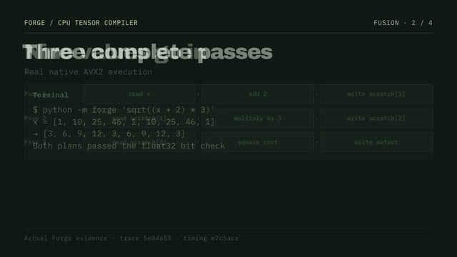
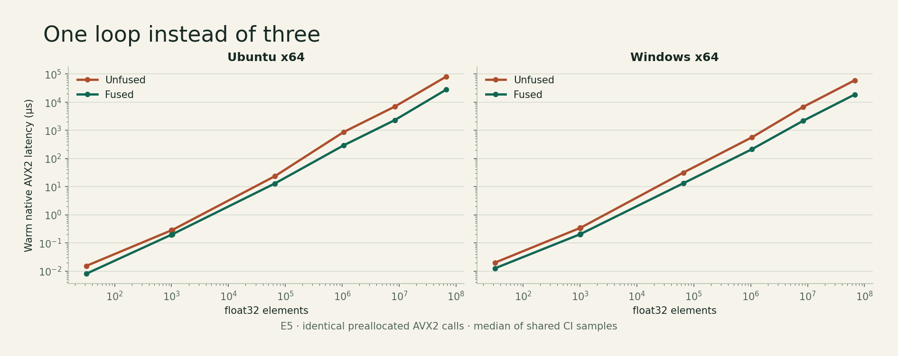

# Forge

Forge is a small CPU tensor compiler built with C++20 and LLVM ORC LLJIT. Its Python frontend compiles float32 array expressions into native code, fuses eligible pointwise operations, and supports ordered reductions and tiled matrix multiplication.

[**Open the interactive showcase**](https://iferdous.github.io/Forge/) · [Benchmark report](docs/results.md) · [Stage 1–8 audit](docs/stage-audit.md) · [MIT preview release](https://github.com/iferdous/Forge/releases/tag/v0.1.0-preview.1)

[Inspect expression → graph → loop plan → LLVM IR → AVX2 → result](https://iferdous.github.io/Forge/#inspect) · [Explore timings across 10 kernels](https://iferdous.github.io/Forge/#benchmarks) · [Reproduce the demos and charts](docs/showcase.md)

## Measured results

Forge compiles the float32 expression `sqrt((x + 2) * 3)` into **one loop with zero temporary arrays**, down from three loops and two temporaries. The resulting LLJIT object contains eight-lane AVX2 arithmetic and a scalar remainder. Fused and unfused executions preserve the same numerical result.

| Workload and warm measurement | Ubuntu x64 | Windows x64 |
| --- | ---: | ---: |
| 1,024 elements · allocating Python, NumPy → Forge | **3.21×** | **3.65×** |
| 65,536 elements · native AVX2, unfused → fused | 23.40 → 12.89 µs (**1.82×**) | 31.31 → 13.07 µs (**2.40×**) |
| 65,536 elements · native fused, scalar → AVX2 | **4.00×** | **7.95×** |
| 512 × 512 × 512 matmul · allocating NumPy advantage | **7.37×** | **5.51×** |

The chart measures a preallocated native call. The first and last table rows measure allocating Python calls. All timings come from shared CI at the preview tag and exclude compilation. Both x64 runners passed **23 test entries and 61 benchmark-case accuracy checks**. An isolated Linux run at 8,388,608 elements also measured the first-call **RSS increase falling from 64.008 MiB to 0.004 MiB** after fusion. [Full results, percentile data and scope](docs/results.md) · [Tagged CI](https://github.com/iferdous/Forge/actions/runs/45121155018) · [Native RSS capture](https://github.com/iferdous/Forge/actions/runs/45124189095)

## Try it

Once the LLVM-enabled build is on `PYTHONPATH`, run `python -m forge 'sqrt((x + 2) * 3)'` for both loop plans, the result, and the generated x86 instructions. Omit the expression for the interactive prompt. Use `--inspect ir` or `--inspect assembly` for the full output. [Build setup](docs/plan/01-toolchain-and-ci.md#reproduce-the-smoke-test) · [Playground setup](docs/plan/05-operator-fusion.md#try-an-expression)

~~~python
import forge
import numpy as np

x = np.array([1, 10, 25, 46], dtype=np.float32)
program = forge.compile("sqrt((x + 2) * 3)", inputs=("x",))
target = "avx2" if forge.has_avx2() else "scalar"
kernel = program.jit(x, target=target, cache=True)
print(kernel(x))  # [ 3.  6.  9. 12.]
~~~

## Architecture

~~~mermaid
flowchart LR
    A["Python expression"] --> B["Bounded parser"]
    B --> C["Typed tensor graph"]
    C --> D["Kernel plan and fusion"]
    D --> E["LLVM IR and vectorization"]
    E --> F["ORC LLJIT"]
    F --> G["Owned float32 result"]
~~~

Forge owns expression validation, shape inference, fusion decisions, loop scheduling, and LLVM IR lowering. LLVM supplies instruction selection, vectorization, and in-process linking. The verified AVX2 demo processes eight float32 elements per packed iteration and uses a scalar remainder. [Step through each component](https://iferdous.github.io/Forge/#inspect) · [Source map](docs/showcase.md#follow-one-expression-through-the-compiler)

## Numerical contract and platforms

- Inputs are native-endian, C-contiguous rank-one or rank-two NumPy float32 arrays. Pointwise operators accept equal shapes or a scalar operand.
- Pointwise steps round separately in float32. Sum, mean, and matmul preserve their documented accumulation order. Max propagates NaNs and has a deterministic signed-zero tie rule. [Reduction and matmul contract](docs/plan/06-reductions-and-matmul.md#expression-and-numerical-contract)
- Ubuntu and Windows x64 run the native AVX2 checks. Apple Silicon runs the scalar JIT and can emit Linux x86-64 assembly for inspection. [Release handoff and test scope](docs/plan/08-release-and-handoff.md)

## Implementation plan

| Step | Deliverable |
| --- | --- |
| [01 · Toolchain and CI](docs/plan/01-toolchain-and-ci.md) | Pin LLVM, qualify the environments, and prove the LLVM libraries link |
| [02 · Language and reference](docs/plan/02-language-and-reference.md) | Define the expression syntax, shapes, and floating-point contract |
| [03 · Scalar JIT](docs/plan/03-scalar-jit.md) | Compile and run a correct elementwise expression end to end |
| [04 · SIMD and baselines](docs/plan/04-simd-and-baselines.md) | Show packed instructions, test scalar tails, and capture initial timings |
| [05 · Operator fusion](docs/plan/05-operator-fusion.md) | Fuse a legal chain and isolate its effect with a control |
| [06 · Reductions and matmul](docs/plan/06-reductions-and-matmul.md) | Add aggregate and matrix kernels with separate accuracy checks |
| [07 · Python runtime and benchmarks](docs/plan/07-python-runtime-and-benchmarks.md) | Validate the Python API, compilation cache, and ten-kernel comparison |
| [08 · Release and handoff](docs/plan/08-release-and-handoff.md) | Publish a reproducible benchmark, a short demo, and evidence-backed résumé bullets |

The HRT engineering write-up inspired Forge's focus on measuring repeated overhead and intermediate data movement. [Research and constraints](docs/research.md) · [HRT intern projects](https://www.hudsonrivertrading.com/hrtbeat/intern-spotlight-software-engineering-summer-projects/)
