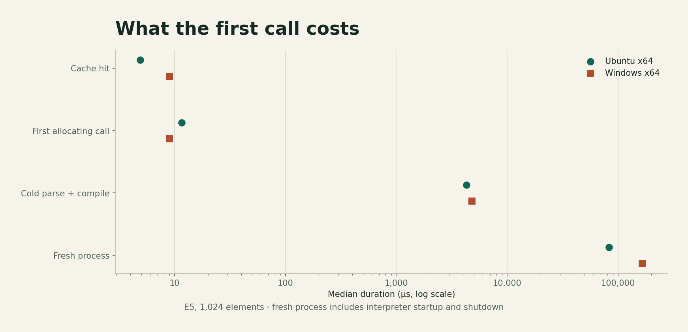

# Forge performance and numerical evidence

At 1,024 float32 elements, Forge's warm Python call ran the three-operation chain **3.21× faster on Ubuntu x64 and 3.65× faster on Windows x64** than the matching allocating NumPy expression. At 65,536 elements, disabling fusion while holding AVX2 and the native call boundary fixed made the same chain **1.82× and 2.40× slower**. The suite also measures workloads where NumPy leads. [Complete benchmark tables](../README.md#complete-benchmark-tables) · [Tagged preview evidence and raw timing samples](https://github.com/iferdous/Forge/releases/tag/v0.1.0-preview.1)

## Did Forge meet its targets?

| Original target | Verified outcome | Assessment |
| --- | --- | --- |
| 3–8× faster than NumPy on small tensor operations | The 1,024-element three-op chain reached 3.21× and 3.65× on the two x64 runners. At 32 elements a single add reached 0.86× and 0.90×. | Lower end reached for the featured chain. A general 3–8× speedup remains unsupported. |
| At least 70% less intermediate data movement from fusion | The four-op chain drops from 32 to 8 logical array bytes per element, a 75% modeled reduction. The three-op chain drops from 24 to 8, a 66.7% modeled reduction. | Met for the four-op chain in the model. Physical memory traffic has not been measured. |
| Compile in tens of milliseconds | Median cold parse and compilation for 1,024-element E5 was 4.28 ms on Ubuntu and 4.82 ms on Windows in an initialized process. | Below 10 ms for this workload and measured boundary. |
| Prove vectorization from generated machine code | Both x64 runs executed the real LLJIT code. The fused object shows packed YMM arithmetic and a packed store followed by scalar cleanup. | Verified. |
| Preserve documented float32 semantics | The two x64 runs passed all 61 benchmark-case accuracy checks and 23 CTest entries per runner. Finite pointwise outputs are checked bit-for-bit. Aggregates use ordered references and separate error bounds. | Verified for the tested fixtures. |
| Repeat results on an idle dedicated AVX2 host | The complete grid ran on two hosted CI runners using the ci-smoke profile. | Open for Stages 07 and 08. |

## Fusion and vectorization

The planner joins eligible single-use elementwise producers into the consumer's loop. Unfused code stores and rereads a float32 intermediate after each step. The fused three-op plan performs one input read and one output write per element, with stepwise rounding preserved inside the loop. The published optimized IR and LLJIT disassembly show the YMM path and scalar remainder. [Recorded compiler traces](../README.md#compiler-traces) · [Planner source](../src/kernel_plan.cpp)

| Workload and warm boundary | Ubuntu x64 | Windows x64 |
| --- | ---: | ---: |
| E5 at 1,024 · Allocating Python, NumPy → Forge | 1.722 → 0.536 µs (3.21×) | 3.864 → 1.059 µs (3.65×) |
| E5 at 65,536 · Allocating Python, NumPy → Forge | 27.62 → 13.14 µs (2.10×) | 47.52 → 14.69 µs (3.24×) |
| E5 at 65,536 · Native AVX2, unfused → fused | 23.40 → 12.89 µs (1.82×) | 31.31 → 13.07 µs (2.40×) |
| E5 at 65,536 · Native fused, scalar → AVX2 | 51.60 → 12.89 µs (4.00×) | 103.94 → 13.07 µs (7.95×) |
| E6 at 65,536 · Native AVX2, unfused → fused | 24.22 → 5.63 µs (4.31×) | 37.07 → 6.27 µs (5.92×) |
| E5 at 67,108,864 · Native AVX2, unfused → fused | 80.19 → 27.70 ms (2.89×) | 59.14 → 18.48 ms (3.20×) |

The streaming case starts with 512 MiB of input plus output before intermediates and exceeds both runners' reported last-level cache. The distinct Python and native ratios answer different questions and cannot be multiplied together. [Full Ubuntu grid and p95s](../showcase/data/linux-x64.csv) · [Full Windows grid and p95s](../showcase/data/windows-x64.csv)

## Crossover and NumPy wins

Both runners favored NumPy for the 1,048,576-element ordered sum. Ubuntu measured 552.12 µs for Forge versus 178.24 µs for NumPy. Windows measured 1,002.60 µs versus 356.78 µs. Forge preserves left-to-right accumulation, which constrains reassociation and vectorization. NumPy has its own accumulation strategy. [Reduction contract and accuracy checks](plan/06-reductions-and-matmul.md)

The largest allocating gains in the grid came from the 32-element mean, **9.55× on Ubuntu and 8.88× on Windows**. The largest losses on each host came from max. Ubuntu measured 165.48 µs for Forge versus 3.80 µs for NumPy at 65,536 elements (**43.52× in NumPy’s favor**). Windows measured 1,012.95 µs versus 65.68 µs at 1,048,576 elements (**15.42× in NumPy’s favor**). Forge lowers max to an ordered loop using LLVM’s NaN-propagating maximum operation. The kernel measurements show where the gap occurs. They leave the exact microarchitectural causes unmeasured. [Reduction lowering](../src/llvm_lowering.cpp) · [Ubuntu and Windows measurements](../README.md#complete-benchmark-tables)

For the 512 × 512 × 512 matrix product, allocating calls took 10.60 ms for Forge and 1.44 ms for NumPy on Ubuntu, and 17.84 ms and 3.24 ms on Windows. Forge vectorizes independent columns inside a tiled loop. NumPy delegates the multiplication to a tuned one-thread OpenBLAS runtime. [Benchmark cases and comparison rules](plan/07-python-runtime-and-benchmarks.md#timing-and-evidence-protocol)

## First use and compiled handles

| E5 at 1,024 elements | Ubuntu x64 | Windows x64 |
| --- | ---: | ---: |
| Cold parse and compile in initialized process | 4.28 ms | 4.82 ms |
| First allocating call | 11.56 µs | 8.95 µs |
| Cache hit on parsed graph, including new handle | 4.91 µs | 9.00 µs |
| Fresh process including interpreter launch and shutdown | 82.80 ms | 165.80 ms |
| Approximate calls to amortize compilation against allocating NumPy | 3,615 | 1,723 |

The amortization estimate divides the median compile cost plus the first-call premium by the positive median warm saving. The README shows actual cache counters for an empty cache, first compile, repeated shape, and different shape. The 16-entry cache keys on structure, shapes and target settings, and each handle owns its scratch space. [Runtime design](plan/07-python-runtime-and-benchmarks.md#python-api)

## Intermediate workspace and resident memory

For 8,388,608 elements each float32 intermediate occupies 32 MiB. The unfused kernel reserved two such arrays, **64 MiB of workspace**. Fusion reserved **zero**. The process experiment measured the RSS delta after compilation and after the first execution, with caller buffers touched in advance. In three fresh Linux processes per arm, median RSS rose **64.008 MiB unfused** and **0.004 MiB fused**. Small residual RSS changes include process-level page state. The logical byte counts are a buffer-access model. RSS measures resident pages. Both can be reproduced without performance counters. [Raw per-process samples](../showcase/data/captures.json) · [Capture instrument](../showcase/capture.py)

## Reproduce and verify

The preview timing data comes from commit e7c5ace9e168bfc2986a0e8592033812cc26773b on Ubuntu x64 (Intel Xeon 6975P-C) and Windows x64 (AMD EPYC 7763). Both used one OpenBLAS thread. There are ten kernels, 61 workload-and-shape rows per runner, 198 native timing configurations and 244 Python warm configurations per runner, and 20 samples per configuration. In total the two hosts contribute 7,920 native warm samples and 9,760 Python warm samples. P95 summarizes iteration batches in native and batch means in Python. The complete files include distributions, compiler and dependency metadata, and known environment limits. [Tagged CI](https://github.com/iferdous/Forge/actions/runs/45121155018) · [Raw bundle with SHA-256 manifest](https://github.com/iferdous/Forge/releases/tag/v0.1.0-preview.1)

The separate Linux x64 trace capture is from 5e04a5368fc56af452addb45f0e0cf030df5376e. It exercised seven recorded cases, including multiple tail lengths, a shared producer, ordered sum and an odd-tile matrix multiply. The README includes recorded compiler stages. The local CLI evaluates new expressions. [Trace CI](https://github.com/iferdous/Forge/actions/runs/45124189095) · [Showcase reproduction](showcase.md) · [Full stage audit](stage-audit.md)
