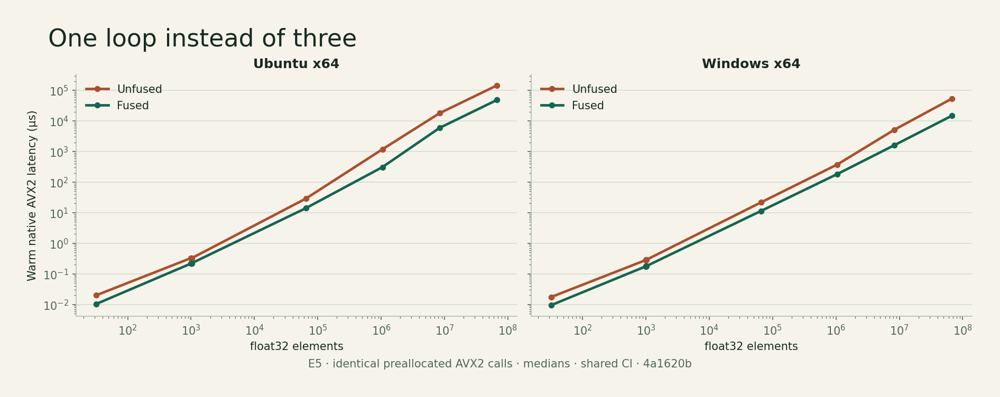
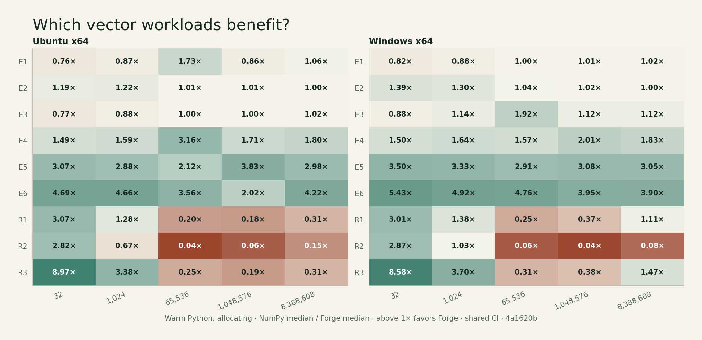
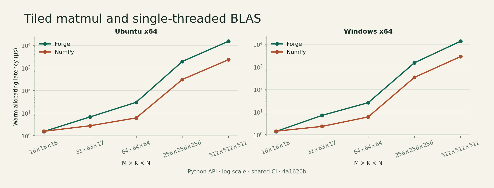
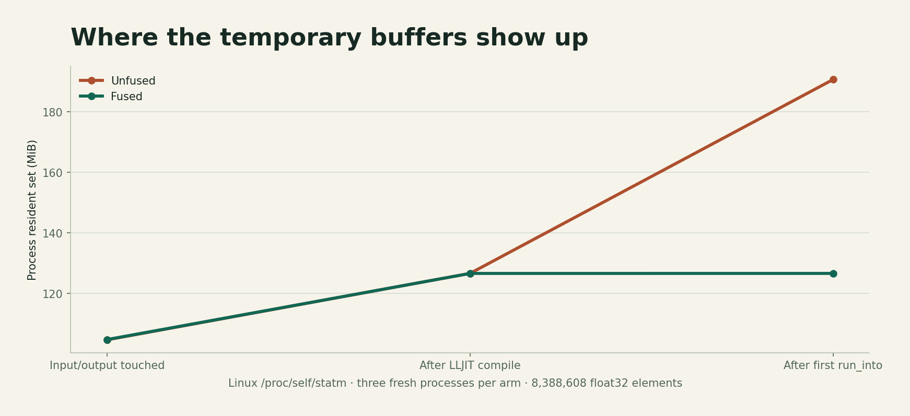

# Forge performance and numerical evidence

The current timing snapshot comes from source commit 4a1620b. The 1,024-element three-op chain reached 2.88× on Ubuntu x64 and 3.33× on Windows x64 against the same allocating NumPy expression. At 65,536 elements, fusion achieved 2.06× and 1.91× over unfused Forge in matched preallocated AVX2 calls. [Shared CI benchmark and sanitizer run](https://github.com/iferdous/Forge/actions/runs/45268500878) · [Full benchmark tables](../README.md#complete-benchmark-tables)

## Did Forge meet its targets?

| Original target | Verified outcome | Assessment |
| --- | --- | --- |
| 3–8× faster than NumPy on small tensor operations | The 1,024-element three-op chain reached 2.88× and 3.33× on the two x64 runners. At 32 elements a single add reached 0.76× and 0.82×. | This workload reached the target range on one runner. The speedup is workload-specific. |
| At least 70% less intermediate data movement from fusion | The four-op chain drops from 32 to 8 logical array bytes per element, a 75% modeled reduction. The three-op chain drops from 24 to 8, a 66.7% modeled reduction. | Met for the four-op chain in the logical traffic model. Physical memory traffic has not been measured. |
| Compile in tens of milliseconds | Median cold parse and compilation for 1,024-element E5 was 5.77 ms on Ubuntu and 3.82 ms on Windows in an initialized process. | Measured for this workload and call boundary. |
| Prove vectorization from generated machine code | Both x64 runs executed the real LLJIT code. The fused object shows packed YMM arithmetic and a packed store followed by scalar cleanup. | Verified. |
| Preserve documented float32 semantics | The two x64 runs passed all 61 benchmark-case accuracy checks and 23 CTest entries per runner. Finite pointwise outputs are checked bit-for-bit. Aggregates use ordered references and separate error bounds. | Verified for the tested fixtures. |
| Repeat results on an idle dedicated AVX2 host | The complete grid ran on two hosted CI runners using the ci-smoke profile. | Open for Stages 07 and 08. |

## Fusion and vectorization

The planner joins eligible single-use elementwise producers into the consumer's loop. Unfused code stores and rereads a float32 intermediate after each step. The fused three-op plan performs one input read and one output write per element, with stepwise rounding preserved inside the loop. The published optimized IR and LLJIT disassembly show the YMM path and scalar remainder. [Recorded compiler traces](../README.md#compiler-traces) · [Planner source](../src/kernel_plan.cpp)

| Workload and warm boundary | Ubuntu x64 | Windows x64 |
| --- | --- | --- |
| E5 at 1,024 · Allocating Python, NumPy → Forge | 2.853 → 0.990 µs (2.88×) | 2.876 → 0.863 µs (3.33×) |
| E5 at 65,536 · Allocating Python, NumPy → Forge | 32.17 → 15.17 µs (2.12×) | 36.44 → 12.52 µs (2.91×) |
| E5 at 65,536 · Native AVX2, unfused → fused | 29.28 → 14.25 µs (2.06×) | 21.74 → 11.39 µs (1.91×) |
| E5 at 65,536 · Native fused, scalar → AVX2 | 57.27 → 14.25 µs (4.02×) | 90.71 → 11.39 µs (7.96×) |
| E6 at 65,536 · Native AVX2, unfused → fused | 38.98 → 6.85 µs (5.69×) | 21.57 → 4.64 µs (4.65×) |
| E5 at 67,108,864 · Native AVX2, unfused → fused | 145.67 → 48.62 ms (3.00×) | 53.39 → 14.78 ms (3.61×) |

The streaming case starts with 512 MiB of input plus output before intermediates and exceeds both runners' reported last-level cache. The distinct Python and native ratios answer different questions and cannot be multiplied together. [Full Ubuntu grid and p95s](../showcase/data/linux-x64.csv) · [Full Windows grid and p95s](../showcase/data/windows-x64.csv)

## Crossover and NumPy wins

The ordered 1,048,576-element sum shows the cost of preserving left-to-right float32 accumulation. Ubuntu x64 measured 1,215.80 µs for Forge and 221.00 µs for NumPy. Windows x64 measured 863.48 µs for Forge and 322.25 µs for NumPy. [Reduction contract and accuracy checks](plan/06-reductions-and-matmul.md)

Max is another measured loss. At 65,536 elements, Ubuntu x64 measured 164.29 µs for Forge and 6.28 µs for NumPy (26.18× in NumPy’s favor). At 1,048,576 elements, Windows x64 measured 1,158.50 µs for Forge and 46.99 µs for NumPy (24.65× in NumPy’s favor). Forge lowers max to an ordered loop using LLVM’s NaN-propagating maximum operation. The exact cause of the measured gap needs a separate investigation. [Reduction lowering](../src/llvm_lowering.cpp)

For the 512 × 512 × 512 matrix product, Ubuntu x64 measured 15.20 ms for Forge and 2.32 ms for NumPy. Windows x64 measured 13.56 ms for Forge and 2.83 ms for NumPy. Forge vectorizes independent columns inside a tiled loop. NumPy delegates the multiplication to a tuned one-thread OpenBLAS runtime. [Benchmark protocol](plan/07-python-runtime-and-benchmarks.md#timing-and-evidence-protocol)

## First use and compiled handles

| First-use timing for the 1,024-element chain | Ubuntu x64 | Windows x64 |
| --- | --- | --- |
| Cold parse and compile in an initialized process | 5.77 ms | 3.82 ms |
| First allocating call | 18.56 µs | 7.65 µs |
| Cache hit on the parsed graph, including the new handle | 8.18 µs | 6.70 µs |
| Fresh process, including interpreter launch and exit | 111.93 ms | 126.98 ms |
| Estimated warm calls to earn back compilation against NumPy | 3,106 | 1,901 |

The amortization estimate divides the median compile cost plus the first-call premium by the positive median warm saving. The README shows actual cache counters for an empty cache, first compile, repeated shape, and different shape. The 16-entry cache keys on structure, shapes and target settings, and each handle owns its scratch space. [Runtime design](plan/07-python-runtime-and-benchmarks.md#python-api)

## Intermediate workspace and resident memory

For 8,388,608 elements each float32 intermediate occupies 32 MiB. The unfused kernel reserved two such arrays, **64 MiB of workspace**. Fusion reserved **zero**. The process experiment measured the RSS delta after compilation and after the first execution, with caller buffers touched in advance. In three fresh Linux processes per arm, median RSS rose **64.008 MiB unfused** and **0.004 MiB fused**. Small residual RSS changes include process-level page state. The logical byte counts are a buffer-access model. RSS measures resident pages. Both can be reproduced without performance counters. [Raw per-process samples](../showcase/data/captures.json) · [Capture instrument](../showcase/capture.py)

## Reproduce and verify

The published timing tables and performance charts come from source commit 4a1620bbe9f8af6fb3a208b0c91fa224c77d83c7 on Ubuntu x64 (Intel(R) Xeon(R) Platinum 8370C CPU @ 2.80GHz) and Windows x64 (AMD EPYC 9V74 80-Core Processor). Both used one OpenBLAS thread. There are ten kernels, 61 workload-and-shape rows per runner, 198 native timing configurations and 244 Python warm configurations per runner, and 20 samples per configuration. P95 summarizes iteration batches in native and batch means in Python. [Shared CI benchmark and sanitizer run](https://github.com/iferdous/Forge/actions/runs/45268500878) · [Archived raw samples and SHA-256 manifest](../showcase/data/benchmark-evidence.zip)

The three published films use the original preview timing snapshot from e7c5ace and the separate native trace capture. [Preview evidence](https://github.com/iferdous/Forge/releases/tag/v0.1.0-preview.1)

The separate Linux x64 trace capture is from 5e04a5368fc56af452addb45f0e0cf030df5376e. It exercised seven recorded cases, including multiple tail lengths, a shared producer, ordered sum and an odd-tile matrix multiply. The README includes recorded compiler stages. The local CLI evaluates new expressions. [Trace CI](https://github.com/iferdous/Forge/actions/runs/45124189095) · [Showcase reproduction](showcase.md) · [Full stage audit](stage-audit.md)
